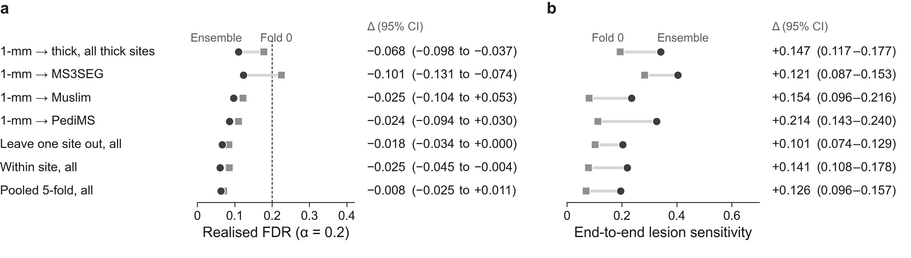

# Abstract

**Background.** Conformal selection can wrap any lesion segmenter with a distribution-free
"precision dial": among the candidate lesions of a scan, report only those whose conformal
p-values pass Benjamini–Hochberg, so that the expected share of false lesions per scan (the
lesion-wise false-discovery rate, FDR) is at most α. The promise rests on exchangeability between
the calibration data and the scan at hand. Routine multiple sclerosis (MS) imaging breaks that
assumption: sites differ, much FLAIR is still acquired as 2D slices of 4–8 mm, and public cohorts
often sit inside the segmenter's training data.

**Purpose.** To measure where lesion-wise conformal false-discovery control holds and where it
fails for a state-of-the-art MS segmenter, when calibration and use differ in site and acquisition,
and on healthy brains.

**Methods.** We used five public patient cohorts (304 scans, 245 patients) and 100 healthy
controls, segmented with the five folds of FLAMeS, after excluding every scan in FLAMeS's training
data. Two cohorts are delivered on a 1-mm grid; three are native 2D acquisitions with 3.9–8.3 mm
slice spacing. We resampled and split by patient. The analysis followed a protocol with fixed
decision rules, committed to the project's git repository 38 minutes before the first results, by
AI-agent sessions; it was not publicly time-stamped before the results. We compared conformal
Benjamini–Hochberg (P1; per-scan FDR ≤ α) with a scan-level exceedance threshold (P2, "CALM-FDX";
P(FDP > γ) ≤ δ = 0.1), an application of conformal risk control and Learn-then-Test, and with
pre-registered and post-hoc baselines.

**Results.** The pre-registered verdicts for transport from 1-mm-grid to thick-slice cohorts were
*inconclusive* for P1 and *refuted* for P2. No P1 comparison showed a violation, but at α = 0.1 the
data do not exclude a realised FDR of 1.4α (MS3SEG) and 1.8α (Muslim). Per-scan behaviour is a
property of the estimand, not of P2 alone: under P1 at α = 0.1, 34 % of MS3SEG scans had a
false-discovery proportion above 0.1, and the Muslim scans with any reported lesion had a mean
proportion of 0.188. Calibration from the 1-mm-grid cohorts did not transfer: on thick slices the
realised FDR at α = 0.1 was 2.6 (95 % CI 1.3–7.1) and 3.2 (1.2–25.6) times its within-cohort value.
P2 let 21 % [13, 30] and 29 % [17, 44] of thick-slice scans exceed γ = 0.1, against 10 %; it needs
at least 9 calibration patients by construction, and with 10 local patients it was valid on average
but found 4.0 % and 0.7 % of lesions. Averaging the five folds doubled sensitivity at α = 0.2
(0.102 → 0.203) but raised the realised FDR on one cohort (0.051 → 0.122 at α = 0.1). On healthy
brains, 1-mm-calibrated P1 reported a lesion in 14/100 (α = 0.1) and 24/100 (α = 0.2) controls,
both undecided; without selection the segmentation marked a lesion in 85/100 and met a brain
dissemination-in-space rule in 19/100.

**Conclusions.** Thin-slice calibration of lesion-wise conformal guarantees does not carry over to
thick-slice MS FLAIR. Calibrate with the deployed segmenter on the target cohort and acquisition,
expect little power, and do not extend patient calibrations to healthy or screening populations.
Cohort and acquisition were confounded throughout. A default-off software card derived from this
work shows no false-lesion rate; this is translation, not clinical validation.

**Keywords:** conformal selection; false discovery rate; false-discovery exceedance; Learn-then-Test;
multiple sclerosis; lesion segmentation; distribution shift; slice spacing; protocol-first analysis;
training-set contamination.

---

# 1 Introduction

Automated segmentation of MS white-matter lesions on FLAIR has reached voxel Dice of about 0.7 on
external data with nnU-Net-class models [@isensee2021nnunet; @dereskewicz2025flames;
@wiltgen2024lstai]. A reader of a single scan, however, needs a different number: how many of the
lesions the software marks are false. Diagnostic rules make each lesion count. The McDonald
criteria require lesions in several characteristic regions to establish dissemination in space
[@thompson2018diagnosis; @montalban2025diagnosis], and a few false periventricular or juxtacortical
marks can turn a negative scan positive.

Conformal inference offers a principled answer. Conformal p-values computed against a calibration
set of known false candidates are valid and positively dependent [@bates2023testing].
Benjamini–Hochberg (BH) selection on them bounds the false-discovery rate of the reported set
[@benjamini1995controlling; @jin2023selection]. The resulting "precision dial" needs no model
assumptions; its one proviso is exchangeability between the calibration candidates and the false
candidates of the new scan. Risk-control and Learn-then-Test (LTT) frameworks give analogous
guarantees with the scan as the exchangeable unit
[@angelopoulos2024crc; @angelopoulos2025ltt; @bates2021rcps].

MS imaging stresses this proviso in four ways. First, scanners and protocols differ between sites.
Second, 2D FLAIR with 4–8 mm slices is still common in routine care, although consensus guidelines
recommend 3D FLAIR [@wattjes2021magnims]; thick slices change both lesion appearance and the
segmenter's errors. Third, false candidates within one scan share that scan's quality and anatomy,
so they are not exchangeable as single units. Fourth, the public MS cohorts used for evaluation are
often part of the segmenter's training data, which turns an external test into an in-distribution
one [@kapoor2023leakage; @varoquaux2022machine].

This paper does not propose a new conformal method. It is a protocol-first, reproducible audit of
lesion-wise conformal false-discovery control on real MS data, with a forensic check of which scans
the segmenter trained on, the patient as the unit of splitting and resampling, held-out sites,
intervals that remain valid with few patients, healthy controls and plainly reported negative
results. Our earlier internal drafts made claims that this audit retracts (Appendix B).

**Contributions.**

1. A five-cohort evaluation, under a protocol with fixed decision rules, of lesion-wise conformal
   FDR (P1) and per-scan false-discovery exceedance (FDX, P2) control when calibration and use differ
   in cohort and acquisition, with every scan of the segmenter's training data excluded (§6.2–6.3).
2. Evidence that the per-scan behaviour of P1 is as poor as that of P2 on thick slices: the
   contrast is between estimands (an expectation and a tail probability), and the expectation is
   kept low partly by scans on which nothing is reported (§6.2).
3. A comparison with pre-registered (conformal risk control, LTT, precision-matched) and post-hoc
   scan-aware baselines, including at matched power (§6.4).
4. A cohort-and-acquisition table of validity, power and lesion-size-resolved detection (§6.6),
   stated as a contrast between cohorts, not as a controlled thickness effect.
5. Evidence that fold ensembling doubles power at the guarantee without fixing validity, and why
   (§6.7).
6. A recalibration-size analysis, and a healthy-control analysis that replaces an unfounded earlier
   claim about dissemination in space on healthy brains (§6.8–6.9).

# 2 Related work

**Conformal selection and FDR.** Conformal p-values against a shared calibration set satisfy PRDS,
so BH on them controls the FDR at α·E[m0/m] ≤ α, where m0/m is the share of nulls among the tested
units [@bates2023testing]. @jin2023selection cast prediction-based selection in this framework, and
@marandon2024adaptive extended it to adaptive scores. Under covariate shift, weighted conformal
p-values restore validity when the likelihood ratio is known or can be estimated
[@tibshirani2019conformal; @jin2026weighted]. More general deviations from exchangeability cost a
quantifiable coverage gap [@barber2023beyond]. Mondrian (group-conditional) calibration calibrates
within strata such as sites or acquisition types [@vovk2005algorithmic].

**Grouped data and scan-level risk control.** When observations are clustered, exchangeability
holds at the cluster level at best. @dunn2023distribution calibrate by subsampling one observation
per group. @lee2025selection construct hierarchical and subsampling conformal e-values with e-BH
[@wang2022false]; their guarantee assumes group sizes independent of the observations. Conformal
risk control [@angelopoulos2024crc] and LTT [@angelopoulos2025ltt] control the expectation, or a
high-probability bound, of any bounded loss over exchangeable units; with the scan as unit and the
per-scan false-discovery proportion (FDP), or the indicator {FDP > γ}, as loss, they control
scan-level FDR or FDX for a global threshold. Non-exchangeable risk control trades the guarantee for
weights over the calibration data [@farinhas2024nonexchangeable].

**Simultaneous and exceedance bounds.** FDX control dates back to @genovese2006exceedance.
Reference-family bounds [@blanchard2020posthoc], the exact joint law of conformal p-values
[@gazin2024transductive] and everywhere-valid FDP bounds for conformal selection
[@song2026everywhere] give post hoc or simultaneous control. All of them assume exchangeability of
the individual candidates.

**Conformal methods in medical image segmentation.** Recent work controls voxel-level miss rates
for 3D lesions [@tan2025conformal], image-level false-positive proportions in segmentation masks
[@mossina2025controlling] and per-scan nodule miss rates by risk control [@hulsman2025conformal].
@lambert2024robust estimate volumes under covariate shift. @adhikary2026bound report that per-organ
recall risk control in CT fails to transfer under clinical domain shift. In MS, conformal prediction
has been applied to disease course from registry data [@sreenivasan2025conformal]; MS lesion
uncertainty has otherwise been evaluated without distribution-free guarantees
[@molchanova2025structural; @malinin2022shifts].

**Position of this work.** We found no study of lesion-wise conformal FDR or FDX control for MS
segmentation that tests transport across cohorts and acquisitions while controlling for the
segmenter's training-set overlap. We make no stronger novelty claim. The methods are standard; the
per-scan procedure is an application of risk control and LTT (§3.2). The literature search must be
refreshed before submission (Appendix D).

# 3 Problem setting and procedures

## 3.1 Candidates, lesion-wise error and what the guarantees assume

For a scan, the segmenter outputs a voxelwise lesion probability map. A *candidate* is an
18-connected component of {p ≥ 0.5} whose physical volume is at least 3 mm³, computed with the
scan's own voxel volume. Its *score* s is the mean probability over the component; higher scores are
more lesion-like. *Expert lesions* are 18-connected components of the expert mask of at least
3 mm³ ("detectable"). *Clinical* lesions are those of at least 14.14 mm³ (a sphere of 3 mm
diameter). Candidates are matched one-to-one to expert lesions by maximum-IoU Hungarian assignment
[@kuhn1955hungarian]. The pre-registered primary matching is lenient (IoU > 0); a strict variant
(IoU ≥ 0.10) is a sensitivity analysis. A candidate is *true* if it is matched; unmatched fragments
are *false*.

A selection rule reports a subset R of a scan's candidates, with false-discovery proportion
FDP = |R ∩ F| / max(|R|, 1), where F is the set of false candidates. We report:

- the **realised FDR**: the mean per-scan FDP over test scans, counting a scan with no selection as
  FDP = 0 (the pre-registered estimand);
- the **FDR among selecting scans**: the mean FDP over the scans on which anything was reported —
  what a reader who sees a non-empty list experiences — with the share of scans selecting;
- the **realised FDX**: the share of test scans with FDP > γ, reported for P1 as well as for P2;
- the **end-to-end sensitivity**: selected-and-matched expert lesions divided by all detectable
  expert lesions.

On a lesion-free scan, FDP is the indicator of at least one reported lesion, so each promise becomes
a bound on the healthy false-alarm rate.

**What the guarantees assume, and why none of them strictly holds here.** Three features of the data
violate the assumptions behind every procedure in §3.2, even within a site.

- *Labels depend on the matching.* "False" is defined by one-to-one matching inside each scan, so the
  null set mixes genuine false positives with surplus fragments of true lesions and — under MS3SEG's
  protocol — periventricular hyperintensities that its raters excluded from the lesion class. The
  null is not a draw from a fixed law.
- *Candidates are clustered within scans, and scans within patients* (MSLesSeg contributes up to four
  timepoints per patient to the calibration pool). The intraclass correlation of false-candidate
  scores is modest (0.10 on MSLesSeg, below 0.03 elsewhere), but with about 11 false candidates per
  scan the design effect is not negligible; BH's validity depends on the joint law of a test scan's
  null p-values given the scan.
- *Test sets contain repeated scans* of the same patients (MSLesSeg, PediMS), whereas the scan-level
  procedures calibrate on first timepoints only.

We therefore treat P1 and the other procedures as calibrated procedures whose guarantees assume
conditions that the data do not meet, and we measure how far the realised error departs from the
nominal level. A small simulation (§6.2, Appendix Table A7) separates the effect of within-scan
clustering from that of a shift in the false-candidate scores.

## 3.2 Procedures

**P1 — conformal BH (primary FDR procedure).** The null set N contains the scores of all false
candidates of all scans of the calibration patients, with size n. For a test candidate with score s,
p = (1 + #{u ∈ N : u ≥ s}) / (n + 1). BH at level α is applied within each test scan. If the test
scan's false-candidate scores were exchangeable with N, these p-values would be valid and PRDS, and
the per-scan FDR would be bounded by α·E[m0/m] ≤ α [@bates2023testing; @jin2023selection], where m0/m
is the scan's share of false candidates (0 for a scan without candidates). This is a bound: equality
is not guaranteed for discrete, positively dependent conformal p-values.

**P2 — CALM-FDX, single-threshold form (primary FDX procedure).** For each calibration patient
(first timepoint only) and each threshold λ on the grid {0, 0.001, …, 1, ∞}, FDP_i(λ) is the FDP of
{s ≥ λ}. The scan's *safe threshold* t_i is the smallest grid value λ such that FDP_i(λ′) ≤ γ for
every grid λ′ ≥ λ. With K calibration patients, λ̂ is the ⌈(K + 1)(1 − δ)⌉-th smallest t_i; if that
index exceeds K, λ̂ = ∞ and the procedure abstains. With δ = 0.1 it therefore cannot select with fewer
than 9 calibration patients. Because FDP_test(λ̂) > γ implies t_test > λ̂, and t_test is exchangeable
with t_1, …, t_K when patients are exchangeable, P(FDP_test > γ) ≤ δ. This is the split-conformal
quantile argument [@vovk2005algorithmic]; equivalently, conformal risk control with the binary loss
1{t_i > λ} [@angelopoulos2024crc], whose high-probability (PAC) analogue is LTT
[@angelopoulos2025ltt]. We keep the name CALM-FDX for continuity with our earlier drafts, but
**it is an application of these frameworks, not new theory**. The guarantee is marginal over the
calibration draw; with K = 10 a sizeable share of individual calibrations fails
[@vovk2013conditional]. The earlier two-layer variant with per-scan region certificates was not
re-run (§9).

**Baselines (pre-registered).** *B1, precision-matched threshold*: the lowest threshold whose
pooled calibration micro-FDR is at most α; no guarantee. *B2, conformal risk control*: a global
threshold with the monotonised per-scan FDP as loss, which gives E[FDP_test] ≤ α under scan
exchangeability [@angelopoulos2024crc]. *B3, LTT*: Hoeffding–Bentkus p-values with fixed-sequence
testing over thresholds and per-scan FDP as loss; with probability at least 0.9 over the
calibration draw, E[FDP_test] ≤ α [@angelopoulos2025ltt]. B2 and B3 use one scan per calibration
patient.

**Baselines added post hoc (§5.5).** *SUB*: one false candidate drawn at random from the **first
scan** of each calibration patient, conformal p-values against this subsampled null and BH within
the test scan [@dunn2023distribution]. Each p-value is marginally valid under patient
exchangeability, but BH's PRDS argument is not re-established, so its FDR control is empirical. It
is randomised; a deployment uses one draw. *LR-hier*: hierarchical conformal e-values with weights
1/N_k and e-BH over the whole batch of test scans of the held-out site [@lee2025selection;
@wang2022false]. Its guarantee is a batch FDR and assumes group sizes independent of the
observations, which is doubtful here because candidate counts track lesion load.

**Table 3. The procedures and what each one guarantees, if its assumptions hold.**

| procedure | exchangeable unit assumed | error controlled | type of guarantee | randomised | status |
|---|---|---|---|---|---|
| P1 conformal BH | false candidates (pooled) | per-scan FDR ≤ α | marginal (over calibration and test) | no | pre-registered, primary |
| P2 CALM-FDX threshold | patients (first scans) | P(FDP_scan > γ) ≤ δ | marginal | no | pre-registered, primary |
| B1 precision-matched | — | none | — | no | pre-registered baseline |
| B2 conformal risk control | patients (first scans) | per-scan FDR ≤ α | marginal | no | pre-registered baseline |
| B3 Learn-then-Test | patients (first scans) | per-scan FDR ≤ α | PAC, δ = 0.1 | no | pre-registered baseline |
| SUB one candidate per patient + BH | patients (first scans) | none proven (each p-value valid) | — | yes | post hoc baseline |
| LR-hier hierarchical e-values + e-BH | patients, sizes independent of data | batch FDR ≤ α | marginal | no | post hoc baseline |

# 4 Data

## 4.1 Cohorts

Table 1 lists the cohorts: MSLesSeg [@guarnera2025mslesseg; @mslesseg2025data], the Ljubljana 3D MR
MS dataset [@lesjak2018novel], MS3SEG [@bawil2026ms3seg; @ms3seg2026data], the cohort of
@muslim2022brain [@muslim2022data] and PediMS [@popa2025pedims; @pedims2025data]. The healthy
controls are the 100 controls of SibBMS [@tuchinov2025sibbms].

Two acquisition facts matter for everything that follows.

- **The "1-mm" cohorts are 1-mm grids, not 1-mm acquisitions.** MSLesSeg's release includes an
  acquisition table that lists native FLAIR slice thicknesses of 2–5 mm: 43 scans at 2–2.3 mm, 52 at
  3 mm, 15 at 4–5 mm and 5 unknown. The images are registered and resampled to MNI 1 mm. Only the
  Ljubljana scans are natively thin (3D, 0.8 mm). Throughout, "1-mm sites" means cohorts *delivered*
  on a 1-mm grid.
- **The thick-slice cohorts are native 2D acquisitions, and what varies is slice spacing.** MS3SEG
  slices are 4.7–6.9 mm thick with a 0.7–2.1 mm gap (spacing 6.0–8.1 mm). Muslim slices are 3–6 mm
  thick with a spacing of 4.86–8.3 mm. PediMS has a spacing of 3.9 mm; its dataset description gives
  a 3 mm slice thickness. All were analysed on their native grids. We use "slice spacing" for this
  axis.

The Muslim dataset has 60 patients from about 20 centres (most patients came from Baghdad). We used
the 51 axial FLAIR scans; 6 coronal and 3 sagittal scans were not used. Its in-plane pixel size is
not published. We estimated it per scan (0.41–0.97 mm) from the head's breadth and length scaled to
adult reference sizes; the same recipe has a coefficient of variation of about 4.6 % on 15 MS3SEG
adults of known pixel size, hence an expected error of about ±5 % per axis (±10 % in volume).

We skull-stripped MS3SEG and Muslim with HD-BET 2.0.1 [@isensee2019hdbet]. PediMS is distributed
both raw (defaced) and skull-stripped; we used the stripped images. MSLesSeg and Ljubljana are used as
distributed (MNI 1 mm).

The expert masks follow different protocols. MS3SEG's MS-lesion class excludes periventricular
hyperintensities that its raters judged non-MS, so FLAMeS marks there count as false. Muslim masks
come from a sequential correction chain. PediMS has one rater validated by two specialists and
includes one patient with Baló's concentric sclerosis.

**Table 1. Cohorts (5-fold ensemble arm; candidates and labels as in §3.1).**

<!-- BEGIN TABLE t1 -->
| cohort | origin, scanner | scans / patients | native FLAIR geometry | grid analysed | detectable expert lesions | candidates (false) | candidate AUROC, 5-fold mean [95 % CI] | AUROC, single folds on their own candidates (range) |
|---|---|---|---|---|---:|---|---|---|
| MSLesSeg | Italy (Catania); 8 scanner models, 1.5/3 T | 115 / 75 | 2D/3D; slice thickness 2–5 mm (43 at 2–2.3, 52 at 3, 15 at 4–5, 5 unknown) | MNI 1 mm (delivered resampled) | 3344 | 3788 (1257) | 0.818 [0.798, 0.837] | 0.735–0.758 |
| Ljubljana-10 | Slovenia (Ljubljana); Siemens 3 T | 10 / 10 | 3D; 0.47 × 0.47 × 0.8 mm | MNI 1 mm (delivered) | 667 | 517 (82) | 0.802 [0.729, 0.883] | 0.673–0.701 |
| MS3SEG | Iran; one Toshiba 1.5 T scanner | 100 / 100 | 2D; thickness 4.7–6.9 mm + gap 0.7–2.1 mm (spacing 6.0–8.1, median 7.2) | native | 3354 | 3402 (1162) | 0.801 [0.786, 0.816] | 0.699–0.720 |
| Muslim | Iraq, ~20 centres (most patients from Baghdad); 1.5 T | 51 / 51 | 2D; thickness 3–6 mm, spacing 4.86–8.3 mm (median 6.0); in-plane pixel size estimated | native | 1819 | 1540 (568) | 0.784 [0.741, 0.822] | 0.731–0.746 |
| PediMS | one centre; Siemens Skyra 3 T; 9 children | 28 / 9 | 2D; spacing 3.9 mm (0.75 × 0.75 mm in-plane) | native | 1104 | 1110 (321) | 0.801 [0.774, 0.864] | 0.683–0.715 |
| SibBMS healthy controls | Siberia (Russia), one site | 100 / 100 | not verified; images registered to an MNI-type 1-mm template | template 1 mm | 0 | 263 (263); fold 0: 306 | — | — |
<!-- END TABLE t1 -->

## 4.2 Training-set overlap (contamination)

FLAMeS was trained on 668 FLAIR scans of people with MS [@dereskewicz2025flames]. Its article
describes eight datasets (three public, five private) from seven sites; listing the four MSSEG-2016
centres separately gives the 11 sources of its Table 1. The article is internally inconsistent on the
number of people (575 vs 408). The public data in training are 20 ISBI-2015 scans
[@carass2017longitudinal], 20 Ljubljana scans (listed as PubMRI) [@lesjak2018novel] and 53
MSSEG-2016 cases from centres 01, 03, 07 and 08, which include cases of both the challenge's
training and test sets [@commowick2018objective]. A segmenter evaluated on its own training scans is
not being tested externally [@kapoor2023leakage]. We handled overlap as follows (Table 2).

- **ISBI-2015** is not used anywhere in this paper. An analysis in our earlier draft that used it is
  withdrawn.
- **Ljubljana.** The released weights contain nnU-Net's dataset fingerprint (per-case spacing and
  brain bounding box of all 668 training cases). Twenty consecutive entries match Ljubljana patients
  01–15 and 21–25 exactly, with zero voxels of disagreement on all three axes. The training logs show
  that each fold trains on four fifths of the cases. These 20 scans are excluded from every analysis,
  including calibration. The remaining 10 patients (16–20, 26–30; "Ljubljana-10") were never trained
  on by any fold, but their **site** was. We never count Ljubljana-10 as an unseen-site test; its two
  leave-one-site-out cells are reported but flagged (†), and a post-hoc analysis removes Ljubljana
  from every calibration pool (§6.5).
- **MSLesSeg, MS3SEG, Muslim, PediMS** are not among FLAMeS's training sources; MSLesSeg served as an
  external test set in the FLAMeS publication. For the three thick-slice cohorts the fingerprint
  supports this: none of the 668 training cases has a voxel spacing of 3 mm or more on any axis. A
  thick-slice scan resampled to a fine grid before training would not be detected this way.
- **SibBMS controls** are not among the training sources. The fingerprint has 668 entries, none
  compatible with the SibBMS template grid or any control's brain box, and SibBMS was released after
  FLAMeS was submitted.

**Table 2. Segmenter training-set overlap and licences.**

| item | in FLAMeS training? | used here as | in LST-AI training? | licence |
|---|---|---|---|---|
| MSLesSeg | no (FLAMeS external test) | calibration and test | no | data CC BY 4.0 (the article is non-commercial; we use the data only) |
| Ljubljana (open_ms_data / 3D MR MS) | **20 of 30 scans** (patients 01–15, 21–25) | only the 10 never-trained scans; site flagged as seen | no (LST-AI test set) | **the laboratory states both CC BY (database description PDF) and CC BY-NC-ND (web page)**; we apply the stricter: academic use only, no derivatives |
| ISBI-2015 | **yes (20 scans)** | **not used** | — | challenge terms |
| MS3SEG | no (dataset descriptions; no training case ≥ 3 mm) | test, and calibration in pooled designs | not used | data CC BY 4.0; code MIT (the article is non-commercial) |
| Muslim 2022 | no (as MS3SEG) | as MS3SEG | not used | CC BY 4.0 |
| PediMS | no (as MS3SEG) | as MS3SEG | not used | CC BY 4.0 |
| SibBMS healthy controls | no (fingerprint, release dates) | test only (controls) | not run (pending) | stated as both CC BY 3.0 and CC BY-NC-SA 3.0; we apply the stricter: research use only |
| FLAMeS weights v2.0 | — | segmenter | — | **CC BY 4.0 on Zenodo; CC BY-NC 4.0 on the Hugging Face model card for the same weights (changed on 2026-08-13 from GPL-3.0)**; the FLAMeS article is non-commercial |

LST-AI's code is MIT-licensed; the HD-BET weights are licensed for non-commercial use. The
consequences for commercial use are stated under Declarations (Licences).

# 5 Study design and statistics

## 5.1 A protocol-first analysis, and what its timestamps can support

The analysis protocol (`docs/research/paper/PROTOCOL-v0.3.md`) was committed on 2026-10-21 at
04:21 CEST (commit 9951494), together with the input inventory (file hashes, grids and value
ranges). The SHA-256 of the protocol file at that commit is
1b5b39a8e5cc3c3af6cfce22d64c16832e0ccc71dbaf5ba35b11db15b93c6016 (committed blob, LF line endings).
The metric functions, their tests and the candidate-extraction code (commit c0c5fa1, 04:35) and the
candidate cache with a gate deviation (commit 50c9b08, 04:41) followed before any outcome. The
analysis script itself was committed only together with the first results, at 04:59 (8a420bc),
38 minutes after the protocol; nothing in the history therefore shows that the analysis code
postdates the protocol. The protocol, the extraction and the analysis were written by AI-agent
sessions working in the project's local git repository. The pre-outcome sections of the protocol are
unchanged since 9951494, apart from a note pointing to a later correction (entry 9).

The healthy-control addendum (`PROTOCOL-v0.3-addendum-controls.md`) was committed on 2026-10-24 at
15:52 CEST (commit caa47e7; SHA-256
bdae74ec6373daa0685c49cc4f57fed73445716b92d469d9658cede764f87213), before any control outcome on the
ensemble maps or on the 70 never-analysed fold-0 control maps.

**External evidence is weak for the main protocol.** The protocol was not deposited in a public
registry [@nosek2018preregistration]. The branch reached the public remote (GitHub) only at 05:09
CEST on 2026-10-21, together with the first results, so the protocol's precedence rests on git
author timestamps, which can be set freely. The addendum is stronger: it was pushed to the public
remote at 13:52:31 UTC on 2026-10-24, 71 minutes before its results (15:03:30 UTC) — which bounds the
publication of those results, not their computation. In the sense of the cited reference this is a
protocol-first analysis with an internal audit trail, not a registered report. We call the protocol's
fixed rules and verdicts "pre-registered" below in that limited sense only.

**A concurrent analysis of the same data.** The same night, a separate pre-registered study in the
same repository ("lesion-detector v3.1": protocol commit 129d2ff at 04:14, evaluation code 0d339b1 at
04:24, results d451fbb at 05:13 CEST) labelled and scored candidates on the same three thick-slice
cohorts from the same five-fold maps, and tested fold disagreement as a candidate score. It was also
run by an AI agent. Its labelling started after this study's protocol commit, but its results —
mainly that averaging the folds ranks candidates far better than one fold — were available before
this study's first text revision (0731145, 05:30) and before every manuscript-stage analysis. It is
disclosed here because it is a second analysis of the same data that shaped our interpretation.

A three-scan processing pilot on one scan per thick-slice cohort (FLAMeS fold 0, 2026-10-18) also
preceded the protocol; its outcomes were not inspected, and it is disclosed in protocol entry 7. The
fold-0 arm on MSLesSeg and Ljubljana and on 30 of the controls had been analysed in our earlier
drafts and is not blind.

## 5.2 Segmenter and arms

FLAMeS [@dereskewicz2025flames] is a 3D full-resolution nnU-Net [@isensee2021nnunet] trained on FLAIR
only. We ran each of its five folds separately (checkpoint_final, no test-time augmentation) and
stored probability maps as uint8 with a scale factor; the maximum decoding error is about 0.002.

- **Ensemble arm (primary).** The voxelwise mean of the five fold maps, which is nnU-Net's own
  ensembling [@lakshminarayanan2017simple]. Candidates are extracted from that map.
- **Fold-0 arm.** The pipeline of our earlier drafts. Folds 1–4 were run the same way to check
  whether fold 0 is typical.
- **Secondary score.** S_cons is the minimum over folds of the per-fold mean probability on an
  ensemble candidate; it is lesion-like only if all folds agree.
- **LST-AI** v1.2.0 [@wiltgen2024lstai] was run on MSLesSeg and Ljubljana only, for an exploratory
  paired segmenter swap.

A reproduction gate (G1) compared the new fold-0 candidates with those of our earlier analysis:
125/125 scans had identical candidate counts and 4400/4400 candidates had identical one-to-one
labels. One candidate's score differed by 0.0078, above the 0.003 tolerance; this is a documented
boundary voxel, and the deviation was logged before any outcome (Table 11, entry 5).

## 5.3 Calibration designs

- **D1, within-site:** patient-grouped 5-fold cross-fitting within each cohort;
  leave-one-patient-out for Ljubljana-10 and PediMS.
- **D2, leave-one-site-out:** calibrate on all eligible patients of the other four cohorts, test on
  the held-out cohort.
- **D3, 1-mm grid → thick (primary transport design):** calibrate on MSLesSeg + Ljubljana-10, test on
  MS3SEG, Muslim and PediMS separately. D3r is the reverse direction.
- **D4, pooled:** patient-grouped 5-fold cross-fitting over all five cohorts.
- **D5, recalibration curve:** draw k patients of the target cohort (k ∈ {1, 2, 3, 5, 10, 20, 40},
  200 draws each), calibrate either on them alone (*site-only*) or on the 1-mm pool plus them
  (*augmented*), and test on the rest of the cohort.

Repeated timepoints of one patient (MSLesSeg, PediMS) are never split between calibration and test.

## 5.4 Outcomes, intervals, classification and multiplicity

The **32 primary cells** cover the held-out cohorts in D3 (3 thick-slice cohorts) and D2 (5 cohorts),
for P1 at α ∈ {0.1, 0.2} (realised FDR) and P2 at γ ∈ {0.1, 0.2} with δ = 0.1 (realised FDX). All are
for the ensemble arm with the primary score and lenient matching.

**Pre-registered intervals and rule.** Intervals are 95 % patient-cluster percentile bootstraps with
2000 resamples [@davison1997bootstrap], holding the calibration fixed. For FDX, the interval is the
union with the exact Clopper–Pearson interval over scans [@clopper1934use]. A cell is *violated* if
the lower bound exceeds the nominal level, *holds* if the upper bound is at most nominal + 0.05, and
*inconclusive* otherwise. A non-violated cell with fewer than 10 selections or end-to-end sensitivity
below 0.05 is flagged as *abstention*. "Holds" therefore means *no violation detected and the upper
bound is within the margin*: it is not a proof of validity, and a "holds" cell can have a point
estimate above α. The 0.05 absolute margin is 50 % of α = 0.1 but only 25 % of α = 0.2; it was fixed
before outcomes and is not otherwise justified, so we also report one-sided upper bounds and the
inflation factor they cannot exclude.

**Additional intervals (post hoc, §5.5).** The percentile bootstrap under-covers with 9–10 clusters
and degenerates to [0, 0] when no selection is false. For every primary cell we therefore also
report a one-sided 95 % Hoeffding–Bentkus upper bound over patients [@bates2021rcps], valid for any
number of independent patients and bounded per-patient values (for cohorts with several scans per
patient it bounds the patient-weighted mean), and we classify a cell whose bootstrap interval is
degenerate as *not estimable*. The primary intervals hold the calibration fixed, so they test
calibration-conditional validity, which the theory does not promise; a two-level bootstrap that
resamples calibration and test patients (1000 resamples, with Monte Carlo error) gives the marginal
view for every primary cell. A *low-power* flag (fewer than half of the test scans select anything,
or sensitivity below 0.10) complements the pre-registered abstention flag.

**Multiplicity.** We report Bonferroni intervals over the 32 primary cells (level 1 − 0.05/32,
20 000 resamples). The cells are strongly positively correlated: the α = 0.1 and 0.2 cells, and the
γ = 0.1 and 0.2 cells, share their test patients and often their threshold. The expectation of about
0.8 spurious one-sided "violations" among 32 cells under exact validity assumes independent cells and
overstates the number of independent tests; Bonferroni remains valid under any dependence. Secondary
and post-hoc results (including subgroup analyses) carry no multiplicity control and are labelled.

**Pre-registered decision rules (protocol §10).**

- Q1 (thin-to-thick transport) is *supported* if no D3 cell is violated and the MS3SEG and Muslim
  cells hold, and *refuted* if any D3 cell is violated; otherwise *inconclusive*.
- Q3 (ensemble) "helps" if the paired difference in sensitivity excludes 0 in its favour in D2 and
  D3 without a new violated cell.
- Q4 defines k* as the smallest k at which the mean realised error is at most nominal and the mean
  power is at least 90 % of within-site power.

For **healthy controls**, the primary cells are the ensemble arm with 1-mm-site calibration, P1 at
α ∈ {0.1, 0.2} and P2. We report the share of the 100 controls with at least one reported lesion,
with exact intervals and the same classification rule. A secondary outcome applies the software's
own brain dissemination-in-space (DIS) rule to the raw and selected lesions.

## 5.5 Post hoc analyses

Analyses written after results had been seen are labelled **[post hoc]** wherever they are cited.
Four groups exist:

- explanatory checks of v0.3 (`v03_posthoc.py`), including the low-lesion-load analysis added after
  an independent re-implementation;
- a stratification of MSLesSeg by native slice thickness (`v03_mslesseg_native.py`);
- two manuscript-stage analyses (`v03m_manuscript_posthoc.py`): Ljubljana removed from every
  calibration pool, and the SUB and LR-hier baselines;
- the analyses requested by an independent review (`v03r_revision.py`, `v03r_revision_extra.py`):
  the abstention-aware quantities, the additional bounds and the two-level bootstrap for every
  primary cell, an interval for the transfer ratio with its sensitivity to the within-site fold
  assignment, a clustering-and-shift simulation, 2000-draw Monte Carlo re-estimates, candidate AUROC
  on matched candidates, and validity–power frontiers.

The manuscript-stage and review-stage analyses were logged as protocol entries 10 and 11 and pushed
to the public remote (commits 70b0831, 75093ec and 2333f05) immediately before they were run; the
evidence for that order is the local git log of the pushes. All values are now stored at full
precision and rounded once, at printing (`v03r_fullprecision.py` re-runs the committed analyses with
the rounding removed and checks that nothing else changes).

## 5.6 Deviations from the protocol

**Table 11. Deviations, clarifications and disclosures.** Entries 1–11 refer to PROTOCOL-v0.3 §13;
entries A1–A2 to the addendum §11.

| # | when (relative to outcomes) | what | effect on reported numbers |
|---|---|---|---|
| 1 | before | FDX intervals: union of the patient-cluster bootstrap and the exact Clopper–Pearson interval (the percentile bootstrap degenerates at 0/n) | wider FDX intervals |
| 2 | before | Bonferroni intervals use 20 000 bootstrap resamples | none |
| 3 | before | Muslim ±10 % volume sensitivity rescales expert-lesion volumes only | none on primary |
| 4 | before | Gate G1 tolerance restricted to the 5 scans where a voxel crosses 0.5 | none |
| 5 | before | G1 strict criterion failed on one candidate (score difference 0.0078 > 0.003; boundary voxel); analysis continued | none |
| 6 | after | fold-0 primary-cell classification and the Q3/Q4 verdict blocks were added to the script after its first run; the re-run reproduced every printed number; explanatory analyses labelled post hoc | none |
| 7 | disclosure | a three-scan thick-slice processing pilot (2026-10-18) preceded the protocol; outcomes not inspected | none |
| 8 | after | independent re-implementation of the patient analysis; wording corrected ("no violation detected", per-scan failure intervals, site confounding, mixed ensemble effect, near-abstention); post-hoc low-lesion-load analysis added | wording only |
| 9 | after | MSLesSeg is natively 2–5 mm (dataset acquisition table); band B1 relabelled "≤ 1.5 mm as delivered"; post-hoc native-thickness stratification | labels only |
| 10 | before running, after all other results | manuscript stage: Ljubljana removed from every calibration pool; SUB and LR-hier baselines [post hoc] | new post-hoc numbers (§6.4, §6.5) |
| 11 | before running, after an independent review | full-precision re-run (eight double-rounding slips corrected); abstention-aware quantities, small-sample bounds and two-level bootstrap for every primary cell; ratio interval; simulation; Monte Carlo re-estimates; matched-candidate AUROC; frontiers [post hoc] | corrected printing; new post-hoc numbers |
| A1 | after | control analysis: interrupted runs and two coding errors (a rounding helper; a key name) fixed; the fourth run reproduced every printed number; a separate re-implementation matched all counts exactly | none |
| A2 | after | controls [post hoc]: visual check of four top-scoring false candidates; their FLAIR intensity; Fisher test of the 30 previously analysed vs 70 new controls | post-hoc numbers only |
| — | reporting | the two leave-one-site-out Ljubljana cells are reported as "site seen in segmenter training" rather than counted as unseen-site evidence | none |
| — | reporting | the earlier text stated that conformal BH was "the only procedure with no violated 1-mm → thick cell"; Learn-then-Test (B3) had none either | correction |
| — | reporting | the pre-registered "thickness bands" are reported as cohort–acquisition groups (§6.6) | labels only |
| — | not done | the LST-AI arm on the controls (addendum E1) is pending | — |

## 5.7 Software, compute and reproducibility

Candidate extraction (18 min on 7 workers), the analysis (6 min) and every post-hoc analysis ran on
a local CPU, with deterministic seeds (20261021, 20261024, 20261031 and 20261101). FLAMeS and LST-AI
inference ran earlier on cloud CPU virtual machines (Declarations, Funding). Every input file is
hashed in the inventory records. The cached candidate set is identified by its SHA-256
(2096109e…a6f4ec) and is not redistributed (Declarations, Data availability). The metric functions
have 33 unit tests. Appendix C maps every result to its script and record, and `NUMBERS_CHECK.md`
maps every number in this paper to its full-precision stored value.

Two independent re-implementations were made, both in separate AI-agent sessions, not by a second
human analyst:

- **Patient analysis (2026-10-21).** It reproduced the candidates (for example, 3402 MS3SEG
  candidates, 1162 false) and the primary rates to three decimals, and found no leakage between
  calibration and test patients. Its code was not archived in the repository (Appendix D).
- **Control counts (2026-10-24).** Written as `v03c_controls_check.py`, with its own labelling,
  p-values and BH. All counts matched exactly.

The independent review re-derived the key numbers from the per-candidate cache with its own code and
found them reproducible apart from the eight rounding slips corrected here.

# 6 Results

## 6.1 Score quality

On their own candidates, single folds ranked candidates with AUROC 0.67–0.76 (Table 1), and the
5-fold mean reached 0.78–0.82 at every cohort. These two figures compare different candidate sets
(components of different maps); a paired comparison on the same candidates is in §6.7. Candidate
precision without selection was 0.63–0.84, and the ensemble produced 8.2–11.6 false candidates per
scan. Fold disagreement alone (the negative standard deviation of the five per-fold candidate means)
ranked candidates almost as well as the mean (AUROC 0.77–0.81).

## 6.2 Transport of marginal FDR control (P1)

**Table 4. The 32 pre-registered primary cells (ensemble arm).** Entries: realised value
[95 % CI] → class; end-to-end sensitivity; number of selections. "*" marks a cell that holds with a
point estimate above nominal; "(abst.)" marks a pass by abstention; † marks a site seen in FLAMeS
training.

<!-- BEGIN TABLE t4 -->
| design · test site | P1, α = 0.1 (FDR) | P1, α = 0.2 (FDR) | P2, γ = 0.1 (FDX vs δ = 0.1) | P2, γ = 0.2 (FDX vs δ = 0.1) |
|---|---|---|---|---|
| 1-mm grid → MS3SEG | 0.107 [0.075, 0.145] holds*; sens. 0.258; n = 957 | 0.123 [0.099, 0.151] holds; sens. 0.404; n = 1545 | 0.21 [0.13, 0.30] **violated**; sens. 0.121; n = 436 | 0.12 [0.06, 0.20] inconclusive; sens. 0.121; n = 436 |
| 1-mm grid → Muslim | 0.122 [0.062, 0.197] inconclusive; sens. 0.095; n = 195 | 0.097 [0.058, 0.146] holds; sens. 0.235; n = 471 | 0.29 [0.17, 0.44] **violated**; sens. 0.036; n = 81 | 0.27 [0.16, 0.42] **violated**; sens. 0.036; n = 81 |
| 1-mm grid → PediMS | 0.041 [0.009, 0.102] holds; sens. 0.120; n = 139 | 0.086 [0.055, 0.122] holds; sens. 0.326; n = 399 | 0.07 [0.00, 0.24] inconclusive; sens. 0.053; n = 60 | 0.07 [0.00, 0.24] inconclusive; sens. 0.053; n = 60 |
| leave-one-site-out · MSLesSeg | 0.009 [0.000, 0.029] holds (abst.); sens. 0.010; n = 34 | 0.018 [0.004, 0.042] holds; sens. 0.089; n = 312 | 0.02 [0.00, 0.06] holds (abst.); sens. 0.001; n = 4 | 0.03 [0.00, 0.07] holds (abst.); sens. 0.004; n = 16 |
| leave-one-site-out · Ljubljana-10 † | 0.000 [0.000, 0.000] holds (abst.); sens. 0.009; n = 6 | 0.011 [0.000, 0.033] holds; sens. 0.118; n = 80 | 0.00 [0.00, 0.31] inconclusive (abst.); sens. 0.010; n = 7 | 0.00 [0.00, 0.31] inconclusive (abst.); sens. 0.010; n = 7 |
| leave-one-site-out · MS3SEG | 0.087 [0.059, 0.121] holds; sens. 0.201; n = 744 | 0.115 [0.093, 0.142] holds; sens. 0.381; n = 1453 | 0.16 [0.09, 0.25] inconclusive; sens. 0.087; n = 316 | 0.12 [0.06, 0.20] inconclusive; sens. 0.087; n = 316 |
| leave-one-site-out · Muslim | 0.082 [0.033, 0.137] holds (abst.); sens. 0.030; n = 66 | 0.100 [0.047, 0.163] holds; sens. 0.139; n = 276 | 0.18 [0.08, 0.31] inconclusive (abst.); sens. 0.015; n = 37 | 0.18 [0.08, 0.31] inconclusive (abst.); sens. 0.015; n = 37 |
| leave-one-site-out · PediMS | 0.006 [0.000, 0.022] holds; sens. 0.064; n = 73 | 0.050 [0.015, 0.093] holds; sens. 0.164; n = 195 | 0.00 [0.00, 0.12] holds (abst.); sens. 0.025; n = 28 | 0.00 [0.00, 0.12] holds (abst.); sens. 0.025; n = 28 |
<!-- END TABLE t4 -->

![Figure 1. The 32 pre-registered primary cells, by design (1-mm grid → thick slices, D3; leave one site out, D2), site and target level. (a) Realised FDR (mean per-scan FDP) of conformal BH (P1; target FDR ≤ α). (b) Realised FDX (share of scans with FDP > γ) of the CALM-FDX threshold (P2; target P(FDP > γ) ≤ 0.1). Shapes and colours encode the pre-registered class: holds (no violation detected; upper bound within the margin), inconclusive, violated (lower bound above nominal). Hollow markers pass only by abstention (fewer than 10 selections or sensitivity below 0.05); a dark edge marks a cell that holds with a point estimate above nominal. The vertical tick is the nominal level and the grey band the pre-registered margin (nominal to nominal + 0.05). Bars are 95 % patient-cluster bootstrap intervals (P2: union with the exact Clopper–Pearson interval). † Ljubljana is a FLAMeS training site: its 10 patients were never trained on, but the site was.](figures/fig1_primary_cells.png)

**Table 4b. What a reader sees, and bounds that survive few patients and a re-drawn calibration
[post hoc].** "Estimate" counts a scan without selection as FDP = 0 (P1) or as not exceeding (P2).
"Revised class" uses the Hoeffding–Bentkus bound instead of the percentile bootstrap for "holds",
and "not estimable" for degenerate bootstrap intervals; "low power": fewer than half of the scans
select anything, or sensitivity below 0.10.

<!-- BEGIN TABLE t4b -->
| design · test site | cell | estimate (empty = 0) | scans selecting | FDR among selecting scans | scans with FDP > 0.1 | one-sided 95 % bound: bootstrap, calibration fixed | two-level bootstrap: mean [95 % CI]; one-sided bound (MC SE) | Hoeffding–Bentkus bound over patients | revised class [post hoc] |
|---|---|---|---|---|---|---|---|---|---|
| 1-mm grid → MS3SEG | P1 α = 0.1 | 0.107 | 92/100 | 0.116 | 34 % | 0.138 | 0.100 [0.067, 0.135]; 0.129 (0.002) | 0.194 | inconclusive |
| 1-mm grid → MS3SEG | P1 α = 0.2 | 0.123 | 97/100 | 0.127 | 49 % | 0.146 | 0.124 [0.097, 0.154]; 0.149 (0.001) | 0.218 | holds |
| 1-mm grid → MS3SEG | P2 γ = 0.1 | 0.210 | 96/100 | 0.079 | 21 % | 0.280 | 0.199 [0.120, 0.310]; 0.290 (0.006) | 0.309 | **violated** |
| 1-mm grid → MS3SEG | P2 γ = 0.2 | 0.120 | 96/100 | 0.079 | 21 % | 0.180 | 0.124 [0.060, 0.200]; 0.190 (0.005) | 0.206 | inconclusive |
| 1-mm grid → Muslim | P1 α = 0.1 | 0.122 | 33/51 | 0.188 | 27 % | 0.184 | 0.105 [0.039, 0.182]; 0.170 (0.003) | 0.261 | inconclusive · low power |
| 1-mm grid → Muslim | P1 α = 0.2 | 0.097 | 43/51 | 0.115 | 33 % | 0.137 | 0.094 [0.055, 0.153]; 0.140 (0.002) | 0.222 | holds |
| 1-mm grid → Muslim | P2 γ = 0.1 | 0.294 | 37/51 | 0.255 | 29 % | 0.412 | 0.271 [0.118, 0.431]; 0.412 (0.002) | 0.447 | **violated** · low power |
| 1-mm grid → Muslim | P2 γ = 0.2 | 0.275 | 37/51 | 0.255 | 29 % | 0.373 | 0.245 [0.118, 0.392]; 0.373 (0.010) | 0.426 | **violated** · low power |
| 1-mm grid → PediMS | P1 α = 0.1 | 0.041 | 18/28 | 0.063 | 14 % | 0.088 | 0.049 [0.007, 0.119]; 0.105 (0.003) | 0.441 | inconclusive |
| 1-mm grid → PediMS | P1 α = 0.2 | 0.086 | 28/28 | 0.086 | 43 % | 0.116 | 0.089 [0.055, 0.125]; 0.120 (0.002) | 0.475 | inconclusive |
| 1-mm grid → PediMS | P2 γ = 0.1 | 0.071 | 21/28 | 0.032 | 7 % | 0.160 | 0.078 [0.000, 0.261]; 0.227 (0.007) | 0.517 | inconclusive · low power |
| 1-mm grid → PediMS | P2 γ = 0.2 | 0.071 | 21/28 | 0.032 | 7 % | 0.160 | 0.068 [0.000, 0.227]; 0.200 (0.008) | 0.517 | inconclusive · low power |
| leave-one-site-out · MSLesSeg | P1 α = 0.1 | 0.009 | 10/115 | 0.100 | 1 % | 0.026 | 0.009 [0.000, 0.028]; 0.026 (0.001) | 0.074 | holds · low power |
| leave-one-site-out · MSLesSeg | P1 α = 0.2 | 0.018 | 34/115 | 0.062 | 5 % | 0.037 | 0.015 [0.003, 0.036]; 0.031 (0.001) | 0.093 | holds · low power |
| leave-one-site-out · MSLesSeg | P2 γ = 0.1 | 0.017 | 4/115 | 0.500 | 2 % | 0.042 | 0.019 [0.000, 0.055]; 0.047 (0.002) | 0.098 | holds · low power |
| leave-one-site-out · MSLesSeg | P2 γ = 0.2 | 0.026 | 15/115 | 0.167 | 3 % | 0.055 | 0.021 [0.000, 0.057]; 0.052 (0.002) | 0.118 | holds · low power |
| leave-one-site-out · Ljubljana-10 † | P1 α = 0.1 | 0.000 | 2/10 | 0.000 | 0 % | 0.000 | 0.000 [0.000, 0.000]; 0.000 (0.000) | 0.259 | not estimable · low power |
| leave-one-site-out · Ljubljana-10 † | P1 α = 0.2 | 0.011 | 5/10 | 0.022 | 10 % | 0.033 | 0.013 [0.000, 0.044]; 0.040 (0.000) | 0.296 | inconclusive |
| leave-one-site-out · Ljubljana-10 † | P2 γ = 0.1 | 0.000 | 6/10 | 0.000 | 0 % | 0.000 | 0.002 [0.000, 0.000]; 0.000 (0.000) | 0.259 | inconclusive · low power |
| leave-one-site-out · Ljubljana-10 † | P2 γ = 0.2 | 0.000 | 6/10 | 0.000 | 0 % | 0.000 | 0.003 [0.000, 0.000]; 0.000 (0.000) | 0.259 | inconclusive · low power |
| leave-one-site-out · MS3SEG | P1 α = 0.1 | 0.087 | 83/100 | 0.105 | 31 % | 0.114 | 0.089 [0.054, 0.129]; 0.123 (0.002) | 0.169 | inconclusive |
| leave-one-site-out · MS3SEG | P1 α = 0.2 | 0.115 | 96/100 | 0.120 | 49 % | 0.137 | 0.116 [0.093, 0.144]; 0.138 (0.002) | 0.206 | holds |
| leave-one-site-out · MS3SEG | P2 γ = 0.1 | 0.160 | 90/100 | 0.083 | 16 % | 0.220 | 0.150 [0.060, 0.240]; 0.230 (0.004) | 0.253 | inconclusive · low power |
| leave-one-site-out · MS3SEG | P2 γ = 0.2 | 0.120 | 90/100 | 0.083 | 16 % | 0.170 | 0.105 [0.040, 0.170]; 0.160 (0.003) | 0.206 | inconclusive · low power |
| leave-one-site-out · Muslim | P1 α = 0.1 | 0.082 | 18/51 | 0.233 | 18 % | 0.130 | 0.074 [0.020, 0.136]; 0.126 (0.003) | 0.208 | inconclusive · low power |
| leave-one-site-out · Muslim | P1 α = 0.2 | 0.100 | 34/51 | 0.150 | 22 % | 0.151 | 0.092 [0.042, 0.158]; 0.145 (0.002) | 0.232 | holds |
| leave-one-site-out · Muslim | P2 γ = 0.1 | 0.176 | 25/51 | 0.233 | 18 % | 0.275 | 0.160 [0.039, 0.295]; 0.275 (0.006) | 0.317 | inconclusive · low power |
| leave-one-site-out · Muslim | P2 γ = 0.2 | 0.176 | 25/51 | 0.233 | 18 % | 0.275 | 0.179 [0.059, 0.314]; 0.294 (0.004) | 0.317 | inconclusive · low power |
| leave-one-site-out · PediMS | P1 α = 0.1 | 0.006 | 12/28 | 0.015 | 4 % | 0.019 | 0.010 [0.000, 0.031]; 0.027 (0.001) | 0.308 | inconclusive · low power |
| leave-one-site-out · PediMS | P1 α = 0.2 | 0.050 | 18/28 | 0.077 | 14 % | 0.086 | 0.054 [0.015, 0.105]; 0.097 (0.003) | 0.428 | inconclusive |
| leave-one-site-out · PediMS | P2 γ = 0.1 | 0.000 | 16/28 | 0.000 | 0 % | 0.000 | 0.000 [0.000, 0.000]; 0.000 (0.000) | 0.283 | inconclusive · low power |
| leave-one-site-out · PediMS | P2 γ = 0.2 | 0.000 | 16/28 | 0.000 | 0 % | 0.000 | 0.000 [0.000, 0.000]; 0.000 (0.000) | 0.283 | inconclusive · low power |
<!-- END TABLE t4b -->

**The pre-registered verdict for P1 under thin-to-thick transport is *inconclusive*.** None of the
16 held-out-site P1 cells had a lower bound above α (14 of them on cohorts FLAMeS never trained on),
and none was violated with Bonferroni intervals. That is an absence of detected violation, not a
demonstration of validity:

1. On Muslim at α = 0.1 the result is undecided: 0.122 [0.062, 0.197]. Its one-sided 95 % upper
   bound is 0.184 with the calibration fixed, so a realised FDR of 1.8α is not excluded; the
   Hoeffding–Bentkus bound over its 51 patients is 0.261.
2. On MS3SEG at α = 0.1, the estimate (0.107 [0.075, 0.145]) is above α and the cell passes only
   through the pre-registered margin; its one-sided bound is 0.138 (1.4α).
3. Three of the 16 cells pass only by abstention, and under the revised flag 6 of the 16 have low
   power.
4. Ljubljana-10 (10 patients) and PediMS (9) cannot be classified with intervals valid for so few
   patients: their Hoeffding–Bentkus bounds are 0.259–0.475, and the Ljubljana-10 cell at α = 0.1 is
   not estimable (no selection was false, so the bootstrap interval is [0, 0]).

With the small-sample bound, 6 of the 16 P1 cells hold, 9 are inconclusive and 1 is not estimable.
The two-level bootstrap (calibration re-drawn) gave 0.100 [0.067, 0.135] for MS3SEG and
0.105 [0.039, 0.182] for Muslim at α = 0.1.

**The per-scan behaviour of P1 is as poor as that of P2.** P1 controls an expectation over scans,
and the expectation is low partly because scans without any report count as FDP = 0. At α = 0.1,
P1 selected something on 33 of 51 Muslim scans; on those, the mean FDP was 0.188. With
leave-one-site-out calibration it selected on 18 of 51 Muslim scans, with a mean FDP of 0.233 among
them. Under P1 at α = 0.1, 34 % of MS3SEG scans had FDP > 0.1 — more than the 21 % of P2 at γ = 0.1
— and at α = 0.2, 49 % did. The contrast between P1 and P2 is therefore a contrast between estimands,
an expectation and a tail probability, not between a procedure that works and one that fails.

**The calibration does not transfer as such.** With within-site calibration, realised FDR at α = 0.1
was 0.041 on MS3SEG and 0.038 on Muslim; with 1-mm calibration it was 0.107 and 0.122. The ratios
are 2.6 (95 % CI 1.3–7.1, patient-paired bootstrap) and 3.2 (1.2–25.6) (Appendix Table A14). They
are imprecise because the within-site denominator is small and depends on the fold assignment:
across 20 other within-site fold splits, the ratio ranged 2.09–2.82 on MS3SEG and 1.89–4.83 on
Muslim. At α = 0.2 the ratios were 1.6 (1.3–2.2) and 1.4 (0.9–2.6). For reference, the BH bound
α·mean per-scan π0 (π0 = the scan's share of false candidates) is 0.034 on MS3SEG and 0.037 on
Muslim **[post hoc]**. The within-site values lie near this bound but not under it on MS3SEG (0.041),
consistent with the matching and clustering issues of §3.1.

**Clustering or shift? [post hoc simulation.]** We simulated conformal BH with the observed
candidate counts (1-mm-grid calibration scans; MS3SEG test scans), a pooled AUROC of 0.80 and a
scan-level random effect (Appendix Table A7). Without any shift, an intraclass correlation of up to
0.2 left the realised FDR at α = 0.1 at 0.030–0.032, below α·π0 (0.034); clustering alone did not
inflate the expectation, but even under exchangeability 11–12 % of scans exceeded FDP 0.1. Shifting
the test scans' false-candidate scores by 0.3 standard deviations roughly doubled the realised FDR
(0.058–0.067). The observed tripling on thick slices is therefore a shift of the false-score law, not
a clustering effect, and the per-scan exceedance is partly intrinsic to the estimand.

**[post hoc]** On the third of MS3SEG + Muslim scans with at least 40 % false candidates (51 of 151
scans; mean π0 0.52), realised FDR at α = 0.1 was 0.196 [0.119, 0.282] with 1-mm calibration,
against 0.050 [0.011, 0.102] with within-site calibration. This subgroup analysis is post hoc and
not adjusted for multiplicity.

In the opposite direction, foreign calibration made the 1-mm cohorts nearly silent. On MSLesSeg at
α = 0.1, leave-one-site-out calibration selected 34 candidates on 10 of 115 scans (sensitivity
0.010); within-site calibration selected 358 (sensitivity 0.102).

**Pre-specified sensitivity analyses** (Appendix Table A10). Strict matching (IoU ≥ 0.10) and
removing the PediMS patient with Baló's concentric sclerosis left every primary class unchanged.
With the fold-consensus score S_cons, every D3 P1 cell held (Muslim α = 0.1: 0.068 [0.026, 0.122])
and no P2 cell was violated (MS3SEG γ = 0.1: 0.14 [0.08, 0.22], inconclusive), at a modest power cost:
at α = 0.2, sensitivity on the thick cohorts was 0.296 with S_cons and 0.341 with the ensemble mean.

## 6.3 Per-scan control (P2) does not transport

With the threshold calibrated on the 1-mm cohorts (λ̂ = 0.965), **21 % [13, 30] of MS3SEG scans
(γ = 0.1) and 29 % [17, 44] / 27 % [16, 42] of Muslim scans (γ = 0.1 / 0.2) had FDP above γ**,
against a budget of 10 %. The pre-registered verdict for P2 is *refuted*. After Bonferroni correction
only Muslim at γ = 0.1 stays violated ([0.12, 0.52]). In the two-level bootstrap with 1000 resamples,
MS3SEG γ = 0.1 gave 0.20 [0.12, 0.31] and Muslim 0.27 [0.12, 0.43]; with 500 resamples in the first
analysis the MS3SEG lower bound had been 0.10, so the MS3SEG marginal violation is borderline within
Monte Carlo error. The Muslim violations remain in every view.

![Figure 2. Why the per-scan threshold fails on thick slices. (a) Share of scans with a false candidate above the 1-mm-calibrated threshold 0.965 [post hoc], next to the pre-registered realised FDX of 1-mm → thick transport at γ = 0.1; the dashed line is δ = 0.1. (b) Share of false candidates scoring at least 0.95, fold 0 versus 5-fold ensemble [post hoc].](figures/fig2_threshold_mechanism.png)

**Mechanism [post hoc].** P2 reduces to a single global threshold. The share of scans with a false
candidate above 0.965 was 6.1 % on MSLesSeg and 10 % on Ljubljana-10, but 24 % on MS3SEG and 29.4 %
on Muslim, close to the realised FDX (Figure 2a). The false-score law of thick-slice scans differs
from the 1-mm law: the pre-registered scan-clustered permutation KS test gave D = 0.107 on MS3SEG
(p = 0.0005, the smallest attainable with 2000 permutations), D = 0.094 on Muslim (p = 0.025) and
D = 0.057 on PediMS (p = 0.51). A single threshold carries a heavier upper tail straight into
exceedance. P2 also hardly depends on γ: the safe threshold lies above the scan's top false candidate
for 58–78 % of first scans at γ = 0.1 and 22–51 % at γ = 0.2, so the procedure largely behaves like
"no false lesion above the threshold in 90 % of patients".

## 6.4 Baselines

**Table 5. All procedures under 1-mm → thick transport (D3), ensemble arm.** Entries: realised FDR
[95 % CI] → class; end-to-end sensitivity. SUB entries average over 200 subsampling draws.

<!-- BEGIN TABLE t5 -->
| procedure | α | MS3SEG | Muslim | PediMS |
|---|---|---|---|---|
| P1 conformal BH (pre-registered, primary) | 0.1 | 0.107 [0.075, 0.145] holds; sens. 0.258 | 0.122 [0.062, 0.197] inconclusive; sens. 0.095 | 0.041 [0.009, 0.102] holds; sens. 0.120 |
| P1 conformal BH (pre-registered, primary) | 0.2 | 0.123 [0.099, 0.151] holds; sens. 0.404 | 0.097 [0.058, 0.146] holds; sens. 0.235 | 0.086 [0.055, 0.122] holds; sens. 0.326 |
| one false candidate per calibration patient (first scan) + BH [post hoc] | 0.1 | 0.065 [0.048, 0.086] holds; sens. 0.193 | 0.028 [0.014, 0.045] holds; sens. 0.071 | 0.029 [0.014, 0.047] holds; sens. 0.116 |
| one false candidate per calibration patient (first scan) + BH [post hoc] | 0.2 | 0.116 [0.094, 0.142] holds; sens. 0.376 | 0.074 [0.052, 0.098] holds; sens. 0.210 | 0.075 [0.048, 0.107] holds; sens. 0.292 |
| hierarchical conformal e-values + e-BH [post hoc] | 0.1 | no selection (sens. 0) | no selection (sens. 0) | no selection (sens. 0) |
| hierarchical conformal e-values + e-BH [post hoc] | 0.2 | no selection (sens. 0) | no selection (sens. 0) | no selection (sens. 0) |
| B2 conformal risk control, per-scan FDP loss (pre-registered) | 0.1 | 0.072 [0.044, 0.107] holds; sens. 0.155 | 0.180 [0.103, 0.265] **violated**; sens. 0.050 | 0.069 [0.015, 0.200] inconclusive; sens. 0.080 |
| B2 conformal risk control, per-scan FDP loss (pre-registered) | 0.2 | 0.129 [0.106, 0.154] holds; sens. 0.414 | 0.120 [0.086, 0.158] holds; sens. 0.280 | 0.098 [0.062, 0.137] holds; sens. 0.386 |
| B3 Learn-then-Test, per-scan FDP loss, δ = 0.1 (pre-registered) | 0.1 | 0.083 [0.040, 0.128] holds; sens. 0.092 | 0.134 [0.062, 0.226] inconclusive; sens. 0.019 | 0.000 [0.000, 0.000] not estimable; sens. 0.039 |
| B3 Learn-then-Test, per-scan FDP loss, δ = 0.1 (pre-registered) | 0.2 | 0.181 [0.152, 0.213] holds; sens. 0.490 | 0.159 [0.119, 0.197] holds; sens. 0.361 | 0.114 [0.076, 0.152] holds; sens. 0.499 |
| B1 precision-matched threshold, no guarantee (pre-registered) | 0.1 | 0.164 [0.136, 0.196] **violated**; sens. 0.473 | 0.144 [0.107, 0.180] **violated**; sens. 0.346 | 0.106 [0.065, 0.146] holds; sens. 0.473 |
| B1 precision-matched threshold, no guarantee (pre-registered) | 0.2 | 0.230 [0.206, 0.255] **violated**; sens. 0.586 | 0.235 [0.185, 0.286] inconclusive; sens. 0.446 | 0.197 [0.152, 0.242] holds; sens. 0.639 |
<!-- END TABLE t5 -->

**Pre-registered baselines.**

- **B1 (precision-matched threshold)** was violated on MS3SEG at both levels (α = 0.1:
  0.164 [0.136, 0.196]; α = 0.2: 0.230 [0.206, 0.255]) and on Muslim at α = 0.1
  (0.144 [0.107, 0.180]).
- **B2 (conformal risk control)** was violated on Muslim at α = 0.1 (0.180 [0.103, 0.265]).
- **B3 (Learn-then-Test, per-scan FDP loss)** had no violated D3 or D2 cell, with Muslim at α = 0.1
  inconclusive (0.134 [0.062, 0.226]). At α = 0.2 it found more lesions than P1 (0.490, 0.361 and
  0.499 against 0.404, 0.235 and 0.326 on MS3SEG, Muslim and PediMS), with realised FDR closer to α
  (0.181, 0.159, 0.114), and at α = 0.1 it found fewer (0.092, 0.019, 0.039). It also had a violated
  healthy-control cell (§6.9).

**At matched power the procedures are close** (Appendix Tables A5–A6). Varying α from 0.05 to 0.3
traces each procedure's validity–power frontier. At a sensitivity of 0.3 on MS3SEG, the realised FDR
was 0.108 for P1, 0.109 for B2, 0.113 for B3, 0.118 for B1 and 0.096 for SUB; at a sensitivity of 0.2
on Muslim it was 0.105, 0.118, 0.128, 0.129 and 0.070. The differences between P1, B2 and B3 at the
nominal levels are thus mostly differences of operating point. Abstention-aware quantities for every
D3 procedure are in Appendix Table A4.

**Post-hoc scan-aware baselines.**

- **SUB** (one false candidate per calibration patient) had no violated cell in D3 or D2. On thick
  slices its averaged realised FDR was lower than P1's (MS3SEG α = 0.1: 0.065 [0.048, 0.086];
  Muslim: 0.028 [0.014, 0.045]), at a cost in power at α = 0.1 (MS3SEG 0.193 against 0.258). A
  deployment uses a single draw, and single draws varied widely: with 2000 draws, the central 95 % of
  realised FDRs on MS3SEG at α = 0.1 ranged from 0.003 to 0.120, and 15.6 % of draws exceeded α.
- **LR-hier** (hierarchical e-values) selected nothing in every D3 cell. With K = 85 calibration
  patients its e-values are at most K + 1 = 86, while e-BH needs k e-values of at least n/(α·k) to
  select k of n test candidates. With n in the thousands, it must select hundreds at once or none.
  In D2, with 145–236 calibration patients, it selected in 3 of 10 cells and then selected heavily.
  On MS3SEG at α = 0.2, the batch FDP was 0.202 and the mean per-scan FDP 0.212 [0.187, 0.239], at
  sensitivity 0.559. Its behaviour is all-or-nothing.

D2 results for all procedures are in Appendix Table A2.

## 6.5 Ljubljana removed from every calibration pool [post hoc]

Ljubljana-10 contributed 82 of the 1339 false candidates in the 1-mm null. Removing Ljubljana from
every pool changed no class in D3 or D2 (Appendix Table A3). On MS3SEG at α = 0.1, the D3 estimate
moved from 0.107 to 0.098 [0.071, 0.131]. Muslim at α = 0.1 stayed at 0.122 [0.062, 0.197]. Every
D3 P2 cell was identical, because the MSLesSeg-only threshold is also 0.965.

## 6.6 Cohort and acquisition contrasts

The protocol fixed four "thickness bands" before outcomes. They are in fact cohort–acquisition
groups (Table 6): the ≤ 1.5 mm group is MSLesSeg (mostly 2–5 mm acquisitions resampled to 1 mm) plus
Ljubljana-10; the 3.9 mm group is nine children from one centre; the > 6.5 mm group is mostly MS3SEG,
that is, one Toshiba 1.5 T scanner whose annotation protocol excludes periventricular
hyperintensities — which directly lowers "sensitivity" and raises "false" counts. What varies across
the thick cohorts is slice spacing, which includes inter-slice gaps (§4.1).

**Table 6. Validity and power by cohort–acquisition group (the pre-registered bands),
leave-one-site-out calibration (D2), ensemble arm.**

<!-- BEGIN TABLE t6 -->
| cohort–acquisition group (pre-registered band) | scans / patients | P1 α = 0.1: FDR · sens. | P1 α = 0.2: FDR [95 % CI] | scans with FDP > 0.1 (α = 0.2) | P1 α = 0.2: sens. [95 % CI] | false / true selected lesions per scan (α = 0.2) | P2 γ = 0.1: FDX [95 % CI] · sens. |
|---|---|---|---|---:|---|---|---|
| G1 · 1-mm grid (MSLesSeg resampled from 2–5 mm; Ljubljana-10 3D 0.8 mm) | 125 / 85 | 0.008 · 0.010 | 0.018 [0.004, 0.040] | 6 % | 0.094 [0.053, 0.141] | 0.13 / 3.0 | 0.016 [0.000, 0.057] · 0.002 |
| G2 · PediMS (children, 3 T, spacing 3.9 mm) | 28 / 9 | 0.006 · 0.064 | 0.050 [0.015, 0.093] | 14 % | 0.164 [0.042, 0.440] | 0.50 / 6.5 | 0.000 [0.000, 0.123] · 0.025 |
| G3 · spacing 4.5–6.5 mm (Muslim 45, MS3SEG 31) | 76 / 76 | 0.084 · 0.112 | 0.101 [0.063, 0.145] | 30 % | 0.236 [0.180, 0.298] | 0.88 / 7.9 | 0.158 [0.079, 0.260] · 0.047 |
| G4 · spacing > 6.5 mm (MS3SEG 69 — one Toshiba scanner — and Muslim 6) | 75 / 75 | 0.087 · 0.170 | 0.119 [0.093, 0.152] | 49 % | 0.355 [0.310, 0.402] | 1.73 / 12.4 | 0.173 [0.093, 0.278] · 0.077 |
<!-- END TABLE t6 -->

At α = 0.2, realised FDR rose from 0.018 (1-mm grid) to 0.050 (PediMS), 0.101 (spacing 4.5–6.5 mm)
and 0.119 (> 6.5 mm), and the share of scans with FDP > 0.1 from 6 % to 14 %, 30 % and 49 %. Within a
cohort the spacing gradient was small: on MS3SEG, realised FDR went from 0.103 (4.5–6.5 mm) to 0.121
(> 6.5 mm); on Muslim from 0.099 to 0.102, with only 6 scans above 6.5 mm. **[post hoc]** Within
MS3SEG (6.0–8.1 mm), per-scan FDP did not trend with spacing (Spearman ρ = 0.03, p = 0.75); on
Muslim, ρ = 0.30 (p = 0.035). We therefore do not claim a thickness effect.

Power at the guarantee is higher on the MS3SEG and Muslim cohorts, whose expert lesions are larger
**[post hoc]**: median 108 and 117 mm³, against 79 mm³ on PediMS, 68 mm³ on MSLesSeg and 20 mm³ on
Ljubljana. The 1-mm cohorts are also penalised by the foreign null.

**Table 7. Expert-lesion detection by lesion volume, per cohort, labelled by acquisition** (raw =
matched by any candidate, before selection; at the guarantee = selected by P1 at α = 0.2 in D2).
Lesion counts are not comparable across grids: 3D components on 4–8 mm slices can merge or split
lesions, so these figures mix geometry with detection.

<!-- BEGIN TABLE t7 -->
| cohort · acquisition | lesions per bin (3–14 / 14–50 / 50–150 / 150–500 / ≥ 500 mm³) | raw sensitivity per bin | sensitivity at P1 α = 0.2 (leave-one-site-out) | raw ≥ 0.8 from | raw ≥ 0.5 from |
|---|---|---|---|---|---|
| MSLesSeg · 1-mm grid, resampled from 2–5 mm | 262 / 990 / 1216 / 565 / 311 | 0.32 / 0.70 / 0.81 / 0.87 / 0.90 | 0.01 / 0.03 / 0.08 / 0.19 / 0.19 | 50 mm³ | 14.14 mm³ |
| Ljubljana-10 · 3D, 0.8 mm | 269 / 227 / 111 / 45 / 15 | 0.40 / 0.80 / 0.83 / 0.89 / 0.93 | 0.03 / 0.10 / 0.24 / 0.33 / 0.53 | 14.14 mm³ | 14.14 mm³ |
| PediMS · 2D, spacing 3.9 mm (children) | 75 / 324 / 378 / 234 / 93 | 0.37 / 0.67 / 0.76 / 0.77 / 0.80 | 0.03 / 0.08 / 0.19 / 0.22 / 0.33 | not reached | 14.14 mm³ |
| Muslim · 2D, spacing 4.86–8.3 mm | 41 / 331 / 673 / 516 / 258 | 0.07 / 0.37 / 0.50 / 0.60 / 0.76 | 0.00 / 0.04 / 0.12 / 0.18 / 0.27 | not reached | 50 mm³ |
| MS3SEG · 2D, spacing 6.0–8.1 mm (one scanner) | 41 / 638 / 1377 / 870 / 428 | 0.24 / 0.48 / 0.71 / 0.74 / 0.71 | 0.05 / 0.13 / 0.36 / 0.52 / 0.59 | not reached | 50 mm³ |
| *within MSLesSeg, native 2–2.3 mm [post hoc]* | 141 / 587 / 594 / 274 / 135 | 0.37 / 0.74 / 0.86 / 0.91 / 0.98 | — | — | — |
| *within MSLesSeg, native 3 mm [post hoc]* | 94 / 305 / 435 / 210 / 132 | 0.29 / 0.65 / 0.77 / 0.83 / 0.86 | — | — | — |
| *within MSLesSeg, native 4–5 mm [post hoc]* | 25 / 59 / 143 / 71 / 35 | 0.16 / 0.39 / 0.73 / 0.82 / 0.71 | — | — | — |
<!-- END TABLE t7 -->

![Figure 3. Share of expert lesions found by lesion volume and pre-registered band (a cohort–acquisition group, labelled by slice spacing): (a) raw segmentation, (b) after P1 selection at α = 0.2, leave-one-site-out. Bands: ≤ 1.5 mm grid (125 scans; 110 natively 2–5 mm), 3.9 mm (PediMS, 28 scans / 9 children), 4.5–6.5 mm (Muslim 45, MS3SEG 31) and > 6.5 mm (MS3SEG 69, Muslim 6). Thin horizontal lines mark 0.5 and 0.8. Bands are confounded with site, scanner, population and annotation protocol; they describe these cohorts, not a controlled thickness effect.](figures/fig3_detection_by_size_and_band.png)

On the two native 2D cohorts with spacing above 4.5 mm (MS3SEG and Muslim), raw detection of lesions
of at least 50 mm³ (about 4.6 mm across) was 0.50–0.76 depending on cohort and size bin, and of
14–50 mm³ lesions 0.37–0.48; no size bin reached 0.8. On MSLesSeg, 0.8 was reached from 50 mm³. **[post hoc]** Within MSLesSeg, raw detection of 14–50 mm³ lesions fell with
native slice thickness: 0.74 at 2–2.3 mm (43 scans), 0.65 at 3 mm (52) and 0.39 at 4–5 mm (15) — a
within-cohort gradient, confounded with scanner and patient. Muslim's estimated pixel size moves its
own 50 %-detection size between 50 and 150 mm³: at a volume scale of 1.1, its 50–150 mm³ bin falls to
0.487.

## 6.7 The 5-fold ensemble against a single fold

**Table 8. Ensemble against fold 0 on the same scans and expert lesions (P1; patient-paired
bootstrap).**

<!-- BEGIN TABLE t8 -->
| design · test set | α | realised FDR: ensemble / fold 0 | Δ FDR [95 % CI] | sensitivity: ensemble / fold 0 | Δ sensitivity [95 % CI] |
|---|---|---|---|---|---|
| 1-mm → thick, all thick sites | 0.2 | 0.110 / 0.178 | -0.068 [-0.098, -0.037] | 0.341 / 0.194 | +0.147 [0.117, 0.177] |
| 1-mm → MS3SEG | 0.2 | 0.123 / 0.225 | -0.101 [-0.131, -0.074] | 0.404 / 0.282 | +0.121 [0.087, 0.153] |
| 1-mm → Muslim | 0.2 | 0.097 / 0.122 | -0.025 [-0.104, 0.053] | 0.235 / 0.080 | +0.154 [0.096, 0.216] |
| 1-mm → PediMS | 0.2 | 0.086 / 0.110 | -0.024 [-0.094, 0.030] | 0.326 / 0.112 | +0.214 [0.143, 0.240] |
| leave-one-site-out, all sites | 0.2 | 0.067 / 0.084 | -0.018 [-0.034, -0.000] | 0.203 / 0.102 | +0.101 [0.074, 0.129] |
| within-site, all sites | 0.2 | 0.061 / 0.085 | -0.025 [-0.045, -0.004] | 0.219 / 0.078 | +0.141 [0.108, 0.178] |
| pooled 5-fold, all sites | 0.2 | 0.063 / 0.070 | -0.008 [-0.025, 0.011] | 0.195 / 0.069 | +0.126 [0.096, 0.157] |
| 1-mm → thick, all thick sites | 0.1 | 0.101 / 0.136 | -0.035 [-0.066, -0.003] | 0.187 / 0.111 | +0.076 [0.050, 0.106] |
| 1-mm → MS3SEG | 0.1 | 0.107 / 0.201 | -0.095 [-0.132, -0.058] | 0.258 / 0.174 | +0.084 [0.048, 0.119] |
| 1-mm → Muslim | 0.1 | 0.122 / 0.051 | +0.070 [0.012, 0.143] | 0.095 / 0.035 | +0.060 [0.028, 0.095] |
| 1-mm → PediMS | 0.1 | 0.041 / 0.057 | -0.016 [-0.061, 0.058] | 0.120 / 0.043 | +0.076 [0.018, 0.219] |
| leave-one-site-out, all sites | 0.1 | 0.046 / 0.068 | -0.021 [-0.040, -0.001] | 0.082 / 0.053 | +0.028 [0.016, 0.042] |
| within-site, all sites | 0.1 | 0.028 / 0.037 | -0.008 [-0.026, 0.010] | 0.064 / 0.027 | +0.036 [0.022, 0.053] |
| pooled 5-fold, all sites | 0.1 | 0.038 / 0.040 | -0.002 [-0.018, 0.016] | 0.063 / 0.019 | +0.044 [0.030, 0.059] |
<!-- END TABLE t8 -->

At α = 0.2, the ensemble roughly doubled end-to-end sensitivity at the guarantee:

- leave-one-site-out: 0.203 against 0.102 (Δ +0.101 [0.074, 0.129]);
- 1-mm → thick: 0.341 against 0.194 (Δ +0.147 [0.117, 0.177]).

Pooled realised FDR was lower (1-mm → thick: 0.110 against 0.178). At α = 0.1 the gain was much
smaller: leave-one-site-out sensitivity went from 0.053 to 0.082 (Δ +0.028 [0.016, 0.042]).

**Validity was not uniformly better.** With fold 0 alone (our earlier pipeline), MS3SEG was violated
in several cells:

- 1-mm → thick, α = 0.1: 0.201 [0.166, 0.242];
- 1-mm → thick, α = 0.2: 0.225 [0.193, 0.260];
- leave-one-site-out, α = 0.1: 0.175 [0.139, 0.216];
- every MS3SEG P2 cell (FDX 0.39–0.62).

The ensemble removed these five violated cells. On Muslim, however, it **raised** realised FDR: with
1-mm → thick calibration at α = 0.1 it reached 0.122 against 0.051 (Δ +0.070 [0.012, 0.143]), and
with leave-one-site-out calibration 0.082 against 0.020 at α = 0.1 (Δ [0.017, 0.121]) and 0.100
against 0.044 at α = 0.2 (Δ [0.006, 0.116]). It also created two new violated cells (Muslim, P2). In
these Muslim comparisons fold 0 had selected almost nothing (sensitivity 0.002–0.035), so its low FDR
partly reflects abstention. The pre-registered verdict is "helps on power, but with new violated
cells". Folds 1–4 behaved like fold 0 (1-mm → thick, P1 α = 0.2: realised FDR 0.157–0.176).

**Why averaging helps [post hoc].** On the ensemble's own candidates, each single fold's mean
probability ranks true against false candidates with AUROC 0.51–0.64, against 0.78–0.82 for their
average (Appendix Table A9; ensemble minus best single fold +0.16 to +0.21). The folds tend to agree
on true candidates and disagree on false ones — fold disagreement alone ranks candidates almost as
well as the mean (§6.1) — so averaging removes over-confident false candidates:
the share of false candidates scoring at least 0.95 fell from 16–32 % (fold 0) to 3–6 % (ensemble) at
every cohort (Figure 2b). This paired comparison conditions on the ensemble's candidate set, so it
favours the ensemble's own score and is a mechanism, not a fair contest.

LST-AI replicated the direction through a different mechanism. Its three-model ensemble did not rank
better than its first sub-model (MSLesSeg AUROC 0.737 against 0.758), but it produced far fewer false
candidates (candidate precision 0.45 against 0.25), so its within-site sensitivity at α = 0.2 was
higher (0.102 against 0.017).

## 6.8 Local recalibration

Within-site calibration kept P1 below α at every cohort (Appendix Table A1). At α = 0.2, realised FDR
was 0.034–0.075 and sensitivity 0.14–0.31.

**Table 9. Recalibration with k local patients (D5; mean over 200 draws, with 2000-draw
re-estimates and Monte Carlo standard errors at k = 10).**

<!-- BEGIN TABLE t9 -->
| site · procedure · mode | k = 3 | k = 10 | k = 40 | k* | 2000-draw re-estimate at k = 10 [post hoc]: mean (MC SE); sens. (MC SE) |
|---|---|---|---|---|---|
| MS3SEG · P1 α = 0.2 · site patients only | FDR 0.056 (0 % of draws > nominal); sens. 0.166 | FDR 0.069 (0 % of draws > nominal); sens. 0.183 | FDR 0.078 (0 % of draws > nominal); sens. 0.193 | 10 | 0.068 (0.0006); 0.184 (0.0019) |
| MS3SEG · P1 α = 0.1 · 1-mm pool + k site patients | FDR 0.104 (72 % of draws > nominal); sens. 0.251 | FDR 0.101 (56 % of draws > nominal); sens. 0.233 | FDR 0.081 (14 % of draws > nominal); sens. 0.185 | 20 | 0.101 (0.0002); 0.234 (0.0003) |
| MS3SEG · P2 γ = 0.1 · site patients only | abstains (k < 9) | FDX 0.075 (30 % of draws > nominal); sens. 0.039 | FDX 0.086 (33 % of draws > nominal); sens. 0.038 | 10 | 0.079 (0.0016); 0.040 (0.0009) |
| MS3SEG · P2 γ = 0.1 · 1-mm pool + k site patients | FDX 0.192 (100 % of draws > nominal); sens. 0.110 | FDX 0.187 (100 % of draws > nominal); sens. 0.105 | FDX 0.162 (86 % of draws > nominal); sens. 0.088 | none | 0.189 (0.0006); 0.106 (0.0003) |
| Muslim · P1 α = 0.2 · site patients only | FDR 0.045 (0 % of draws > nominal); sens. 0.131 | FDR 0.053 (0 % of draws > nominal); sens. 0.150 | FDR 0.068 (3 % of draws > nominal); sens. 0.159 | 10 | 0.051 (0.0006); 0.147 (0.0017) |
| Muslim · P1 α = 0.1 · 1-mm pool + k site patients | FDR 0.103 (51 % of draws > nominal); sens. 0.092 | FDR 0.095 (39 % of draws > nominal); sens. 0.086 | FDR 0.076 (36 % of draws > nominal); sens. 0.066 | 5 | 0.094 (0.0007); 0.086 (0.0003) |
| Muslim · P2 γ = 0.1 · site patients only | abstains (k < 9) | FDX 0.092 (36 % of draws > nominal); sens. 0.006 | FDX 0.095 (26 % of draws > nominal); sens. 0.005 | 10 | 0.090 (0.0021); 0.007 (0.0003) |
| Muslim · P2 γ = 0.1 · 1-mm pool + k site patients | FDX 0.250 (100 % of draws > nominal); sens. 0.027 | FDX 0.235 (100 % of draws > nominal); sens. 0.023 | FDX 0.196 (70 % of draws > nominal); sens. 0.017 | none | 0.233 (0.0014); 0.024 (0.0001) |
<!-- END TABLE t9 -->

**P1, site patients only.** P1 stayed below α at every k. With 10 local patients it reached about
90 % of the full within-site power (MS3SEG α = 0.2: realised FDR 0.069, sensitivity 0.183 against
0.198 within site; Muslim: 0.053, 0.150 against 0.163).

**P2 after recalibration — needs at least 9 patients by construction, and then nearly silent.** With
δ = 0.1, P2 cannot select with fewer than 9 calibration patients, and the next value on the k-grid is
10; the pre-registered criterion then compares with a within-site power that is itself near zero
(Muslim 0.004). The "k* = 10" of the protocol is therefore a consequence of the design, not a finding.
With 10 local patients P2 was valid on average (2000-draw means: FDX 0.079 on MS3SEG and 0.090 on
Muslim) and **found 4.0 % and 0.7 % of lesions**, as it does within site. Individual calibrations
failed often: FDX exceeded 0.1 in 31 % and 33 % of draws, close to the 35 % expected for a marginal
guarantee with 10 calibration units (0.9¹⁰) [@vovk2013conditional]. The within-site P2 cells were
themselves inconclusive (Appendix Table A1).

**Augmented pools.** Adding local patients to the 85-patient 1-mm pool never restored P2 (FDX
0.16–0.28 for k ≤ 40) and left P1 at α = 0.1 on the edge, because the foreign pool dominates the
quantile. Monte Carlo errors for the 200-draw means are in Appendix Table A8 (for example, 0.003 for
MS3SEG P2 sensitivity at k = 10, explaining the difference between the first 3.85 % and the 2000-draw
4.0 %). D5 results for PediMS and Ljubljana-10 are in Appendix Table A13.

## 6.9 Healthy controls (separately pre-registered)

On a lesion-free scan every candidate is false, and the promise of P1 reads "P(at least one reported
lesion) ≤ α" — provided that healthy candidates are exchangeable with the patients' false
candidates, which mix genuine false positives with matching fragments and, in MS3SEG, protocol-excluded
hyperintensities. For P2 the premise is weaker still: a control's safe threshold always lies above its
top candidate, whereas for patients this holds for only 58–78 % of first scans at γ = 0.1. P2's
promise reads "≤ δ = 0.1". Calibrations were frozen from patient data before any control outcome.

**Table 10. Healthy controls (of 100) with at least one reported lesion [exact 95 % CI, %] →
class.** Primary cells are in bold.

<!-- BEGIN TABLE t10 -->
| arm · calibration pool | P1 α = 0.1 | P1 α = 0.2 | P2 γ = 0.1 (= 0.2) | B2 CRC α = 0.1 / 0.2 | B3 LTT α = 0.1 / 0.2 |
|---|---|---|---|---|---|
| ensemble · 1-mm-grid patient sites (primary) | **14 [7.9, 22.4] inconclusive** | **24 [16.0, 33.6] inconclusive** | **6 [2.2, 12.6] holds** | 7 holds / 25 inconclusive | 2 holds / 32 **violated** |
| ensemble · MSLesSeg only | 15 [8.6, 23.5] inconclusive | 24 [16.0, 33.6] inconclusive | 6 [2.2, 12.6] holds | 7 holds / 25 inconclusive | 2 holds / 30 **violated** |
| ensemble · all five patient sites | 5 [1.6, 11.3] holds | 19 [11.8, 28.1] inconclusive | 2 [0.2, 7.0] holds | 2 holds / 11 holds | 2 holds / 32 **violated** |
| ensemble · thick-slice sites | 3 [0.6, 8.5] holds | 14 [7.9, 22.4] holds | 2 [0.2, 7.0] holds | 2 holds / 7 holds | 1 holds / 29 **violated** |
| ensemble · own null (leave-one-control-out; exchangeable by construction) | 4 [1.1, 9.9] | 13 [7.1, 21.2] | — | — | — |
| fold 0 · 1-mm-grid patient sites | 59 [48.7, 68.7] **violated** | 72 [62.1, 80.5] **violated** | 32 [23.0, 42.1] **violated** | 38 **violated** / 53 **violated** | 14 inconclusive / 50 **violated** |
| fold 0 · MSLesSeg only | 59 [48.7, 68.7] **violated** | 72 [62.1, 80.5] **violated** | 33 [23.9, 43.1] **violated** | 38 **violated** / 53 **violated** | 14 inconclusive / 48 **violated** |
| fold 0 · all five patient sites | 39 [29.4, 49.3] **violated** | 58 [47.7, 67.8] **violated** | 7 [2.9, 13.9] holds | 13 inconclusive / 32 **violated** | 8 inconclusive / 48 **violated** |
| fold 0 · thick-slice sites | 27 [18.6, 36.8] **violated** | 51 [40.8, 61.1] **violated** | 4 [1.1, 9.9] holds | 8 inconclusive / 20 inconclusive | 4 holds / 19 inconclusive |
| fold 0 · own null (leave-one-control-out; exchangeable by construction) | 9 [4.2, 16.4] | 21 [13.5, 30.3] | — | — | — |
<!-- END TABLE t10 -->

**Primary result.** With the calibration a deployer would use for 1-mm-grid studies, the healthy
false-alarm rate was undecided and above nominal: **14/100 [7.9, 22.4 %] controls had a reported
lesion at α = 0.1 and 24/100 [16.0, 33.6 %] at α = 0.2**; both cells are *inconclusive*. P2 flagged
6/100 [2.2, 12.6 %] (holds), but it finds almost nothing in patients.

**Subsets (secondary, not adjusted for multiplicity).** Of the 70 controls never analysed before,
13/70 (18.6 % [10.3, 29.7]) were flagged at α = 0.1, a violated cell in that subset; of the 30
analysed earlier, 1/30 (**[post hoc]** Fisher exact test, p = 0.06). Those 30 are the first 40
subject IDs minus 10 (sub-021 to sub-030) whose outputs were lost in the August processing run; the
records give no sign of outcome-based selection, but the contrast may reflect chance or that history.
Without the one control with a poor brain mask, the counts were 14/99 and 23/99.

**The pool matters, in the expected direction.** Pools that include thick-slice patients produced
fewer healthy false alarms (all five cohorts: 5/100 at α = 0.1), because their false-score tail is
heavier. **[post hoc]** The controls' candidates resemble the thick-slice null more than the 1-mm
null: 5.7 % scored at least 0.95, against 2.7 % of the 1-mm null and 5.6 % of the thick-slice null.
LTT (B3) at α = 0.2 was violated with every pool (29–32/100).

**A single fold fails on healthy brains.** Fold 0 with 1-mm calibration flagged 59/100 controls at
α = 0.1 (violated). The ensemble flagged 14/100; the paired difference was −45 points [−55, −35],
with 1 against 46 discordant controls (exact McNemar p < 10⁻⁵).

**Without selection, the segmentation marks most healthy brains.** The ensemble produced at least one
candidate in 85/100 controls (2.63 per scan); fold 0 did so in 93/100.

**Dissemination in space on healthy brains.** We ran the software's own brain-DIS code on these
template-space images: MSMask atlas zones applied without registration (as the software does on
MNI-grid images, and its most favourable case on template-normalised data), the MAGNIMS contact rule,
and at least 2 of the periventricular, juxtacortical and infratentorial regions; spinal cord and
optic nerve were not available.

- Applied to the **unselected** segmentation, the rule was met in **19/100 healthy controls
  (11.8–28.1 %)**; fold 0 met it in 22/100.
- 79/100 controls had at least one automatic lesion in a DIS region.
- After selection, the rule was met in 2/100 (P1 α = 0.1), 3/100 (α = 0.2) and 0/100 (P2; one-sided
  95 % bound 3.0 %).

This was handled in the software as problem report PRB-003 (corrective action CAPA-016): DIS is not
computed from an automatic segmentation that a clinician has not reviewed. The false lesions were not
skull-stripping artefacts: 2 of the 263 false candidates lay within 3 mm of the brain-mask edge. Of
the 263, 165 (63 %) were periventricular; the median volume was 27 mm³ over all 263 and 61 mm³ over
the periventricular ones. **[post hoc]** On visual review, the top-scoring false candidates looked
like normal periventricular caps and small focal white-matter hyperintensities. No expert read these
scans, so some may be genuine incidental findings.

Our earlier drafts claimed that no healthy control met DIS: first "0/200 (95 % CI ≤ 1.8 %)", which
counted 20 resplits of the same 30 scans as independent, then "0/30 (≤ 9.5 %)". Both statements are
withdrawn and replaced by these numbers.

## 6.10 Paired segmenter swap (exploratory)

On the same MSLesSeg images, with 5-fold patient cross-fitting and calibration and test patients
disjoint:

- FLAMeS-calibrated selection on LST-AI candidates selected nothing.
- The reverse, LST-AI calibration applied to FLAMeS candidates, gave realised FDR **0.207
  [0.175, 0.240]** at α = 0.1 and 0.236 [0.203, 0.268] at α = 0.2. At α = 0.1, 78 % of scans had
  FDP > 0.1.
- Within-segmenter calibration stayed below α for both: FLAMeS 0.019 / 0.052 and LST-AI
  0.053 / 0.095.

This failure was expected: the two segmenters' scores live on different scales (mean false-candidate
score 0.65 for LST-AI against 0.76 for the FLAMeS ensemble), and the experiment covers one cohort. It
illustrates a deployment rule: calibrate with the segmenter version that is deployed.

# 7 Translation into software

The author's MS imaging software (MSTool-AI, developed under IEC 62304 Class C [@iec62304]) contains a
"slice-thickness reliability" card derived from this work (change proposal CP-SLICE-THICKNESS-001;
hazards HAZ-015 and HAZ-001). The card reports the slice thickness of the original acquisition (or
"not determinable", e.g. for a 1-mm grid without acquisition metadata), the observed per-size
detection of Table 7's pre-registered bands, that an empty list does not mean the absence of lesions,
and a recommendation of 3D FLAIR for small lesions, in line with consensus guidance
[@wattjes2021magnims]; it shows **no false-lesion rate at any thickness**. Its status, exactly: the
software's requirement and risk documents record the change as approved by the owner on 2026-10-23,
in document versions still marked draft; it was released behind a feature flag that is **off by
default** and has not been enabled; its evidence file still carries the label "draft — pending owner
approval" (a record inconsistency to be reconciled); and its figures have not been re-derived for the
deployed segmenter version, nor its wording reviewed with radiologists. This is translation, not
clinical validation.

# 8 Discussion

## 8.1 What the audit shows

**Under thin-to-thick transport, no violation of marginal lesion-wise FDR control (P1) was detected,
but the data do not establish that it holds.** The pre-registered verdict is inconclusive; at
α = 0.1 the data allow realised rates of 1.4α–1.8α on the two large thick-slice cohorts; the bound
valid for few patients cannot classify the small cohorts; and several cells are dominated by scans on
which nothing is reported. LTT with a per-scan loss (B3) showed the same pattern, and at matched power
the calibrated procedures were close to each other.

**Five findings are negative or unsettled.**

1. **Per-scan control failed** for P2 when calibrated on thin and applied to thick slices, and the
   per-scan exceedance of P1 was no better: one third of MS3SEG scans exceeded FDP 0.1 under P1 at
   α = 0.1.
2. **Thin-slice calibration did not transfer as a calibration**: realised FDR on thick slices was
   2.6 and 3.2 times its within-cohort value at α = 0.1, with wide intervals; a simulation attributes
   this to a shift of the false-candidate scores rather than to clustering.
3. **Local recalibration of P2** needs at least 9 patients by construction and then finds 0.7–4.0 %
   of lesions.
4. **The healthy-brain promise was undecided**, with point estimates above nominal.
5. **Cohort and acquisition were confounded throughout**; the cohorts cannot separate a slice
   thickness or spacing effect from scanner, population and annotation protocol.

## 8.2 Expectation and tail: why P1 and P2 behave differently

Under exchangeability conformal BH has slack — the bound α·mean π0 is about α/3 here — and that
slack absorbs a moderate shift of the null. The realised FDR on thick slices (0.107 and 0.122 at
α = 0.1) roughly consumed it. The expectation also stays near α because lesion-rich scans dilute
their few false selections and silent scans count as FDP = 0; the scans a reader actually sees
(non-empty lists) had higher FDP (0.188 on Muslim). The per-scan threshold has no slack to spend: its
realised exceedance equals the share of scans whose highest false candidate lies above one number,
and thick-slice scans carry a heavier upper tail of confident false candidates.

Two consequences follow. **A marginal guarantee is a property of the population of scans, not of the
scan on the screen**, and even under exact exchangeability about one scan in nine exceeds FDP 0.1 at
α = 0.1 (simulation). **A marginal guarantee with few calibration units fails conditionally in a large
share of calibration draws** (about a third with 10 patients), the known gap between marginal and
calibration-conditional validity [@vovk2013conditional; @angelopoulos2025ltt]. The scan-level random
effect was modest, and the simulation shows that it does not inflate the expectation; scan-aware
procedures (B2, B3, SUB, LR-hier) change which unit must be exchangeable and how power is spent, but
they do not repair a shift.

## 8.3 Implications for deployment

- **Calibrate with the deployed segmenter and with data from the target cohort or acquisition
  type.** Calibration from another segmenter can double the false-discovery rate (§6.10); calibration
  from thin slices does not carry over to thick ones (§6.2–6.3).
- **Report what the reader sees**: the share of scans with a non-empty list and the FDR among them,
  not only the expectation over all scans.
- **Ensemble the folds** for power; do not expect the ensemble to fix validity (§6.7).
- **Do not offer per-scan promises** on this evidence; where they are valid, they are nearly silent.
- **Do not extend patient-calibrated promises to healthy or screening populations**, and do not
  compute dissemination in space from unreviewed automatic lesions (§6.9).
- **Expect low power at the guarantee**: end-to-end sensitivity was 0.01–0.40 for P1 depending on
  cohort, design and α. The main lever is better candidate scores.

## 8.4 Relation to prior work

Our transport failure for a per-scan quantity agrees with @adhikary2026bound, who report per-organ
recall risk control in CT failing under clinical domain shift; our analysis is lesion-wise, uses MS
and thick-slice acquisitions, and contrasts the expectation with the tail. Everywhere-valid and
exact-law FDP bounds [@gazin2024transductive; @song2026everywhere] assume candidate exchangeability,
which our thick-slice data violate at the level of the score law. Weighted conformal selection
[@jin2026weighted] would need a likelihood ratio between acquisition types that is not available from
anisotropic shape features. Mondrian calibration by acquisition type [@vovk2005algorithmic] is the
natural remedy that our recalibration results support; it should be tested prospectively, under a
publicly registered protocol.

## 8.5 Corrections to our earlier drafts

Appendix B lists every claim of our earlier internal drafts that this audit retracts or changes. The
two most consequential concern contamination and healthy controls: the first draft evaluated FLAMeS
on 20 of its own training scans, and it reported "0 of 200 healthy scans certified as DIS (95 % CI
≤ 1.8 %)", where the 200 were 20 resplits of 30 scans (honest ceiling about 10 %); on 100 distinct
controls the unselected segmentation met the DIS rule in 19 %. This revision also withdraws the
framing of version 1 of this manuscript ("marginal, not per-scan"; "marginal control survived"),
which overstated the P1 result relative to its pre-registered inconclusive verdict.

# 9 Limitations

**Segmenter.** One segmenter family (FLAMeS) carries all multi-cohort results. LST-AI appears only on
the 1-mm-grid cohorts.

**Validity conditions.** No procedure's assumptions hold strictly (matching-dependent labels,
within-scan and within-patient clustering, repeated test scans; §3.1). The results measure departures
from the nominal levels; they do not test the theory.

**Contamination.** Twenty Ljubljana scans and the whole ISBI-2015 set are FLAMeS training data and
were excluded. The remaining Ljubljana-10 come from a training site. For the thick-slice cohorts the
absence of overlap rests on dataset descriptions and the fingerprint's lack of thick-slice spacings.

**Confounding.** Cohort, slice spacing, scanner, field strength, population (PediMS: children) and
annotation protocol are confounded. The groups of §6.6 describe these cohorts, not a controlled
thickness effect. The "1-mm" group mixes 10 natively thin scans with 110 resampled 2–5 mm
acquisitions.

**Sample sizes and intervals.** PediMS has 28 scans of 9 children, and Ljubljana-10 has 10 patients;
bounds valid for so few patients cannot classify them. The pre-registered margin (0.05 absolute) is
lenient at α = 0.1.

**Muslim.** Its in-plane pixel size is estimated (±10 % in volume), which moves its size thresholds
by one bin; it spans about 20 uncontrolled centres with sequential annotation.

**Geometry.** 3D connected components on 4–8 mm slices can merge or split lesions; candidate and
expert-lesion rules are identical, but lesion counts are not comparable across grids.

**Healthy controls.** They come from one site and one dataset, registered to a template (brains about
2.0 L); their native acquisition and the controls' ages could not be verified. "Lesion-free" is an
assumption about volunteers, not an expert read. The licence is non-commercial. Thirty of the 100 had
been analysed with fold 0 before the addendum. The LST-AI arm on controls is pending. The DIS code used
inherits a known nonconformity: it counts third-ventricle contact as periventricular. In patients this
changed 0.08 % of lesion regions and no DIS decision; it was not measured on controls.

**Repeated scans.** P2, B2 and B3 calibrate on the first timepoint of each calibration patient, but the
test sets include every timepoint of the test patients (MSLesSeg, PediMS); for follow-up scans the
exchangeability premise of these scan-level procedures is approximate.

**Protocol and independence.** The main protocol was not publicly time-stamped before its results,
the analysis code was committed with the results, the protocol and analysis were written by AI-agent
sessions within 38 minutes, a concurrent study analysed the same data (§5.1), and a processing pilot
preceded the protocol. The "independent" re-implementations were separate AI-agent sessions; no second
human analyst has re-derived the numbers yet.

**Post-hoc analyses.** Several explanatory analyses, two baselines, the training-site sensitivity
analysis and every analysis of §5.5's last group are post hoc.

**Not re-run.** The per-scan region certificates of our earlier two-layer procedure were not re-run on
the new cohorts, and Mondrian calibration by acquisition type was not tested.

# 10 Conclusions

On five public MS cohorts and 100 healthy controls, conformal lesion-wise false-discovery control
around a state-of-the-art segmenter, calibrated on 1-mm-grid FLAIR, did not transfer to thick-slice
2D FLAIR. No violation of the marginal FDR was detected, but the pre-registered verdict was
inconclusive, the calibration's realised error was two to three times its within-cohort value, one
third of the thick-slice scans exceeded FDP 0.1, and the per-scan exceedance threshold failed. The
expectation that survives is a property of the population of scans, kept low partly by silent scans;
it leaves little power and does not cover healthy brains. Fold ensembling buys power, not validity.
Calibration must come from the deployed segmenter and the target cohort and acquisition.

# Declarations

**Data availability.** All data are public:

- MSLesSeg: Figshare, doi 10.6084/m9.figshare.27919209.
- Ljubljana 3D MR MS dataset: the laboratory's page and the open_ms_data mirror.
- MS3SEG: Figshare, doi 10.6084/m9.figshare.30393475.
- Muslim et al.: Mendeley Data, doi 10.17632/8bctsm8jz7.1.
- PediMS: Figshare, doi 10.6084/m9.figshare.28701065.
- SibBMS: https://ai.nsu.ru/files/sibbms/sibbms.zip (openly downloadable).

We do not redistribute images, masks or probability maps. Aggregate result records (JSON, at full
precision) are in the code repository. The per-candidate data could be released for the four CC BY
4.0 cohorts and, under CC BY-NC-SA, for SibBMS, but not for Ljubljana (no derivatives); this is
planned for the public archive (Appendix D).

**Code availability.** Analysis code, tests, the protocol and its deviation log, result records, the
figure and table generators, and `NUMBERS_CHECK.md` are in the project repository under
`research/paper_a/` and `docs/research/` (branch `research/paper-a-manuscript`). TODO (owner): confirm
public visibility and the code licence, and deposit the protocol, addendum, code and records in a
time-stamped public archive (OSF or Zenodo) with a DOI before submission.

**Ethics.** This is a secondary analysis of publicly released, de-identified datasets used under their
licences. No new data were acquired and no participant was contacted. The original studies report their
own ethics approvals. TODO (owner): confirm with the author's institution whether a formal waiver is
required.

**Licences.** See Table 2. The Ljubljana laboratory states both CC BY (database description PDF) and
CC BY-NC-ND (web page); we applied the stricter licence, which permits academic use. MSLesSeg, MS3SEG,
Muslim and PediMS data are CC BY 4.0; SibBMS states both CC BY 3.0 and CC BY-NC-SA 3.0, and we applied
the stricter. The FLAMeS v2.0 weights [@flames2025weights] are CC BY 4.0 on Zenodo, but the Hugging Face model card for the
same weights states CC BY-NC 4.0 since 2026-08-13. Two consequences for commercial use: the software
card of §7 shows detection figures whose 1-mm group includes the 10 Ljubljana scans, so using them in a
commercial product requires clarifying the Ljubljana licence or re-deriving the group without
Ljubljana; and any commercial use of the FLAMeS weights requires clarifying their licence with the
authors. The card is off by default.

**Funding.** No external funding. FLAMeS and LST-AI inference ran on cloud CPU virtual machines paid
from promotional research credit in a dedicated research project. All analyses in this paper ran on a
local computer. TODO (owner): confirm.

**Competing interests.** Nicolás Bonilla Vargas develops MSTool-AI, the MS imaging software in which the
card of §7 was implemented, and is affiliated with Daita AI. TODO (owner): state any further commercial
role, funding or patents.

**Author contributions (CRediT).** Nicolás Bonilla Vargas: conceptualisation, methodology, software
(with AI assistance, see below), formal analysis, writing (original draft and editing), project
administration. TODO: co-authors. A statistician to review §3, §5 and §8.2, and a neuroradiologist to
review §4, §6.9 and §7, are recommended before submission.

**Use of AI assistance.** The analysis code, the protocol and its addendum, the result documents, the
figures and this manuscript were produced with substantial assistance from an AI coding agent (Claude
Opus 5.5, Anthropic, used through Claude Code), working in the project's repository under the author's
direction. AI-agent sessions wrote the protocol and ran the analysis within 38 minutes (§5.1); the
concurrent lesion-detector v3.1 study on the same data was also agent-run; and the two "independent
re-implementations" (§5.7) were separate agent sessions. No AI system is an author. The author is
responsible for the content. Every number is traced to a committed script and a full-precision record
(`NUMBERS_CHECK.md`).

**Acknowledgements.** We thank the creators of MSLesSeg, the Ljubljana 3D MR MS dataset, MS3SEG, the
Muslim et al. dataset, PediMS and SibBMS for releasing their data, the FLAMeS and LST-AI authors for
releasing their models, and the independent reviewer whose report led to this revision. TODO (owner):
further acknowledgements.

# References

<!-- Rendered by tools/build.py from references.bib (pandoc-style [@key] citations). -->

---

# Appendix A — Additional tables

**Table A1. Within-site calibration (D1), ensemble arm.**

<!-- BEGIN TABLE tA1 -->
| site | P1 α = 0.1: FDR · sens. | P1 α = 0.2: FDR · sens. | P2 γ = 0.1: FDX · sens. |
|---|---|---|---|
| MSLesSeg | 0.016 · 0.102 | 0.046 · 0.309 | 0.087 · 0.042 |
| Ljubljana-10 | 0.000 · 0.006 | 0.034 · 0.136 | 0.100 · 0.021 |
| MS3SEG | 0.041 · 0.062 | 0.075 · 0.198 | 0.100 · 0.040 |
| Muslim | 0.038 · 0.013 | 0.068 · 0.163 | 0.078 · 0.004 |
| PediMS | 0.024 · 0.070 | 0.066 · 0.154 | abstains (8 calibration patients < 9) |
<!-- END TABLE tA1 -->

**Table A2. All procedures under leave-one-site-out calibration (D2), ensemble arm.** Format as
Table 5; "not estimable": degenerate bootstrap interval. The Ljubljana-10 column is a site seen in
FLAMeS training.

<!-- BEGIN TABLE tA2 -->
| procedure | α | MSLesSeg | Ljubljana-10 | MS3SEG | Muslim | PediMS |
|---|---|---|---|---|---|---|
| P1 conformal BH (pre-registered, primary) | 0.1 | 0.009 [0.000, 0.029] holds; sens. 0.010 | 0.000 [0.000, 0.000] not estimable; sens. 0.009 | 0.087 [0.059, 0.121] holds; sens. 0.201 | 0.082 [0.033, 0.137] holds; sens. 0.030 | 0.006 [0.000, 0.022] holds; sens. 0.064 |
| P1 conformal BH (pre-registered, primary) | 0.2 | 0.018 [0.004, 0.042] holds; sens. 0.089 | 0.011 [0.000, 0.033] holds; sens. 0.118 | 0.115 [0.093, 0.142] holds; sens. 0.381 | 0.100 [0.047, 0.163] holds; sens. 0.139 | 0.050 [0.015, 0.093] holds; sens. 0.164 |
| one false candidate per calibration patient (first scan) + BH [post hoc] | 0.1 | 0.001 [0.000, 0.002] holds; sens. 0.007 | 0.000 [0.000, 0.000] holds; sens. 0.006 | 0.050 [0.033, 0.071] holds; sens. 0.117 | 0.025 [0.008, 0.046] holds; sens. 0.014 | 0.007 [0.001, 0.020] holds; sens. 0.036 |
| one false candidate per calibration patient (first scan) + BH [post hoc] | 0.2 | 0.010 [0.004, 0.018] holds; sens. 0.072 | 0.011 [0.000, 0.033] holds; sens. 0.066 | 0.107 [0.084, 0.133] holds; sens. 0.335 | 0.071 [0.036, 0.113] holds; sens. 0.095 | 0.036 [0.017, 0.060] holds; sens. 0.130 |
| hierarchical conformal e-values + e-BH [post hoc] | 0.1 | no selection (sens. 0) | no selection (sens. 0) | no selection (sens. 0) | no selection (sens. 0) | no selection (sens. 0) |
| hierarchical conformal e-values + e-BH [post hoc] | 0.2 | no selection (sens. 0) | 0.119 [0.074, 0.169] holds; sens. 0.594 | 0.212 [0.187, 0.239] holds; sens. 0.559 | no selection (sens. 0) | 0.156 [0.115, 0.198] holds; sens. 0.589 |
| B2 conformal risk control, per-scan FDP loss (pre-registered) | 0.1 | 0.022 [0.000, 0.052] holds; sens. 0.004 | 0.000 [0.000, 0.000] not estimable; sens. 0.016 | 0.083 [0.040, 0.128] holds; sens. 0.092 | 0.157 [0.075, 0.245] inconclusive; sens. 0.027 | 0.000 [0.000, 0.000] not estimable; sens. 0.032 |
| B2 conformal risk control, per-scan FDP loss (pre-registered) | 0.2 | 0.042 [0.017, 0.073] holds; sens. 0.075 | 0.038 [0.000, 0.095] holds; sens. 0.100 | 0.094 [0.069, 0.125] holds; sens. 0.219 | 0.108 [0.070, 0.150] holds; sens. 0.201 | 0.061 [0.026, 0.120] holds; sens. 0.141 |
| B3 Learn-then-Test, per-scan FDP loss, δ = 0.1 (pre-registered) | 0.1 | 0.009 [0.000, 0.029] holds; sens. 0.000 | 0.000 [0.000, 0.000] not estimable; sens. 0.016 | 0.046 [0.018, 0.080] holds; sens. 0.066 | 0.134 [0.062, 0.226] inconclusive; sens. 0.018 | 0.000 [0.000, 0.000] not estimable; sens. 0.032 |
| B3 Learn-then-Test, per-scan FDP loss, δ = 0.1 (pre-registered) | 0.2 | 0.094 [0.073, 0.115] holds; sens. 0.460 | 0.072 [0.031, 0.116] holds; sens. 0.417 | 0.190 [0.161, 0.222] holds; sens. 0.507 | 0.151 [0.111, 0.188] holds; sens. 0.352 | 0.109 [0.065, 0.148] holds; sens. 0.487 |
| B1 precision-matched threshold, no guarantee (pre-registered) | 0.1 | 0.058 [0.043, 0.077] holds; sens. 0.336 | 0.046 [0.013, 0.082] holds; sens. 0.283 | 0.141 [0.117, 0.167] **violated**; sens. 0.440 | 0.120 [0.086, 0.158] inconclusive; sens. 0.285 | 0.097 [0.061, 0.137] holds; sens. 0.381 |
| B1 precision-matched threshold, no guarantee (pre-registered) | 0.2 | 0.210 [0.178, 0.241] holds; sens. 0.670 | 0.112 [0.066, 0.163] holds; sens. 0.579 | 0.222 [0.198, 0.247] holds; sens. 0.579 | 0.231 [0.183, 0.281] inconclusive; sens. 0.439 | 0.172 [0.125, 0.218] holds; sens. 0.620 |
<!-- END TABLE tA2 -->

**Table A3. Primary cells with Ljubljana removed from every calibration pool [post hoc].**

<!-- BEGIN TABLE tA3 -->
| design · test site | cell | pre-registered pools (with Ljubljana-10) | Ljubljana removed from every pool [post hoc] |
|---|---|---|---|
| 1-mm grid → MS3SEG | P1 α = 0.1 | 0.107 [0.075, 0.145] holds; sens. 0.258 | 0.098 [0.071, 0.131] holds; sens. 0.267 |
| 1-mm grid → MS3SEG | P1 α = 0.2 | 0.123 [0.099, 0.151] holds; sens. 0.404 | 0.124 [0.100, 0.151] holds; sens. 0.405 |
| 1-mm grid → MS3SEG | P2 γ = 0.1 | 0.21 [0.13, 0.30] **violated**; sens. 0.121 | 0.21 [0.13, 0.30] **violated**; sens. 0.121 |
| 1-mm grid → MS3SEG | P2 γ = 0.2 | 0.12 [0.06, 0.20] inconclusive; sens. 0.121 | 0.12 [0.06, 0.20] inconclusive; sens. 0.121 |
| 1-mm grid → Muslim | P1 α = 0.1 | 0.122 [0.062, 0.197] inconclusive; sens. 0.095 | 0.122 [0.062, 0.197] inconclusive; sens. 0.094 |
| 1-mm grid → Muslim | P1 α = 0.2 | 0.097 [0.058, 0.146] holds; sens. 0.235 | 0.097 [0.059, 0.147] holds; sens. 0.240 |
| 1-mm grid → Muslim | P2 γ = 0.1 | 0.29 [0.17, 0.44] **violated**; sens. 0.036 | 0.29 [0.17, 0.44] **violated**; sens. 0.036 |
| 1-mm grid → Muslim | P2 γ = 0.2 | 0.27 [0.16, 0.42] **violated**; sens. 0.036 | 0.27 [0.16, 0.42] **violated**; sens. 0.036 |
| 1-mm grid → PediMS | P1 α = 0.1 | 0.041 [0.009, 0.102] holds; sens. 0.120 | 0.044 [0.015, 0.089] holds; sens. 0.130 |
| 1-mm grid → PediMS | P1 α = 0.2 | 0.086 [0.055, 0.122] holds; sens. 0.326 | 0.088 [0.060, 0.122] holds; sens. 0.348 |
| 1-mm grid → PediMS | P2 γ = 0.1 | 0.07 [0.00, 0.24] inconclusive; sens. 0.053 | 0.07 [0.00, 0.24] inconclusive; sens. 0.053 |
| 1-mm grid → PediMS | P2 γ = 0.2 | 0.07 [0.00, 0.24] inconclusive; sens. 0.053 | 0.07 [0.00, 0.24] inconclusive; sens. 0.053 |
| leave-one-site-out · MSLesSeg | P1 α = 0.1 | 0.009 [0.000, 0.029] holds; sens. 0.010 | 0.009 [0.000, 0.029] holds; sens. 0.010 |
| leave-one-site-out · MSLesSeg | P1 α = 0.2 | 0.018 [0.004, 0.042] holds; sens. 0.089 | 0.018 [0.004, 0.042] holds; sens. 0.085 |
| leave-one-site-out · MSLesSeg | P2 γ = 0.1 | 0.02 [0.00, 0.06] holds; sens. 0.001 | 0.02 [0.00, 0.06] holds; sens. 0.000 |
| leave-one-site-out · MSLesSeg | P2 γ = 0.2 | 0.03 [0.00, 0.07] holds; sens. 0.004 | 0.02 [0.00, 0.06] holds; sens. 0.001 |
| leave-one-site-out · MS3SEG | P1 α = 0.1 | 0.087 [0.059, 0.121] holds; sens. 0.201 | 0.087 [0.059, 0.121] holds; sens. 0.202 |
| leave-one-site-out · MS3SEG | P1 α = 0.2 | 0.115 [0.093, 0.142] holds; sens. 0.381 | 0.115 [0.093, 0.141] holds; sens. 0.382 |
| leave-one-site-out · MS3SEG | P2 γ = 0.1 | 0.16 [0.09, 0.25] inconclusive; sens. 0.087 | 0.14 [0.08, 0.22] inconclusive; sens. 0.082 |
| leave-one-site-out · MS3SEG | P2 γ = 0.2 | 0.12 [0.06, 0.20] inconclusive; sens. 0.087 | 0.10 [0.05, 0.18] inconclusive; sens. 0.082 |
| leave-one-site-out · Muslim | P1 α = 0.1 | 0.082 [0.033, 0.137] holds; sens. 0.030 | 0.082 [0.033, 0.137] holds; sens. 0.030 |
| leave-one-site-out · Muslim | P1 α = 0.2 | 0.100 [0.047, 0.163] holds; sens. 0.139 | 0.101 [0.049, 0.164] holds; sens. 0.137 |
| leave-one-site-out · Muslim | P2 γ = 0.1 | 0.18 [0.08, 0.31] inconclusive; sens. 0.015 | 0.16 [0.06, 0.29] inconclusive; sens. 0.012 |
| leave-one-site-out · Muslim | P2 γ = 0.2 | 0.18 [0.08, 0.31] inconclusive; sens. 0.015 | 0.18 [0.08, 0.31] inconclusive; sens. 0.015 |
| leave-one-site-out · PediMS | P1 α = 0.1 | 0.006 [0.000, 0.022] holds; sens. 0.064 | 0.006 [0.000, 0.022] holds; sens. 0.063 |
| leave-one-site-out · PediMS | P1 α = 0.2 | 0.050 [0.015, 0.093] holds; sens. 0.164 | 0.050 [0.016, 0.093] holds; sens. 0.163 |
| leave-one-site-out · PediMS | P2 γ = 0.1 | 0.00 [0.00, 0.12] holds; sens. 0.025 | 0.00 [0.00, 0.12] holds; sens. 0.025 |
| leave-one-site-out · PediMS | P2 γ = 0.2 | 0.00 [0.00, 0.12] holds; sens. 0.025 | 0.00 [0.00, 0.12] holds; sens. 0.025 |
<!-- END TABLE tA3 -->

**Table A4. Abstention-aware quantities for every procedure under 1-mm → thick transport (D3)
[post hoc].**

<!-- BEGIN TABLE tA4 -->
| site | procedure | α | realised FDR (empty = 0) | scans selecting | FDR among selecting scans | micro-FDR | scans with FDP > 0.1 | sens. | Hoeffding–Bentkus bound |
|---|---|---|---|---|---|---|---|---|---|
| MS3SEG | P1 | 0.1 | 0.107 | 92/100 | 0.116 | 0.095 | 34 % | 0.258 | 0.194 |
| MS3SEG | P1 | 0.2 | 0.123 | 97/100 | 0.127 | 0.124 | 49 % | 0.404 | 0.218 |
| MS3SEG | B2 | 0.1 | 0.072 | 97/100 | 0.074 | 0.065 | 21 % | 0.155 | 0.152 |
| MS3SEG | B2 | 0.2 | 0.129 | 99/100 | 0.130 | 0.123 | 55 % | 0.414 | 0.218 |
| MS3SEG | B3 | 0.1 | 0.083 | 91/100 | 0.091 | 0.077 | 18 % | 0.092 | 0.166 |
| MS3SEG | B3 | 0.2 | 0.181 | 100/100 | 0.181 | 0.163 | 71 % | 0.490 | 0.287 |
| MS3SEG | B1 | 0.1 | 0.164 | 100/100 | 0.164 | 0.149 | 62 % | 0.473 | 0.264 |
| MS3SEG | B1 | 0.2 | 0.230 | 100/100 | 0.230 | 0.221 | 88 % | 0.586 | 0.331 |
| Muslim | P1 | 0.1 | 0.122 | 33/51 | 0.188 | 0.113 | 27 % | 0.095 | 0.261 |
| Muslim | P1 | 0.2 | 0.097 | 43/51 | 0.115 | 0.093 | 33 % | 0.235 | 0.222 |
| Muslim | B2 | 0.1 | 0.180 | 40/51 | 0.229 | 0.157 | 33 % | 0.050 | 0.333 |
| Muslim | B2 | 0.2 | 0.120 | 51/51 | 0.120 | 0.112 | 43 % | 0.280 | 0.259 |
| Muslim | B3 | 0.1 | 0.134 | 26/51 | 0.263 | 0.227 | 20 % | 0.019 | 0.271 |
| Muslim | B3 | 0.2 | 0.159 | 51/51 | 0.159 | 0.160 | 61 % | 0.361 | 0.308 |
| Muslim | B1 | 0.1 | 0.144 | 51/51 | 0.144 | 0.145 | 61 % | 0.346 | 0.290 |
| Muslim | B1 | 0.2 | 0.235 | 51/51 | 0.235 | 0.241 | 76 % | 0.446 | 0.384 |
| PediMS | P1 | 0.1 | 0.041 | 18/28 | 0.063 | 0.050 | 14 % | 0.120 | 0.441 |
| PediMS | P1 | 0.2 | 0.086 | 28/28 | 0.086 | 0.098 | 43 % | 0.326 | 0.475 |
| PediMS | B2 | 0.1 | 0.069 | 26/28 | 0.074 | 0.064 | 18 % | 0.080 | 0.564 |
| PediMS | B2 | 0.2 | 0.098 | 28/28 | 0.098 | 0.097 | 46 % | 0.386 | 0.479 |
| PediMS | B3 | 0.1 | 0.000 | 19/28 | 0.000 | 0.000 | 0 % | 0.039 | 0.283 |
| PediMS | B3 | 0.2 | 0.114 | 28/28 | 0.114 | 0.116 | 54 % | 0.499 | 0.495 |
| PediMS | B1 | 0.1 | 0.106 | 28/28 | 0.106 | 0.111 | 46 % | 0.473 | 0.489 |
| PediMS | B1 | 0.2 | 0.197 | 28/28 | 0.197 | 0.187 | 89 % | 0.639 | 0.586 |
<!-- END TABLE tA4 -->

**Table A5. Realised FDR at matched sensitivity, D3, interpolated along each procedure's
validity–power frontier (α = 0.05–0.3) [post hoc].**

<!-- BEGIN TABLE tA5 -->
| site | realised FDR at matched sensitivity | P1 | SUB | B2 | B3 | B1 |
|---|---|---|---|---|---|---|
| MS3SEG | sensitivity 0.2 | 0.094 | 0.066 | 0.088 | 0.098 | not reached |
| MS3SEG | sensitivity 0.3 | 0.108 | 0.096 | 0.109 | 0.113 | 0.118 |
| Muslim | sensitivity 0.2 | 0.105 | 0.070 | 0.118 | 0.128 | 0.129 |
| Muslim | sensitivity 0.3 | 0.111 | not reached | 0.130 | 0.130 | 0.139 |
| PediMS | sensitivity 0.2 | 0.070 | 0.052 | 0.069 | 0.045 | 0.077 |
| PediMS | sensitivity 0.3 | 0.084 | 0.077 | 0.085 | 0.073 | 0.088 |
<!-- END TABLE tA5 -->

**Table A6. Validity–power frontier, D3: realised FDR [95 % CI] / end-to-end sensitivity
[post hoc].** SUB averages 200 draws.

<!-- BEGIN TABLE tA6 -->
| site · procedure | α = 0.05 | α = 0.1 | α = 0.15 | α = 0.2 | α = 0.25 | α = 0.3 |
|---|---|---|---|---|---|---|
| MS3SEG · P1 | 0.079 [0.046, 0.118] / 0.136 | 0.107 [0.075, 0.145] / 0.258 | 0.111 [0.089, 0.136] / 0.355 | 0.123 [0.099, 0.151] / 0.404 | 0.137 [0.114, 0.165] / 0.442 | 0.155 [0.130, 0.181] / 0.469 |
| MS3SEG · SUB | 0.017 [0.011, 0.025] / 0.052 | 0.066 [0.049, 0.087] / 0.198 | 0.095 [0.074, 0.120] / 0.297 | 0.118 [0.095, 0.144] / 0.381 | 0.133 [0.110, 0.159] / 0.421 | 0.149 [0.126, 0.175] / 0.460 |
| MS3SEG · B2 | 0.075 [0.036, 0.118] / 0.087 | 0.072 [0.044, 0.107] / 0.155 | 0.094 [0.069, 0.125] / 0.219 | 0.129 [0.106, 0.154] / 0.414 | 0.184 [0.156, 0.216] / 0.499 | 0.213 [0.188, 0.240] / 0.561 |
| MS3SEG · B3 | 0.000 [0.000, 0.000] / 0.010 | 0.083 [0.040, 0.128] / 0.092 | 0.131 [0.107, 0.157] / 0.420 | 0.181 [0.152, 0.213] / 0.490 | 0.205 [0.180, 0.231] / 0.543 | 0.229 [0.205, 0.254] / 0.585 |
| MS3SEG · B1 | 0.095 [0.069, 0.126] / 0.216 | 0.164 [0.136, 0.196] / 0.473 | 0.202 [0.176, 0.228] / 0.538 | 0.230 [0.206, 0.255] / 0.586 | 0.265 [0.240, 0.290] / 0.620 | 0.320 [0.294, 0.347] / 0.661 |
| Muslim · P1 | 0.062 [0.024, 0.107] / 0.030 | 0.122 [0.062, 0.197] / 0.095 | 0.110 [0.056, 0.178] / 0.179 | 0.097 [0.058, 0.146] / 0.235 | 0.097 [0.065, 0.132] / 0.264 | 0.114 [0.079, 0.153] / 0.308 |
| Muslim · SUB | 0.007 [0.001, 0.014] / 0.013 | 0.028 [0.014, 0.046] / 0.067 | 0.045 [0.028, 0.066] / 0.144 | 0.077 [0.054, 0.102] / 0.216 | 0.091 [0.065, 0.117] / 0.255 | 0.109 [0.082, 0.137] / 0.293 |
| Muslim · B2 | 0.134 [0.062, 0.226] / 0.018 | 0.180 [0.103, 0.265] / 0.050 | 0.116 [0.068, 0.166] / 0.097 | 0.120 [0.086, 0.158] / 0.280 | 0.164 [0.127, 0.201] / 0.371 | 0.213 [0.167, 0.260] / 0.424 |
| Muslim · B3 | 0.020 [0.000, 0.059] / 0.000 | 0.134 [0.062, 0.226] / 0.019 | 0.125 [0.089, 0.164] / 0.288 | 0.159 [0.119, 0.197] / 0.361 | 0.201 [0.157, 0.242] / 0.410 | 0.235 [0.185, 0.285] / 0.445 |
| Muslim · B1 | 0.118 [0.070, 0.170] / 0.093 | 0.144 [0.107, 0.180] / 0.346 | 0.190 [0.149, 0.231] / 0.402 | 0.235 [0.185, 0.286] / 0.446 | 0.286 [0.235, 0.337] / 0.480 | 0.354 [0.300, 0.404] / 0.525 |
| PediMS · P1 | 0.008 [0.000, 0.027] / 0.053 | 0.041 [0.009, 0.102] / 0.120 | 0.077 [0.040, 0.138] / 0.218 | 0.086 [0.055, 0.122] / 0.326 | 0.097 [0.066, 0.132] / 0.408 | 0.113 [0.073, 0.155] / 0.464 |
| PediMS · SUB | 0.006 [0.001, 0.014] / 0.023 | 0.033 [0.017, 0.050] / 0.132 | 0.052 [0.031, 0.078] / 0.200 | 0.076 [0.050, 0.109] / 0.299 | 0.095 [0.064, 0.131] / 0.383 | 0.114 [0.077, 0.154] / 0.445 |
| PediMS · B2 | 0.000 [0.000, 0.000] / 0.034 | 0.069 [0.015, 0.200] / 0.080 | 0.061 [0.026, 0.120] / 0.141 | 0.098 [0.062, 0.137] / 0.386 | 0.126 [0.089, 0.163] / 0.515 | 0.166 [0.120, 0.212] / 0.607 |
| PediMS · B3 | 0.000 [0.000, 0.000] / 0.001 | 0.000 [0.000, 0.000] / 0.039 | 0.099 [0.063, 0.140] / 0.396 | 0.114 [0.076, 0.152] / 0.499 | 0.148 [0.106, 0.189] / 0.583 | 0.193 [0.146, 0.240] / 0.637 |
| PediMS · B1 | 0.070 [0.028, 0.142] / 0.131 | 0.106 [0.065, 0.146] / 0.473 | 0.147 [0.104, 0.188] / 0.575 | 0.197 [0.152, 0.242] / 0.639 | 0.243 [0.191, 0.294] / 0.673 | 0.291 [0.234, 0.348] / 0.713 |
<!-- END TABLE tA6 -->

**Table A7. Simulation of conformal BH with a scan-level random effect and a shift of the test
false-candidate scores (400 replicates each; candidate counts of the 1-mm-grid calibration scans and
of the MS3SEG test scans; pooled AUROC ≈ 0.80) [post hoc].**

<!-- BEGIN TABLE tA7 -->
| scan-level ICC ρ | shift of test false scores (SD) | α | realised FDR (MC SE) | α · mean per-scan π0 | scans with FDP > 0.1 | FDR among selecting scans |
|---|---|---|---|---|---|---|
| 0.0 | 0.0 | 0.1 | 0.032 (0.0006) | 0.034 | 11 % | 0.041 |
| 0.0 | 0.0 | 0.2 | 0.068 (0.0007) | 0.069 | 27 % | 0.074 |
| 0.0 | 0.15 | 0.1 | 0.048 (0.0008) | 0.034 | 17 % | 0.062 |
| 0.0 | 0.15 | 0.2 | 0.092 (0.0008) | 0.069 | 36 % | 0.100 |
| 0.0 | 0.3 | 0.1 | 0.067 (0.0010) | 0.034 | 22 % | 0.086 |
| 0.0 | 0.3 | 0.2 | 0.120 (0.0008) | 0.069 | 46 % | 0.128 |
| 0.03 | 0.0 | 0.1 | 0.032 (0.0006) | 0.034 | 12 % | 0.044 |
| 0.03 | 0.0 | 0.2 | 0.067 (0.0007) | 0.069 | 26 % | 0.075 |
| 0.03 | 0.15 | 0.1 | 0.046 (0.0007) | 0.034 | 16 % | 0.062 |
| 0.03 | 0.15 | 0.2 | 0.090 (0.0008) | 0.069 | 35 % | 0.100 |
| 0.03 | 0.3 | 0.1 | 0.067 (0.0010) | 0.034 | 23 % | 0.089 |
| 0.03 | 0.3 | 0.2 | 0.117 (0.0009) | 0.069 | 45 % | 0.129 |
| 0.1 | 0.0 | 0.1 | 0.032 (0.0006) | 0.034 | 12 % | 0.047 |
| 0.1 | 0.0 | 0.2 | 0.064 (0.0007) | 0.069 | 26 % | 0.076 |
| 0.1 | 0.15 | 0.1 | 0.045 (0.0007) | 0.034 | 16 % | 0.066 |
| 0.1 | 0.15 | 0.2 | 0.084 (0.0008) | 0.069 | 33 % | 0.099 |
| 0.1 | 0.3 | 0.1 | 0.063 (0.0009) | 0.034 | 22 % | 0.092 |
| 0.1 | 0.3 | 0.2 | 0.110 (0.0009) | 0.069 | 42 % | 0.129 |
| 0.2 | 0.0 | 0.1 | 0.030 (0.0005) | 0.034 | 12 % | 0.050 |
| 0.2 | 0.0 | 0.2 | 0.061 (0.0007) | 0.069 | 24 % | 0.079 |
| 0.2 | 0.15 | 0.1 | 0.042 (0.0007) | 0.034 | 16 % | 0.069 |
| 0.2 | 0.15 | 0.2 | 0.079 (0.0008) | 0.069 | 31 % | 0.102 |
| 0.2 | 0.3 | 0.1 | 0.058 (0.0008) | 0.034 | 21 % | 0.095 |
| 0.2 | 0.3 | 0.2 | 0.102 (0.0008) | 0.069 | 39 % | 0.132 |
<!-- END TABLE tA7 -->

**Table A8. Monte Carlo precision of the randomised quantities [post hoc].**

<!-- BEGIN TABLE tA8 -->
| quantity | 200 draws (pre-registered / manuscript v1) | 2000 draws [post hoc]: mean | MC SE (2000) | MC SE a 200-draw mean would have |
|---|---|---|---|---|
| MS3SEG · P2 γ = 0.1, site only, k = 10 · realised | 0.075 | 0.079 | 0.0016 | 0.0051 |
| MS3SEG · P2 γ = 0.1, site only, k = 10 · sensitivity | 0.039 | 0.040 | 0.0009 | 0.0030 |
| MS3SEG · P1 α = 0.2, site only, k = 10 · realised | 0.069 | 0.068 | 0.0006 | 0.0019 |
| MS3SEG · P1 α = 0.2, site only, k = 10 · sensitivity | 0.183 | 0.184 | 0.0019 | 0.0060 |
| MS3SEG · P1 α = 0.1, 1-mm pool + 10 · realised | 0.101 | 0.101 | 0.0002 | 0.0006 |
| MS3SEG · P1 α = 0.1, 1-mm pool + 10 · sensitivity | 0.233 | 0.234 | 0.0003 | 0.0010 |
| MS3SEG · P2 γ = 0.1, 1-mm pool + 10 · realised | 0.187 | 0.189 | 0.0006 | 0.0020 |
| MS3SEG · P2 γ = 0.1, 1-mm pool + 10 · sensitivity | 0.105 | 0.106 | 0.0003 | 0.0008 |
| Muslim · P2 γ = 0.1, site only, k = 10 · realised | 0.092 | 0.090 | 0.0021 | 0.0065 |
| Muslim · P2 γ = 0.1, site only, k = 10 · sensitivity | 0.006 | 0.007 | 0.0003 | 0.0010 |
| Muslim · P1 α = 0.2, site only, k = 10 · realised | 0.053 | 0.051 | 0.0006 | 0.0020 |
| Muslim · P1 α = 0.2, site only, k = 10 · sensitivity | 0.150 | 0.147 | 0.0017 | 0.0054 |
| Muslim · P1 α = 0.1, 1-mm pool + 10 · realised | 0.095 | 0.094 | 0.0007 | 0.0021 |
| Muslim · P1 α = 0.1, 1-mm pool + 10 · sensitivity | 0.086 | 0.086 | 0.0003 | 0.0009 |
| Muslim · P2 γ = 0.1, 1-mm pool + 10 · realised | 0.235 | 0.233 | 0.0014 | 0.0044 |
| Muslim · P2 γ = 0.1, 1-mm pool + 10 · sensitivity | 0.023 | 0.024 | 0.0001 | 0.0005 |
| SUB · MS3SEG · α = 0.1 · realised FDR | 0.065 | 0.064 | 0.0007 | 0.0023 |
| SUB · MS3SEG · α = 0.2 · realised FDR | 0.116 | 0.117 | 0.0005 | 0.0015 |
| SUB · Muslim · α = 0.1 · realised FDR | 0.028 | 0.029 | 0.0005 | 0.0016 |
| SUB · Muslim · α = 0.2 · realised FDR | 0.074 | 0.074 | 0.0007 | 0.0021 |
| SUB · PediMS · α = 0.1 · realised FDR | 0.029 | 0.028 | 0.0006 | 0.0018 |
| SUB · PediMS · α = 0.2 · realised FDR | 0.075 | 0.077 | 0.0006 | 0.0019 |
<!-- END TABLE tA8 -->

**Table A9. Candidate AUROC on the same candidates: the 5-fold mean against each fold's mean over the
ensemble candidate (patient-cluster bootstrap) [post hoc].**

<!-- BEGIN TABLE tA9 -->
| site | AUROC, 5-fold mean | AUROC of each fold's mean on the same (ensemble) candidates | ensemble − fold 0 [95 % CI] | ensemble − best single fold |
|---|---|---|---|---|
| MSLesSeg | 0.818 | 0.593 / 0.586 / 0.603 / 0.611 / 0.609 | +0.225 [0.196, 0.257] | +0.207 |
| Ljubljana-10 | 0.802 | 0.581 / 0.627 / 0.634 / 0.609 / 0.585 | +0.222 [0.113, 0.315] | +0.169 |
| MS3SEG | 0.801 | 0.572 / 0.588 / 0.575 / 0.607 / 0.618 | +0.230 [0.204, 0.256] | +0.183 |
| Muslim | 0.784 | 0.586 / 0.569 / 0.598 / 0.613 / 0.598 | +0.198 [0.145, 0.250] | +0.171 |
| PediMS | 0.801 | 0.513 / 0.588 / 0.585 / 0.643 / 0.601 | +0.288 [0.257, 0.366] | +0.158 |
<!-- END TABLE tA9 -->

**Table A10. Pre-specified sensitivity analyses for the 32 primary cells.**

<!-- BEGIN TABLE tA10 -->
| design · test site | cell | primary (lenient IoU > 0) | strict matching (IoU ≥ 0.10) | consensus score S_cons | PediMS without patient P9 |
|---|---|---|---|---|---|
| 1-mm grid → MS3SEG | P1 α = 0.1 | 0.107 holds; sens. 0.258 | 0.104 [0.076, 0.140] holds; sens. 0.265 | 0.076 [0.043, 0.117] holds; sens. 0.186 | 0.107 [0.075, 0.145] holds; sens. 0.258 |
| 1-mm grid → MS3SEG | P1 α = 0.2 | 0.123 holds; sens. 0.404 | 0.131 [0.106, 0.159] holds; sens. 0.397 | 0.102 [0.078, 0.132] holds; sens. 0.346 | 0.123 [0.099, 0.151] holds; sens. 0.404 |
| 1-mm grid → MS3SEG | P2 γ = 0.1 | 0.21 **violated**; sens. 0.121 | 0.21 [0.13, 0.30] **violated**; sens. 0.120 | 0.14 [0.08, 0.22] inconclusive; sens. 0.097 | 0.21 [0.13, 0.30] **violated**; sens. 0.121 |
| 1-mm grid → MS3SEG | P2 γ = 0.2 | 0.12 inconclusive; sens. 0.121 | 0.12 [0.06, 0.20] inconclusive; sens. 0.120 | 0.08 [0.03, 0.15] inconclusive; sens. 0.106 | 0.12 [0.06, 0.20] inconclusive; sens. 0.121 |
| 1-mm grid → Muslim | P1 α = 0.1 | 0.122 inconclusive; sens. 0.095 | 0.123 [0.062, 0.198] inconclusive; sens. 0.101 | 0.068 [0.026, 0.122] holds; sens. 0.060 | 0.122 [0.062, 0.197] inconclusive; sens. 0.095 |
| 1-mm grid → Muslim | P1 α = 0.2 | 0.097 holds; sens. 0.235 | 0.105 [0.066, 0.153] holds; sens. 0.231 | 0.073 [0.044, 0.106] holds; sens. 0.179 | 0.097 [0.058, 0.146] holds; sens. 0.235 |
| 1-mm grid → Muslim | P2 γ = 0.1 | 0.29 **violated**; sens. 0.036 | 0.29 [0.17, 0.44] **violated**; sens. 0.036 | 0.18 [0.08, 0.31] inconclusive; sens. 0.032 | 0.29 [0.17, 0.44] **violated**; sens. 0.036 |
| 1-mm grid → Muslim | P2 γ = 0.2 | 0.27 **violated**; sens. 0.036 | 0.27 [0.16, 0.42] **violated**; sens. 0.036 | 0.22 [0.10, 0.35] inconclusive; sens. 0.036 | 0.27 [0.16, 0.42] **violated**; sens. 0.036 |
| 1-mm grid → PediMS | P1 α = 0.1 | 0.041 holds; sens. 0.120 | 0.044 [0.015, 0.089] holds; sens. 0.129 | 0.023 [0.006, 0.041] holds; sens. 0.111 | 0.042 [0.009, 0.101] holds; sens. 0.125 |
| 1-mm grid → PediMS | P1 α = 0.2 | 0.086 holds; sens. 0.326 | 0.090 [0.058, 0.126] holds; sens. 0.322 | 0.078 [0.047, 0.112] holds; sens. 0.339 | 0.083 [0.051, 0.118] holds; sens. 0.330 |
| 1-mm grid → PediMS | P2 γ = 0.1 | 0.07 inconclusive; sens. 0.053 | 0.07 [0.00, 0.24] inconclusive; sens. 0.053 | 0.04 [0.00, 0.18] inconclusive; sens. 0.053 | 0.04 [0.00, 0.19] inconclusive; sens. 0.054 |
| 1-mm grid → PediMS | P2 γ = 0.2 | 0.07 inconclusive; sens. 0.053 | 0.07 [0.00, 0.24] inconclusive; sens. 0.053 | 0.04 [0.00, 0.18] inconclusive; sens. 0.063 | 0.04 [0.00, 0.19] inconclusive; sens. 0.054 |
| leave-one-site-out · MSLesSeg | P1 α = 0.1 | 0.009 holds; sens. 0.010 | 0.009 [0.000, 0.029] holds; sens. 0.011 | 0.014 [0.000, 0.038] holds; sens. 0.016 | 0.009 [0.000, 0.029] holds; sens. 0.010 |
| leave-one-site-out · MSLesSeg | P1 α = 0.2 | 0.018 holds; sens. 0.089 | 0.014 [0.005, 0.026] holds; sens. 0.089 | 0.019 [0.008, 0.033] holds; sens. 0.126 | 0.012 [0.004, 0.022] holds; sens. 0.090 |
| leave-one-site-out · MSLesSeg | P2 γ = 0.1 | 0.02 holds; sens. 0.001 | 0.02 [0.00, 0.06] holds; sens. 0.001 | 0.03 [0.01, 0.09] holds; sens. 0.007 | 0.02 [0.00, 0.06] holds; sens. 0.001 |
| leave-one-site-out · MSLesSeg | P2 γ = 0.2 | 0.03 holds; sens. 0.004 | 0.03 [0.00, 0.07] holds; sens. 0.004 | 0.03 [0.01, 0.09] holds; sens. 0.007 | 0.03 [0.00, 0.07] holds; sens. 0.004 |
| leave-one-site-out · Ljubljana-10 † | P1 α = 0.1 | 0.000 holds; sens. 0.009 | 0.000 [0.000, 0.000] holds; sens. 0.010 | 0.000 [0.000, 0.000] holds; sens. 0.010 | 0.000 [0.000, 0.000] holds; sens. 0.010 |
| leave-one-site-out · Ljubljana-10 † | P1 α = 0.2 | 0.011 holds; sens. 0.118 | 0.011 [0.000, 0.033] holds; sens. 0.115 | 0.025 [0.000, 0.062] holds; sens. 0.148 | 0.011 [0.000, 0.033] holds; sens. 0.118 |
| leave-one-site-out · Ljubljana-10 † | P2 γ = 0.1 | 0.00 inconclusive; sens. 0.010 | 0.00 [0.00, 0.31] inconclusive; sens. 0.010 | 0.00 [0.00, 0.31] inconclusive; sens. 0.012 | 0.00 [0.00, 0.31] inconclusive; sens. 0.010 |
| leave-one-site-out · Ljubljana-10 † | P2 γ = 0.2 | 0.00 inconclusive; sens. 0.010 | 0.00 [0.00, 0.31] inconclusive; sens. 0.010 | 0.00 [0.00, 0.31] inconclusive; sens. 0.016 | 0.00 [0.00, 0.31] inconclusive; sens. 0.010 |
| leave-one-site-out · MS3SEG | P1 α = 0.1 | 0.087 holds; sens. 0.201 | 0.092 [0.063, 0.127] holds; sens. 0.214 | 0.057 [0.030, 0.091] holds; sens. 0.155 | 0.085 [0.058, 0.118] holds; sens. 0.209 |
| leave-one-site-out · MS3SEG | P1 α = 0.2 | 0.115 holds; sens. 0.381 | 0.123 [0.100, 0.149] holds; sens. 0.377 | 0.102 [0.074, 0.137] holds; sens. 0.322 | 0.115 [0.093, 0.141] holds; sens. 0.382 |
| leave-one-site-out · MS3SEG | P2 γ = 0.1 | 0.16 inconclusive; sens. 0.087 | 0.16 [0.09, 0.25] inconclusive; sens. 0.087 | 0.13 [0.07, 0.21] inconclusive; sens. 0.065 | 0.16 [0.09, 0.25] inconclusive; sens. 0.087 |
| leave-one-site-out · MS3SEG | P2 γ = 0.2 | 0.12 inconclusive; sens. 0.087 | 0.12 [0.06, 0.20] inconclusive; sens. 0.087 | 0.09 [0.04, 0.16] inconclusive; sens. 0.065 | 0.12 [0.06, 0.20] inconclusive; sens. 0.087 |
| leave-one-site-out · Muslim | P1 α = 0.1 | 0.082 holds; sens. 0.030 | 0.082 [0.033, 0.137] holds; sens. 0.030 | 0.067 [0.020, 0.124] holds; sens. 0.032 | 0.082 [0.033, 0.137] holds; sens. 0.030 |
| leave-one-site-out · Muslim | P1 α = 0.2 | 0.100 holds; sens. 0.139 | 0.103 [0.053, 0.164] holds; sens. 0.134 | 0.073 [0.034, 0.125] holds; sens. 0.139 | 0.096 [0.045, 0.158] holds; sens. 0.140 |
| leave-one-site-out · Muslim | P2 γ = 0.1 | 0.18 inconclusive; sens. 0.015 | 0.18 [0.08, 0.31] inconclusive; sens. 0.015 | 0.14 [0.06, 0.26] inconclusive; sens. 0.017 | 0.18 [0.08, 0.31] inconclusive; sens. 0.015 |
| leave-one-site-out · Muslim | P2 γ = 0.2 | 0.18 inconclusive; sens. 0.015 | 0.18 [0.08, 0.31] inconclusive; sens. 0.015 | 0.16 [0.06, 0.29] inconclusive; sens. 0.019 | 0.18 [0.08, 0.31] inconclusive; sens. 0.015 |
| leave-one-site-out · PediMS | P1 α = 0.1 | 0.006 holds; sens. 0.064 | 0.006 [0.000, 0.022] holds; sens. 0.065 | 0.012 [0.000, 0.031] holds; sens. 0.053 | 0.007 [0.000, 0.024] holds; sens. 0.068 |
| leave-one-site-out · PediMS | P1 α = 0.2 | 0.050 holds; sens. 0.164 | 0.051 [0.016, 0.095] holds; sens. 0.159 | 0.061 [0.030, 0.095] holds; sens. 0.248 | 0.051 [0.018, 0.096] holds; sens. 0.174 |
| leave-one-site-out · PediMS | P2 γ = 0.1 | 0.00 holds; sens. 0.025 | 0.00 [0.00, 0.12] holds; sens. 0.025 | 0.00 [0.00, 0.12] holds; sens. 0.022 | 0.00 [0.00, 0.13] holds; sens. 0.027 |
| leave-one-site-out · PediMS | P2 γ = 0.2 | 0.00 holds; sens. 0.025 | 0.00 [0.00, 0.12] holds; sens. 0.025 | 0.04 [0.00, 0.18] inconclusive; sens. 0.028 | 0.00 [0.00, 0.13] holds; sens. 0.027 |
<!-- END TABLE tA10 -->

**Table A11. P1 at α = 0.3 (secondary target, pre-registered).**

<!-- BEGIN TABLE tA11 -->
| design · test site | P1 α = 0.3: realised FDR [95 % CI] → class; sens. |
|---|---|
| 1-mm grid → MS3SEG | 0.155 [0.130, 0.181] holds; sens. 0.469 |
| 1-mm grid → Muslim | 0.114 [0.079, 0.153] holds; sens. 0.308 |
| 1-mm grid → PediMS | 0.113 [0.073, 0.155] holds; sens. 0.464 |
| leave-one-site-out · MSLesSeg | 0.035 [0.021, 0.050] holds; sens. 0.254 |
| leave-one-site-out · Ljubljana-10 † | 0.058 [0.018, 0.102] holds; sens. 0.309 |
| leave-one-site-out · MS3SEG | 0.143 [0.120, 0.170] holds; sens. 0.455 |
| leave-one-site-out · Muslim | 0.098 [0.060, 0.148] holds; sens. 0.247 |
| leave-one-site-out · PediMS | 0.089 [0.056, 0.130] holds; sens. 0.341 |
<!-- END TABLE tA11 -->

**Table A12. Expert-lesion sensitivity at P2 γ = 0.2 by lesion bin (pre-registered secondary
outcome).**

<!-- BEGIN TABLE tA12 -->
| group | sensitivity at P2 γ = 0.2 by lesion bin (3–14 / 14–50 / 50–150 / 150–500 / ≥ 500 mm³), leave-one-site-out |
|---|---|
| G1 · 1-mm grid | 0.01 / 0.00 / 0.00 / 0.01 / 0.02 |
| G2 · PediMS | 0.03 / 0.03 / 0.02 / 0.03 / 0.00 |
| G3 · spacing 4.5–6.5 mm | 0.00 / 0.03 / 0.05 / 0.05 / 0.06 |
| G4 · spacing > 6.5 mm | 0.00 / 0.03 / 0.09 / 0.09 / 0.08 |
<!-- END TABLE tA12 -->

**Table A13. Recalibration curve (D5) for PediMS and Ljubljana-10 (k ≤ 5; pre-registered).**

<!-- BEGIN TABLE tA13 -->
| site · procedure · mode | k = 1 | k = 2 | k = 3 | k = 5 |
|---|---|---|---|---|
| PediMS · P1 α = 0.1 · site only | FDR 0.008; sens. 0.041 | FDR 0.012; sens. 0.051 | FDR 0.017; sens. 0.070 | FDR 0.023; sens. 0.087 |
| PediMS · P1 α = 0.2 · site only | FDR 0.035; sens. 0.126 | FDR 0.044; sens. 0.146 | FDR 0.057; sens. 0.184 | FDR 0.064; sens. 0.194 |
| PediMS · P1 α = 0.1 · 1-mm pool + k | FDR 0.039; sens. 0.122 | FDR 0.041; sens. 0.129 | FDR 0.040; sens. 0.133 | FDR 0.051; sens. 0.154 |
| PediMS · P2 γ = 0.1 · 1-mm pool + k | FDX 0.068; sens. 0.053 | FDX 0.064; sens. 0.055 | FDX 0.063; sens. 0.056 | FDX 0.079; sens. 0.066 |
| Ljubljana-10 · P1 α = 0.1 · site only | FDR 0.000; sens. 0.002 | FDR 0.004; sens. 0.027 | FDR 0.003; sens. 0.026 | FDR 0.006; sens. 0.043 |
| Ljubljana-10 · P1 α = 0.2 · site only | FDR 0.014; sens. 0.088 | FDR 0.025; sens. 0.142 | FDR 0.025; sens. 0.124 | FDR 0.036; sens. 0.147 |
| Ljubljana-10 · P1 α = 0.1 · 1-mm pool + k | FDR 0.000; sens. 0.060 | FDR 0.000; sens. 0.060 | FDR 0.000; sens. 0.061 | FDR 0.000; sens. 0.069 |
| Ljubljana-10 · P2 γ = 0.1 · 1-mm pool + k | FDX 0.101; sens. 0.032 | FDX 0.101; sens. 0.032 | FDX 0.111; sens. 0.032 | FDX 0.087; sens. 0.034 |
<!-- END TABLE tA13 -->

**Table A14. Ratio of realised FDR under 1-mm calibration to within-site calibration, with its
sensitivity to the within-site fold assignment [post hoc].**

<!-- BEGIN TABLE tA14 -->
| site | α | realised FDR, 1-mm calibration (D3) | realised FDR, within site (D1, pre-registered split) | ratio [95 % CI, patient-paired bootstrap] | D1 over 20 other fold splits: min–max | ratio over those splits: min–max |
|---|---|---|---|---|---|---|
| MS3SEG | 0.1 | 0.107 | 0.041 | 2.58 [1.32, 7.10] | 0.038–0.051 | 2.09–2.82 |
| MS3SEG | 0.2 | 0.123 | 0.075 | 1.65 [1.33, 2.16] | 0.073–0.090 | 1.37–1.69 |
| Muslim | 0.1 | 0.122 | 0.038 | 3.18 [1.24, 25.57] | 0.025–0.064 | 1.89–4.83 |
| Muslim | 0.2 | 0.097 | 0.068 | 1.41 [0.88, 2.64] | 0.052–0.091 | 1.06–1.85 |
<!-- END TABLE tA14 -->

# Appendix B — Claims of our earlier drafts that this audit retracts or changes

| earlier claim (draft) | status now | where |
|---|---|---|
| Evaluation on all 30 Ljubljana scans as external (v0.1) | **retracted**: 20 are FLAMeS training data; only 10 are used, and their site is flagged as seen | §4.2 |
| "0 of 200 healthy scans certified as DIS, 95 % CI ≤ 1.8 %" (v0.1) | **retracted**: 20 resplits of 30 scans; honest ceiling about 10 % (0/30, one-sided bound 9.5 %); replaced by 100 distinct controls: 19/100 meet the DIS rule without selection, 0–3/100 after selection | §6.9 |
| "0/30 healthy controls certified as DIS" (v0.2, two-layer certificates, fold 0) | **superseded**, not re-run | §6.9, §9 |
| ISBI-2015 segmenter-shift result (v0.2) | **withdrawn**: ISBI-2015 is FLAMeS training data | §4.2 |
| "Lesion-level AUROC 0.70–0.75; the score is the bottleneck" (v0.2) | **changed**: true for a single fold; the 5-fold ensemble scores 0.78–0.82 | §6.1, §6.7 |
| "A segmenter change collapses power — the safe direction" (v0.2) | **changed**: the reverse direction violates the guarantee on the same images (expected from score scales) | §6.10 |
| "The guarantee held in every held-out cell" (first v0.3 text) | **changed**: no violation detected; pre-registered verdict inconclusive | §6.2 |
| "Validity and power change with slice thickness" (first v0.3 text) | **changed**: a cohort–acquisition contrast; small within cohorts | §6.6 |
| "The ensemble restores validity" (first v0.3 text) | **changed**: power gain; raises FDR on one cohort; two new violated cells | §6.7 |
| "Ten local patients restore the per-scan guarantee" (first v0.3 text) | **qualified**: at least 9 are needed by construction; with 10, valid on average by near-abstention (0.7–4.0 % of lesions) | §6.8 |
| "Conformal BH is the only procedure without a violated 1-mm → thick cell" (v0.3 results) | **corrected**: Learn-then-Test had none either | §6.4 |
| "MSLesSeg native geometry unpublished" (first v0.3 text) | **corrected**: native 2–5 mm per the dataset's acquisition table | §4.1 |
| "Marginal, not per-scan"; "marginal lesion-wise FDR control survived site and thickness shift" (manuscript version 1) | **withdrawn**: the pre-registered P1 verdict was inconclusive; P1's per-scan exceedance was as poor as P2's | Abstract, §6.2, §8 |
| "Conformal BH attains exactly α·π0 under exchangeability" (manuscript version 1) | **corrected**: BH gives a bound, α·mean per-scan π0 | §3.2, §6.2 |
| "Only ≥ 10 local calibration patients restored the per-scan guarantee" (manuscript version 1) | **corrected**: a consequence of δ = 0.1 and the k-grid | §6.8 |
| Eight values off by 0.001 (double rounding; manuscript version 1) | **corrected** by rendering from full-precision records | §5.5 |
| Earlier claims of v0.1 corrected in v0.2 ("7–13× the floor", "conformal breaks across MS site shift", a transport p-value, candidate AUROC without a source) | remain withdrawn | — |

# Appendix C — Reproducibility map

| result | script | record |
|---|---|---|
| protocol and deviations | — | `docs/research/paper/PROTOCOL-v0.3.md` (commit 9951494 and later entries) |
| input hashes, grids, fold-0 reproduction | `research/paper_a/v03_inventory.py` | `docs/research/records/2026-10-21_paper_a_v03_inventory.json` |
| candidates, labels, gate G1 | `research/paper_a/v03_candidates.py` | `docs/research/records/2026-10-21_paper_a_v03_candidates.json` |
| Tables 1, 4–9, A1, A2, A10–A13 (pre-registered parts) | `research/paper_a/v03_analysis.py` (+ `v03_metrics.py`, `v03_data.py`, `baselines.py`) | `2026-10-21_paper_a_v03_results.json`; full precision: `2026-10-31_paper_a_v03_results_fullprec.json` |
| full-precision re-run and its equality check | `research/paper_a/v03r_fullprecision.py` | `2026-10-31_paper_a_fullprec_check.json` and the `*_fullprec.json` records |
| post-hoc explanations (§6.2, §6.3, §6.6, §6.7) | `research/paper_a/v03_posthoc.py` | `2026-10-31_paper_a_v03_posthoc_fullprec.json` |
| MSLesSeg native thickness [post hoc] | `research/paper_a/v03_mslesseg_native.py` | `2026-10-31_paper_a_v03_mslesseg_native_fullprec.json` |
| SUB, LR-hier, Ljubljana-out [post hoc] (Tables 5, A2, A3) | `research/paper_a/v03m_manuscript_posthoc.py` | `2026-10-31_paper_a_manuscript_posthoc_fullprec.json` |
| review-stage analyses (Tables 4b, 9, A4–A9, A14; §6.2–6.9) | `research/paper_a/v03r_revision.py`, `v03r_revision_extra.py` | `2026-10-31_paper_a_revision.json`, `2026-10-31_paper_a_revision_extra.json` |
| controls: protocol | — | `docs/research/paper/PROTOCOL-v0.3-addendum-controls.md` (commit caa47e7) |
| controls: inventory, contamination check, frozen calibration | `research/paper_a/v03c_inventory.py`, `v03c_calibration.py` | `2026-10-24_paper_a_v03c_{inventory,calibration}.json` |
| Table 10, §6.9 | `research/paper_a/v03c_controls.py` | `2026-10-24_paper_a_v03c_controls.json` |
| independent control counts | `research/paper_a/v03c_controls_check.py` | `2026-10-24_paper_a_v03c_controls_check.json` |
| public-remote timestamps | — | `2026-10-31_paper_a_github_push_events.json` |
| figures | `docs/research/paper/manuscript/figures/make_figures.py` | `figures/figures_manifest.json` |
| tables in this manuscript | `docs/research/paper/manuscript/tools/make_tables.py` | (generated from the records above) |
| number-by-number trace | `docs/research/paper/manuscript/tools/check_numbers.py` | `docs/research/paper/manuscript/NUMBERS_CHECK.md` |

# Appendix D — Open items before submission (owner checklist)

1. Co-authors: a mathematical statistician and a neuroradiologist (contributions; review of §3, §5,
   §8.2, §4, §6.9 and §7).
2. A human re-derivation of the primary numbers, and archiving of the patient-analysis
   re-implementation code, which is not in the repository.
3. Deposit the protocol, addendum, code and full-precision records in a time-stamped public archive
   (OSF or Zenodo) now, with the per-candidate data of the CC BY cohorts; register future studies there
   before analysis.
4. Refresh the novelty search (the 2026-10-17 search ran partly without web-search quota).
5. Bibliography items that need a web check: given names for Farinhas et al., Mossina & Friedrich and
   Hulsman et al.; full author lists for Lesjak et al., Molchanova et al., Malinin et al., Guarnera et
   al. and the dataset records; DOIs for 11 entries listed in RESPONSE_TO_REVIEW.md; the PediMS slice
   thickness of 3 mm.
6. Licences: the Ljubljana licence (both CC BY and CC BY-NC-ND stated) and the FLAMeS weights licence
   (CC BY 4.0 on Zenodo, CC BY-NC 4.0 on Hugging Face) before any commercial use; SibBMS (two licences
   stated).
7. Reconcile the software card's records (evidence file "pending approval" vs requirements "approved").
8. Affiliation details, ORCID, funding, competing interests, ethics waiver, code visibility, licence
   and DOI.
9. Optional before submission: the LST-AI control arm; a second-site, natively acquired, expert-read
   control set; a prospective, publicly registered test of Mondrian calibration by acquisition type.
