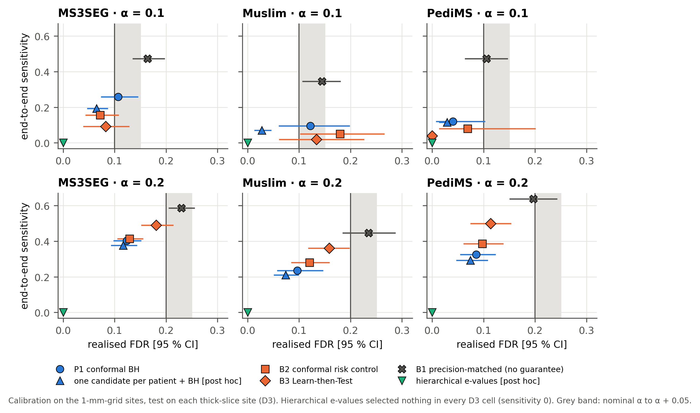
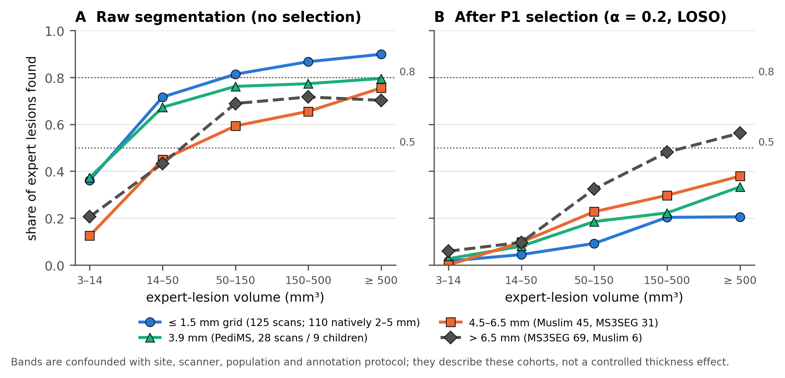
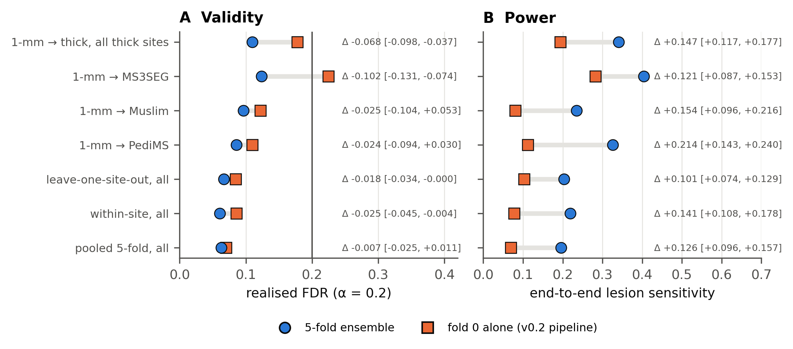
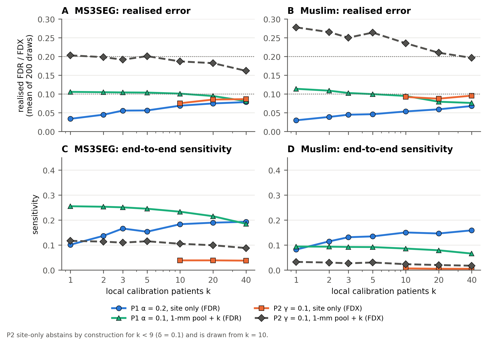
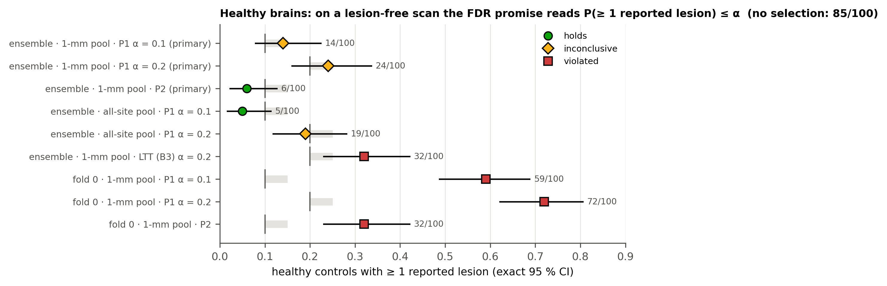

# Abstract

**Background.** Conformal selection can wrap any lesion segmenter with a distribution-free
"precision dial": among the candidate lesions of a scan, report only those whose conformal
p-values pass Benjamini–Hochberg, so that the expected share of false lesions (the lesion-wise
false-discovery rate, FDR) is at most α. The promise rests on exchangeability between the
calibration data and the scan at hand. Multiple sclerosis (MS) imaging routinely breaks that
assumption. Sites differ, much FLAIR is still acquired as 2D slices of 4–8 mm, and public cohorts
often sit inside the segmenter's training data.

**Purpose.** To measure, under a pre-registered protocol, where lesion-wise conformal
false-discovery control holds and where it fails for a state-of-the-art MS segmenter: across
sites, from thin to thick slices, with and without fold ensembling, and on healthy brains.

**Methods.** We used five public patient cohorts (304 scans, 245 patients) and 100 healthy
controls, segmented with the five folds of FLAMeS. Two patient cohorts are delivered on a 1-mm
grid: 10 scans are natively thin, 110 are 2–5 mm acquisitions resampled to 1 mm and 5 have unknown native thickness. Three cohorts are
natively 2D, with 3.9–8.3 mm slices. We excluded every scan in FLAMeS's training data. We resampled
and split by patient, never by scan. The protocol was committed before any outcome was computed
(2026-10-21; git commit 9951494; SHA-256 1b5b39a8…6016). A separately pre-registered addendum covers
the controls (2026-10-24; commit caa47e7). We compared conformal BH (P1, marginal FDR) with a
scan-level exceedance threshold (P2, "CALM-FDX": P(FDP > γ) ≤ δ = 0.1). P2 is an application of
conformal risk control and Learn-then-Test, not new theory. We also compared risk-control,
Learn-then-Test and precision-matched baselines, plus two scan-aware baselines analysed post hoc.

**Results.** No violation of marginal FDR control was detected in the 16 pre-registered
held-out-site comparisons (14 on sites FLAMeS never trained on). This is weaker than validity. One
thick-slice site was undecided at α = 0.1 (Muslim: realised FDR 0.122 [95 % CI 0.062, 0.197]). Three
comparisons passed only because almost nothing was selected. With 1-mm calibration, realised FDR on
the two large thick-slice sites was 2.6–3.2 times its within-site value. Post hoc, on the third of
thick-slice scans with many false candidates, it was 0.196 [0.120, 0.282]. The per-scan guarantee
failed on thick slices calibrated on thin ones: 21 % [13, 30] (MS3SEG) and 29 % [17, 44] (Muslim) of
scans exceeded γ = 0.1, against a 10 % budget. Only 10 or more local calibration patients restored
it, and then only by near-abstention (3.85 % and 0.65 % of lesions found). Thickness effects were
confounded with site. Averaging the five folds raised candidate AUROC from 0.67–0.76 to 0.78–0.82.
It doubled lesion sensitivity at α = 0.2 (0.102 → 0.203, leave-one-site-out) and lowered pooled
realised FDR. On one site, however, it raised realised FDR at α = 0.1 (0.052 → 0.122). On
healthy brains, 1-mm-calibrated selection flagged 14/100 (α = 0.1) and 24/100 (α = 0.2) controls;
both results were undecided and above nominal. Without selection, the segmentation marked a lesion
in 85/100 healthy brains and met a brain dissemination-in-space rule in 19/100 [11.8, 28.1 %].

**Conclusions.** Marginal lesion-wise FDR control survived site and thickness shift in the sense
that no violation was detected. Per-scan control did not survive. Lesion-wise conformal guarantees
for MS should be calibrated with the deployed segmenter on the target site or acquisition type.
They leave little power, and they do not cover healthy or screening populations. We translated
these findings into a slice-thickness reliability card that is off by default and shows no
false-lesion rate. This is translation, not clinical validation.

**Keywords:** conformal selection; false discovery rate; false-discovery exceedance; Learn-then-Test;
multiple sclerosis; lesion segmentation; distribution shift; slice thickness; pre-registration;
training-set contamination.

---

# 1 Introduction

Automated segmentation of MS white-matter lesions on FLAIR has reached voxel Dice of about 0.7 on
external data with nnU-Net-class models [@isensee2021nnunet; @dereskewicz2025flames;
@wiltgen2024lstai]. A reader of a single scan, however, needs a different number: how many of the
lesions the software marks are false. Diagnostic rules make each lesion count. The McDonald
criteria require lesions in several characteristic regions to establish dissemination in space
[@thompson2018diagnosis; @montalban2025diagnosis]. A few false periventricular or juxtacortical
marks can turn a negative scan positive.

Conformal inference offers a principled answer. Conformal p-values computed against a calibration
set of known false candidates are valid and positively dependent [@bates2023testing].
Benjamini–Hochberg (BH) selection on them controls the false-discovery rate of the reported set
[@benjamini1995controlling; @jin2023selection]. The resulting "precision dial" needs no model
assumptions. Its one proviso is exchangeability between the calibration candidates and the false
candidates of the new scan. Risk-control and Learn-then-Test (LTT) frameworks provide analogous
guarantees with the scan as the exchangeable unit
[@angelopoulos2024crc; @angelopoulos2025ltt; @bates2021rcps].

MS imaging stresses this proviso in four ways. First, scanners and protocols differ between sites.
Second, 2D FLAIR with 4–8 mm slices is still common in routine care, although consensus guidelines
recommend 3D FLAIR [@wattjes2021magnims]; thick slices change both lesion appearance and the
segmenter's errors. Third, false candidates within one scan share that scan's quality and anatomy,
so they are not exchangeable as single units. Fourth, the public MS cohorts used for evaluation are
often part of the segmenter's training data, which turns an external test into an in-distribution
one [@kapoor2023leakage; @varoquaux2022machine].

This paper does not propose a new conformal method. It is a pre-registered, reproducible audit of
lesion-wise conformal false-discovery control on real MS data, with the safeguards such a claim
needs: a forensic check of which scans the segmenter trained on, the patient as the unit of
splitting and resampling, held-out sites, multiplicity-aware intervals, healthy controls and
plainly reported negative results. Our earlier internal drafts made claims that this audit retracts;
we list them (Appendix B).

**Contributions.**

1. A pre-registered five-cohort evaluation of lesion-wise conformal FDR (P1) and per-scan
   false-discovery exceedance (FDX, P2) control, with leave-one-site-out and thin-to-thick-slice
   transport designs, in which every scan in the segmenter's training data is excluded (§6.2–6.3).
2. A comparison with pre-registered (conformal risk control, LTT, precision-matched) and post-hoc
   scan-aware baselines (one candidate per patient; hierarchical conformal e-values) (§6.4).
3. A slice-thickness reliability table: validity, power and lesion-size-resolved detection per
   thickness band. We state its confounding with site plainly (§6.6).
4. Evidence that fold ensembling doubles power at the guarantee without fixing validity (§6.7).
5. A recalibration-size analysis: how many local patients restore validity, and at what power
   (§6.8).
6. A pre-registered healthy-control analysis, which replaces an unfounded earlier claim about
   dissemination in space on healthy brains (§6.9).
7. A description of how the findings were translated into a conservative, default-off software
   feature, explicitly not a clinical validation (§7).

# 2 Related work

**Conformal selection and FDR.** Conformal p-values against a shared calibration set satisfy PRDS,
so BH on them controls FDR at α·π0 ≤ α, where π0 is the share of nulls among the tested units
[@bates2023testing]. @jin2023selection cast prediction-based selection in this framework, and
@marandon2024adaptive extended it to adaptive scores. Under covariate shift, weighted conformal
p-values restore validity when the likelihood ratio is known or can be estimated
[@tibshirani2019conformal; @jin2026weighted]. More general deviations from exchangeability cost a
quantifiable coverage gap [@barber2023beyond]. Mondrian (group-conditional) calibration calibrates
within strata such as sites or thickness bands [@vovk2005algorithmic].

**Grouped data and scan-level risk control.** When observations are clustered, exchangeability
holds at the cluster level at best. @dunn2023distribution calibrate by subsampling one observation
per group. @lee2025selection construct hierarchical and subsampling conformal e-values with e-BH
[@wang2022false]; their guarantee assumes group sizes independent of the observations. Conformal
risk control [@angelopoulos2024crc] and LTT [@angelopoulos2025ltt] control the expectation, or a
high-probability bound, of any bounded loss over exchangeable units. With the scan as unit and the
per-scan false-discovery proportion (FDP), or the indicator {FDP > γ}, as loss, they control
scan-level FDR or FDX for a global threshold. Non-exchangeable risk control trades the guarantee for
weights over the calibration data [@farinhas2024nonexchangeable].

**Simultaneous and exceedance bounds.** FDX control dates back to @genovese2006exceedance.
Reference-family bounds [@blanchard2020posthoc], the exact joint law of conformal p-values
[@gazin2024transductive] and everywhere-valid FDP bounds for conformal selection
[@song2026everywhere] give post hoc or simultaneous control. All of them assume exchangeability of
the individual candidates.

**Conformal methods in medical image segmentation.** Recent work controls voxel-level miss rates
for 3D lesions [@tan2025conformal], image-level false-positive proportions in segmentation masks
[@mossina2025controlling] and per-scan nodule miss rates by risk control [@hulsman2025conformal].
@lambert2024robust estimate volumes under covariate shift. @adhikary2026bound showed that per-organ
recall risk control in CT fails to transfer under clinical domain shift. In MS, conformal prediction
has been applied to disease course from registry data [@sreenivasan2025conformal]. MS lesion
uncertainty has otherwise been evaluated without distribution-free guarantees
[@molchanova2025structural; @malinin2022shifts].

**Position of this work.** We found no study of lesion-wise conformal FDR or FDX control for MS
segmentation that tests transport across sites and slice thickness while controlling for the
segmenter's training-set overlap. We make no stronger novelty claim. The methods are standard, and
the per-scan procedure is an application of risk control and LTT (§3.2). Before submission, the
literature search must be refreshed (Appendix D, owner checklist).

# 3 Problem setting and procedures

## 3.1 Candidates and lesion-wise error

For a scan, the segmenter outputs a voxelwise lesion probability map. A *candidate* is an
18-connected component of {p ≥ 0.5} whose physical volume is at least 3 mm³, computed with the
scan's own voxel volume. Its *score* s is the mean probability over the component; higher scores are
more lesion-like. *Expert lesions* are 18-connected components of the expert mask of at least
3 mm³ ("detectable"). *Clinical* lesions are those of at least 14.14 mm³ (a sphere of 3 mm
diameter). Candidates are matched one-to-one to expert lesions by maximum-IoU Hungarian assignment
[@kuhn1955hungarian]. The pre-registered primary matching is lenient (IoU > 0); a strict variant
(IoU ≥ 0.10) is a sensitivity analysis. A candidate is *true* if it is matched; unmatched fragments
are *false*.

A selection rule reports a subset R of a scan's candidates. Its false-discovery proportion is
FDP = |R ∩ F| / max(|R|, 1), where F is the set of false candidates. We report:

- the **realised FDR**: the mean per-scan FDP over test scans, with FDP = 0 when nothing is
  selected;
- the **realised FDX**: the share of test scans with FDP > γ;
- the **end-to-end sensitivity**: selected-and-matched expert lesions divided by all detectable
  expert lesions.

On a lesion-free scan, FDP is the indicator of at least one reported lesion. Each promise then
becomes a bound on the healthy false-alarm rate.

## 3.2 Procedures

**P1 — conformal BH (primary FDR procedure).** The null set N contains the scores of all false
candidates of all scans of the calibration patients, with size n. For a test candidate with score s,
p = (1 + #{u ∈ N : u ≥ s}) / (n + 1). BH at level α is applied within each test scan. If the test
scan's false-candidate scores are exchangeable with N, these p-values are valid and PRDS, and
E[FDP] ≤ α·π0 ≤ α [@bates2023testing; @jin2023selection]. Candidate-level exchangeability is
exactly what a scan-level random effect breaks. We measured that effect as the intraclass
correlation of false-candidate scores within scans.

**P2 — CALM-FDX, single-threshold form (primary FDX procedure).** For each calibration patient
(first timepoint only) and each threshold λ on the grid {0, 0.001, …, 1, ∞}, FDP_i(λ) is the FDP of
{s ≥ λ}. The scan's *safe threshold* t_i is the smallest grid value λ such that FDP_i(λ′) ≤ γ for
every grid λ′ ≥ λ. With K calibration patients, λ̂ is the ⌈(K + 1)(1 − δ)⌉-th smallest t_i. If that
index exceeds K, λ̂ = ∞ and the procedure abstains. Because FDP_test(λ̂) > γ implies t_test > λ̂, and
t_test is exchangeable with t_1, …, t_K when patients are exchangeable,
P(FDP_test > γ) ≤ δ. This is the split-conformal quantile argument [@vovk2005algorithmic].
Equivalently, it is conformal risk control with the binary loss 1{t_i > λ} [@angelopoulos2024crc].
Its high-probability (PAC) analogue is LTT [@angelopoulos2025ltt]. We call it CALM-FDX to keep
continuity with our earlier drafts, but **it is an application of these frameworks, not new
theory**. The earlier two-layer variant with per-scan region certificates was not re-run (§9).

**Baselines (pre-registered).** *B1, precision-matched threshold*: the lowest threshold whose
pooled calibration micro-FDR is at most α; it carries no guarantee. *B2, conformal risk control*: a
global threshold with the monotonised per-scan FDP as loss, which gives E[FDP_test] ≤ α under scan
exchangeability [@angelopoulos2024crc]. *B3, LTT*: Hoeffding–Bentkus p-values with fixed-sequence
testing over thresholds and per-scan FDP as loss; with probability at least 0.9 over the
calibration draw, E[FDP_test] ≤ α [@angelopoulos2025ltt]. B2 and B3 use one scan per calibration
patient.

**Baselines added post hoc (§5.5).** *SUB*: one false candidate drawn at random per calibration
patient, conformal p-values against this subsampled null and BH within the scan
[@dunn2023distribution]. Each p-value is marginally valid under patient exchangeability, but BH's
PRDS argument is not re-established, so its FDR control is empirical. The procedure is randomised
(200 draws). *LR-hier*: hierarchical conformal e-values with weights 1/N_k and e-BH over the whole
batch of test scans of the held-out site [@lee2025selection; @wang2022false]. Its guarantee is a
batch FDR and assumes group sizes independent of the observations, which is doubtful here: candidate
counts track lesion load.

**Table 3. The procedures and what each one guarantees.**

| procedure | exchangeable unit assumed | error controlled | type of guarantee | randomised | status |
|---|---|---|---|---|---|
| P1 conformal BH | false candidates (pooled) | per-scan FDR ≤ α | marginal (over calibration and test) | no | pre-registered, primary |
| P2 CALM-FDX threshold | patients (one scan each) | P(FDP_scan > γ) ≤ δ | marginal | no | pre-registered, primary |
| B1 precision-matched | — | none | — | no | pre-registered baseline |
| B2 conformal risk control | patients | per-scan FDR ≤ α | marginal | no | pre-registered baseline |
| B3 Learn-then-Test | patients | per-scan FDR ≤ α | PAC, δ = 0.1 | no | pre-registered baseline |
| SUB one candidate per patient + BH | patients | none proven (each p-value valid) | — | yes | post hoc baseline |
| LR-hier hierarchical e-values + e-BH | patients, sizes independent of data | batch FDR ≤ α | marginal | no | post hoc baseline |

# 4 Data

## 4.1 Cohorts

Table 1 lists the cohorts. The five patient cohorts are MSLesSeg [@rondinella2025mslesseg;
@mslesseg2025data], the Ljubljana 3D MR MS dataset [@lesjak2018novel], MS3SEG [@bawil2026ms3seg;
@ms3seg2026data], the Baghdad cohort of @muslim2022brain [@muslim2022data] and PediMS
[@popa2025pedims; @pedims2025data]. The healthy controls are the 100 controls of SibBMS
[@tuchinov2025sibbms].

Two acquisition facts matter for everything that follows:

- **The "1-mm" cohorts are 1-mm grids, not 1-mm acquisitions.** MSLesSeg's release includes an
  acquisition table that lists native FLAIR slice thicknesses of 2–5 mm: 43 scans at 2–2.3 mm, 52 at
  3 mm, 15 at 4–5 mm and 5 unknown. The images are registered and resampled to MNI 1 mm. Only the
  Ljubljana scans are natively thin (3D, 0.8 mm). Throughout, "1-mm sites" means sites *delivered*
  on a 1-mm grid.
- **The thick-slice cohorts are natively 2D**, with slice spacing of 3.9 mm (PediMS),
  4.86–8.3 mm (Muslim) and 6.0–8.1 mm (MS3SEG). They were analysed on their native grids.

We skull-stripped MS3SEG and Muslim with HD-BET 2.0.1 [@isensee2019hdbet]. PediMS is distributed
skull-stripped. MSLesSeg and Ljubljana are used as distributed (MNI 1 mm).

The expert masks follow different protocols. MS3SEG's MS-lesion class excludes periventricular
hyperintensities that its raters judged to be non-MS, so FLAMeS marks there count as false. Muslim
masks come from a sequential correction chain, and Muslim's in-plane pixel size was not reliably
available and was estimated (±5 % per axis). PediMS has one rater validated by two specialists and
includes one patient with Baló's concentric sclerosis.

**Table 1. Cohorts (5-fold ensemble arm; candidates and labels as in §3.1).**

<!-- BEGIN TABLE t1 -->
| cohort | origin, scanner | scans / patients | native FLAIR geometry | grid analysed | detectable expert lesions | candidates (false) | candidate AUROC, 5-fold mean [95 % CI] | AUROC, single folds (range) |
|---|---|---|---|---|---:|---|---|---|
| MSLesSeg | Italy (Catania); 8 scanner models, 1.5/3 T | 115 / 75 | 2D/3D, native 2–5 mm (43 at 2–2.3, 52 at 3, 15 at 4–5, 5 unknown) | MNI 1 mm (delivered) | 3344 | 3788 (1257) | 0.818 [0.798, 0.837] | 0.735–0.758 |
| Ljubljana-10 | Slovenia (Ljubljana); Siemens 3 T | 10 / 10 | 3D, 0.47 × 0.47 × 0.8 mm | MNI 1 mm (delivered) | 667 | 517 (82) | 0.802 [0.729, 0.883] | 0.673–0.701 |
| MS3SEG | Iran; Toshiba 1.5 T | 100 / 100 | 2D, slice spacing 6.0–8.1 mm (median 7.2) | native | 3354 | 3402 (1162) | 0.802 [0.786, 0.816] | 0.699–0.720 |
| Muslim | Iraq (Baghdad), ~20 centres; 1.5 T | 51 / 51 | 2D, 4.86–8.3 mm (median 6.0); in-plane pixel size estimated | native | 1819 | 1540 (568) | 0.784 [0.741, 0.822] | 0.731–0.746 |
| PediMS | one centre; Siemens Skyra 3 T; 9 children | 28 / 9 | 2D, 0.75 × 0.75 × 3.9 mm | native | 1104 | 1110 (321) | 0.801 [0.774, 0.864] | 0.683–0.715 |
| SibBMS healthy controls | Siberia (Russia), one site | 100 / 100 | not verified; images registered to an MNI-type 1-mm template | template 1 mm | 0 | 263 (263); fold 0: 306 | — | — |
<!-- END TABLE t1 -->

## 4.2 Training-set overlap (contamination)

FLAMeS was trained on 668 FLAIR scans from 11 sources [@dereskewicz2025flames]. Two public MS
cohorts are among them: 20 ISBI-2015 scans [@carass2017longitudinal] and 20 Ljubljana scans
(listed as PubMRI) [@lesjak2018novel]. MSSEG-2016 scans (centres 01, 03, 07 and 08) are also included
[@commowick2018objective]. A segmenter evaluated on its own training scans is not being tested
externally [@kapoor2023leakage]. We therefore handled overlap as follows (Table 2).

- **ISBI-2015** is not used anywhere in this paper. An analysis in our earlier draft that used it is
  withdrawn.
- **Ljubljana.** The released weights contain nnU-Net's dataset fingerprint (per-case spacing and
  brain bounding box of all 668 training cases). Twenty consecutive entries match Ljubljana
  patients 01–15 and 21–25 exactly, with zero voxels of disagreement on all three axes. The training
  logs show that each fold trains on four fifths of the cases. These 20 scans are excluded from
  every analysis, including calibration. The remaining 10 patients (16–20, 26–30; "Ljubljana-10")
  were never trained on by any fold. Their **site**, however, was in training. We therefore never
  count Ljubljana-10 as an unseen-site test. Its two leave-one-site-out cells are reported but flagged
  (†). A post-hoc analysis removes Ljubljana from every calibration pool (§6.5).
- **MSLesSeg, MS3SEG, Muslim, PediMS** are not among FLAMeS's training sources. MSLesSeg served as an
  external test set in the FLAMeS publication. For the three thick-slice cohorts, the exclusion
  rests on the dataset and model descriptions, not on fingerprint forensics.
- **SibBMS controls** are not among the training sources. The fingerprint has 668 entries, none
  compatible with the SibBMS template grid or any control's brain box, and SibBMS was released after
  FLAMeS was submitted.

**Table 2. Segmenter training-set overlap and licences.**

| cohort | in FLAMeS training? | used here as | in LST-AI training? | licence (data) |
|---|---|---|---|---|
| MSLesSeg | no (FLAMeS external test) | calibration and test | no | CC BY 4.0 (the article itself is non-commercial; we use the data only) |
| Ljubljana (open_ms_data / 3D MR MS) | **20 of 30 scans** (patients 01–15, 21–25) | only the 10 never-trained scans; site flagged as seen | no (LST-AI test set) | **CC BY-NC-ND per the laboratory's page** (a download mirror states CC BY); we apply the stricter licence: academic use only |
| ISBI-2015 | **yes (20 scans)** | **not used** | — | challenge terms |
| MS3SEG | no known overlap | test, and calibration in pooled designs | not used | CC BY 4.0 (data); code MIT |
| Muslim 2022 | no known overlap | as MS3SEG | not used | CC BY 4.0 |
| PediMS | no known overlap | as MS3SEG | not used | CC BY 4.0 |
| SibBMS healthy controls | no (fingerprint, release dates) | test only (controls) | not run (pending) | stated as both CC BY 3.0 and CC BY-NC-SA 3.0; we apply the stricter: research use only |

The FLAMeS weights (v2.0) are CC BY 4.0 [@flames2025weights]. LST-AI's code is MIT-licensed. The
HD-BET weights are licensed for non-commercial use.

# 5 Study design and statistics

## 5.1 Pre-registration and its limits

The analysis protocol (`docs/research/paper/PROTOCOL-v0.3.md`) was committed on 2026-10-21 at
04:21 CEST (commit 9951494). At that point, only the input inventory had been computed: file
hashes, grids and value ranges. No candidate label, selection, FDP, recall or AUROC had been
computed on the new data. The SHA-256 of the protocol file at that commit is
1b5b39a8e5cc3c3af6cfce22d64c16832e0ccc71dbaf5ba35b11db15b93c6016 (committed blob, LF line endings).
Implementation clarifications 1–4 (commit c0c5fa1, 04:35) and the gate deviation 5 (commit 50c9b08,
04:41) were logged before any outcome. The first results were committed at 04:59 (8a420bc).

The healthy-control addendum (`PROTOCOL-v0.3-addendum-controls.md`) was committed on 2026-10-24 at
15:52 CEST (commit caa47e7; SHA-256
bdae74ec6373daa0685c49cc4f57fed73445716b92d469d9658cede764f87213). It was written before any control
outcome on the ensemble maps or on the 70 never-analysed fold-0 control maps.

**Limit, stated plainly.** The pre-registration lives in the project's version-controlled
repository, not in a public registry [@nosek2018preregistration]. For the main protocol, the
external timestamp is weak: the branch reached the public remote (GitHub) only at 05:09 CEST on
2026-10-21, together with the first results. Its precedence over the results therefore rests on the
git history, whose author timestamps cannot be verified independently. The addendum is stronger: it
was pushed to the public remote at 13:52:31 UTC on 2026-10-24, 71 minutes before its results
(15:03:30 UTC). These times come from GitHub push events. A three-scan processing pilot on one scan
per thick-slice cohort (FLAMeS fold 0, 2026-10-18) preceded the protocol. Its outcomes were not
inspected, and it is disclosed in protocol entry 7.

## 5.2 Segmenter and arms

FLAMeS [@dereskewicz2025flames] is a 3D full-resolution nnU-Net [@isensee2021nnunet] trained on FLAIR
only. We ran each of its five folds separately (checkpoint_final, no test-time augmentation) and
stored probability maps as uint8 with a scale factor; the maximum decoding error is about 0.002.

- **Ensemble arm (primary).** The voxelwise mean of the five fold maps, which is nnU-Net's own
  ensembling [@lakshminarayanan2017simple]. Candidates are extracted from that map.
- **Fold-0 arm.** The pipeline of our earlier drafts. Folds 1–4 were run the same way to check
  whether fold 0 is typical.
- **Secondary score.** S_cons is the minimum over folds of the per-fold mean probability on an
  ensemble candidate; it is lesion-like only if all folds agree.
- **LST-AI** v1.2.0 [@wiltgen2024lstai] was run on MSLesSeg and Ljubljana only, for an exploratory
  paired segmenter swap.

A reproduction gate (G1) compared the new fold-0 candidates with those of our earlier analysis:
125/125 scans had identical candidate counts and 4400/4400 candidates had identical one-to-one
labels. One candidate's score differed by 0.0078, above the 0.003 tolerance. This is a documented
boundary voxel, and the deviation was logged before any outcome (Table 11, entry 5).

## 5.3 Calibration designs

- **D1, within-site:** patient-grouped 5-fold cross-fitting within each site; leave-one-patient-out
  for Ljubljana-10 and PediMS.
- **D2, leave-one-site-out:** calibrate on all eligible patients of the other four sites, test on
  the held-out site.
- **D3, 1-mm grid → thick (primary transport design):** calibrate on MSLesSeg + Ljubljana-10, test on
  MS3SEG, Muslim and PediMS separately. D3r is the reverse direction.
- **D4, pooled:** patient-grouped 5-fold cross-fitting over all five sites.
- **D5, recalibration curve:** draw k patients of the target site (k ∈ {1, 2, 3, 5, 10, 20, 40},
  200 draws each), calibrate either on them alone (*site-only*) or on the 1-mm pool plus them
  (*augmented*), and test on the rest of the site.

Repeated timepoints of one patient (MSLesSeg, PediMS) are never split between calibration and test.

## 5.4 Outcomes, classification and multiplicity

The **32 primary cells** cover the held-out sites in D3 (3 thick-slice sites) and D2 (5 sites), for
P1 at α ∈ {0.1, 0.2} (realised FDR) and P2 at γ ∈ {0.1, 0.2} with δ = 0.1 (realised FDX). All are
for the ensemble arm with the primary score and lenient matching.

Intervals are 95 % patient-cluster percentile bootstraps with 2000 resamples [@davison1997bootstrap].
For FDX, the interval is the union with the exact Clopper–Pearson interval over scans
[@clopper1934use]. Each cell is classified as follows:

- *violated* if the lower bound exceeds the nominal level;
- *holds* if the upper bound is at most nominal + 0.05;
- *inconclusive* otherwise.

A non-violated cell with fewer than 10 selections or end-to-end sensitivity below 0.05 is flagged as
*abstention*. "Holds" therefore means *no violation detected and the upper bound is within the
margin*. It is not a proof of validity, and a "holds" cell can have a point estimate above α.

Under exact validity we would expect about 0.8 spurious one-sided "violations" among 32 cells. We
therefore also report Bonferroni intervals (level 1 − 0.05/32, 20 000 resamples) and a two-level
bootstrap that resamples calibration and test patients (500 resamples), which gives the marginal
view.

The pre-registered decision rules (protocol §10) were:

- Q1 (thin-to-thick transport) is *supported* if no D3 cell is violated and the MS3SEG and Muslim
  cells hold, and *refuted* if any D3 cell is violated.
- Q3 (ensemble) "helps" if the paired difference in sensitivity excludes 0 in its favour in D2 and
  D3 without a new violated cell.
- Q4 defines k* as the smallest k at which the mean realised error is at most nominal and the mean
  power is at least 90 % of within-site power.

For **healthy controls**, the primary cells are the ensemble arm with 1-mm-site calibration, P1 at
α ∈ {0.1, 0.2} and P2. We report the share of the 100 controls with at least one reported lesion,
with exact intervals and the same classification rule. A secondary outcome applies the software's
own brain dissemination-in-space (DIS) rule to the raw and selected lesions.

## 5.5 Post hoc analyses

Analyses written after results had been seen are labelled **[post hoc]** wherever they are cited.
Three groups exist:

- explanatory checks of v0.3 (`v03_posthoc.py`), including the low-lesion-load analysis added after
  an independent re-implementation;
- a stratification of MSLesSeg by native thickness (`v03_mslesseg_native.py`);
- two analyses added at the manuscript stage (`v03m_manuscript_posthoc.py`): Ljubljana removed from
  every calibration pool, and the SUB and LR-hier baselines.

The manuscript-stage analyses were logged as protocol entry 10 and pushed to the public remote
(commit 70b0831) immediately before they were run. The evidence for that order is the local git log
of the push; no external timestamp was available for this push when we wrote this paper.

## 5.6 Deviations from the pre-registered protocol

**Table 11. Deviations, clarifications and disclosures.** Entries 1–10 refer to PROTOCOL-v0.3 §13;
entries A1–A2 refer to the addendum §11.

| # | when (relative to outcomes) | what | effect on reported numbers |
|---|---|---|---|
| 1 | before | FDX intervals: union of the patient-cluster bootstrap and the exact Clopper–Pearson interval (the percentile bootstrap degenerates at 0/n) | wider FDX intervals |
| 2 | before | Bonferroni intervals use 20 000 bootstrap resamples | none |
| 3 | before | Muslim ±10 % volume sensitivity rescales expert-lesion volumes only | none on primary |
| 4 | before | Gate G1 tolerance restricted to the 5 scans where a voxel crosses 0.5 | none |
| 5 | before | G1 strict criterion failed on one candidate (score difference 0.0078 > 0.003; boundary voxel); analysis continued | none |
| 6 | after | fold-0 primary-cell classification and the Q3/Q4 verdict blocks were added to the script after its first run; the re-run reproduced every printed number; explanatory analyses labelled post hoc | none |
| 7 | disclosure | a three-scan thick-slice processing pilot (2026-10-18) preceded the protocol; outcomes not inspected | none |
| 8 | after | independent re-implementation of the patient analysis; wording corrected ("no violation detected", per-scan failure intervals, site confounding, mixed ensemble effect, near-abstention); post-hoc low-lesion-load analysis added | wording only; no pre-registered number changed |
| 9 | after | MSLesSeg is natively 2–5 mm (dataset acquisition table), not "unpublished geometry"; band B1 relabelled "≤ 1.5 mm as delivered"; post-hoc native-thickness stratification | labels only |
| 10 | before running, after all other results | manuscript stage: Ljubljana removed from every calibration pool; SUB and LR-hier baselines [post hoc] | new post-hoc numbers (§6.4, §6.5) |
| A1 | after | control analysis: interrupted runs and two coding errors (a rounding helper; a key name) fixed; the fourth run reproduced every printed number; a separate re-implementation matched all counts exactly | none |
| A2 | after | controls [post hoc]: visual check of four top-scoring false candidates; their FLAIR intensity; Fisher test of the 30 previously analysed vs 70 new controls | post-hoc numbers only |
| — | reporting | the two leave-one-site-out Ljubljana cells are reported as "site seen in segmenter training" rather than counted as unseen-site evidence | none |
| — | reporting | the earlier text stated that conformal BH was "the only procedure with no violated 1-mm → thick cell"; Learn-then-Test (B3) had none either (§6.4) | correction |
| — | not done | the LST-AI arm on the controls (addendum E1) is pending | — |

## 5.7 Software, compute and reproducibility

Candidate extraction (18 min on 7 workers), the analysis (6 min) and every post-hoc analysis ran on
a local CPU, with deterministic seeds (20261021, 20261024 and 20261031). FLAMeS and LST-AI inference
ran earlier on CPU virtual machines (§Funding). Every input file is hashed in the inventory records.
The cached candidate set is identified by its SHA-256 (2096109e…a6f4ec) and is not redistributed. Its
licence conditions (Ljubljana: no derivatives) forbid sharing; scripts regenerate it from the public
sources. The metric functions have 33 unit tests. Appendix C maps every result to its script and
record, and `NUMBERS_CHECK.md` maps every number in this paper to its stored value.

Two independent re-implementations were made:

- **Patient analysis (2026-10-21).** It reproduced the candidates (for example, 3402 MS3SEG
  candidates, 1162 false) and the primary rates to three decimals, and found no leakage between
  calibration and test patients. Its code was not archived in the repository (Appendix D).
- **Control counts (2026-10-24).** Written as `v03c_controls_check.py`, with its own labelling,
  p-values and BH. All counts matched exactly.

Both re-implementations were written in separate AI-agent sessions, not by a second human analyst
(see AI-assistance statement).

# 6 Results

## 6.1 Score quality

Every single fold ranked candidates with AUROC 0.67–0.76 (Table 1). The 5-fold mean reached
0.78–0.82 at every site. Candidate precision without selection was 0.63–0.84. The ensemble produced
8.2–11.6 false candidates per scan. Fold disagreement alone (the negative standard deviation of the
five per-fold candidate means) ranked candidates almost as well as the mean (AUROC 0.77–0.81).

## 6.2 Held-out sites: marginal FDR control (P1)

**Table 4. The 32 pre-registered primary cells (ensemble arm).** Entries: realised value
[95 % CI] → class; end-to-end sensitivity; number of selections. "*" marks a cell that holds with a
point estimate above nominal; "(abst.)" marks a pass by abstention; † marks a site seen in FLAMeS
training.

<!-- BEGIN TABLE t4 -->
| design · test site | P1, α = 0.1 (FDR) | P1, α = 0.2 (FDR) | P2, γ = 0.1 (FDX vs δ = 0.1) | P2, γ = 0.2 (FDX vs δ = 0.1) |
|---|---|---|---|---|
| 1-mm grid → MS3SEG | 0.107 [0.075, 0.145] holds*; sens. 0.258; n = 957 | 0.123 [0.099, 0.151] holds; sens. 0.404; n = 1545 | 0.21 [0.13, 0.30] **violated**; sens. 0.121; n = 436 | 0.12 [0.06, 0.20] inconclusive; sens. 0.121; n = 436 |
| 1-mm grid → Muslim | 0.122 [0.062, 0.197] inconclusive; sens. 0.095; n = 195 | 0.097 [0.058, 0.146] holds; sens. 0.235; n = 471 | 0.29 [0.17, 0.44] **violated**; sens. 0.036; n = 81 | 0.27 [0.16, 0.42] **violated**; sens. 0.036; n = 81 |
| 1-mm grid → PediMS | 0.041 [0.009, 0.102] holds; sens. 0.120; n = 139 | 0.086 [0.056, 0.122] holds; sens. 0.326; n = 399 | 0.07 [0.00, 0.24] inconclusive; sens. 0.053; n = 60 | 0.07 [0.00, 0.24] inconclusive; sens. 0.053; n = 60 |
| leave-one-site-out · MSLesSeg | 0.009 [0.000, 0.029] holds (abst.); sens. 0.010; n = 34 | 0.018 [0.004, 0.042] holds; sens. 0.089; n = 312 | 0.02 [0.00, 0.06] holds (abst.); sens. 0.001; n = 4 | 0.03 [0.00, 0.07] holds (abst.); sens. 0.004; n = 16 |
| leave-one-site-out · Ljubljana-10 † | 0.000 [0.000, 0.000] holds (abst.); sens. 0.009; n = 6 | 0.011 [0.000, 0.033] holds; sens. 0.118; n = 80 | 0.00 [0.00, 0.31] inconclusive (abst.); sens. 0.011; n = 7 | 0.00 [0.00, 0.31] inconclusive (abst.); sens. 0.011; n = 7 |
| leave-one-site-out · MS3SEG | 0.087 [0.059, 0.121] holds; sens. 0.201; n = 744 | 0.116 [0.093, 0.142] holds; sens. 0.381; n = 1453 | 0.16 [0.09, 0.25] inconclusive; sens. 0.087; n = 316 | 0.12 [0.06, 0.20] inconclusive; sens. 0.087; n = 316 |
| leave-one-site-out · Muslim | 0.082 [0.033, 0.137] holds (abst.); sens. 0.030; n = 66 | 0.100 [0.048, 0.163] holds; sens. 0.139; n = 276 | 0.18 [0.08, 0.31] inconclusive (abst.); sens. 0.015; n = 37 | 0.18 [0.08, 0.31] inconclusive (abst.); sens. 0.015; n = 37 |
| leave-one-site-out · PediMS | 0.007 [0.000, 0.022] holds; sens. 0.064; n = 73 | 0.050 [0.016, 0.093] holds; sens. 0.164; n = 195 | 0.00 [0.00, 0.12] holds (abst.); sens. 0.025; n = 28 | 0.00 [0.00, 0.12] holds (abst.); sens. 0.025; n = 28 |
<!-- END TABLE t4 -->

**No P1 cell was violated, but this is weaker than "the guarantee held".** Across the 16
held-out-site P1 cells, none had a lower bound above α. Fourteen of these cells are on sites FLAMeS
never trained on. The pre-registered verdict for thin-to-thick transport of P1 is nevertheless
*inconclusive*, for four reasons:

1. On Muslim at α = 0.1 the result is undecided: 0.122 [0.062, 0.197].
2. Three of the 16 cells pass only by abstention: leave-one-site-out MSLesSeg, Ljubljana-10 and
   Muslim at α = 0.1.
3. Ljubljana-10 (10 patients) and PediMS (9) are small. Percentile bootstraps with so few clusters
   under-cover.
4. On MS3SEG at α = 0.1, the estimate (0.107 [0.075, 0.145]) is above α and the cell passes only
   through the pre-registered margin.

With Bonferroni intervals, no P1 cell is violated. The two-level bootstrap gave 0.101 [0.070, 0.136]
(MS3SEG) and 0.104 [0.042, 0.182] (Muslim) at α = 0.1.

**The calibration does not transfer as such.** With within-site calibration, realised FDR at α = 0.1
was 0.041 on MS3SEG and 0.038 on Muslim. These values are close to α·π0 = 0.034 and 0.037
**[post hoc]**, where π0 is the share of false candidates. Conformal BH attains exactly this value
under exchangeability. With 1-mm calibration, realised FDR was 0.107 and 0.122, that is 2.6–3.2 times
higher. The thick-slice false candidates are therefore not exchangeable with the 1-mm null. The
average bound survives only because many thick-slice scans are lesion-rich, so their false
selections are diluted by true ones.

**[post hoc]** On the third of MS3SEG + Muslim scans with at least 40 % false candidates (51 of 151
scans; mean π0 0.52), realised FDR at α = 0.1 was **0.196 [0.120, 0.282]** with 1-mm calibration,
against 0.050 [0.011, 0.103] with within-site calibration. With at least 50 % false candidates
(24 scans) it was 0.225 [0.101, 0.366]. A marginal guarantee averages over a mixture of scans; for
low-lesion-load thick-slice scans, the 1-mm calibration does not deliver it.

In the opposite direction, foreign calibration made the 1-mm sites nearly silent. On MSLesSeg at
α = 0.1, leave-one-site-out calibration selected 34 candidates (sensitivity 0.010); within-site
calibration selected 358 (sensitivity 0.102).

**Pre-specified sensitivity analyses.** Strict matching (IoU ≥ 0.10) and removing the PediMS patient
with Baló's concentric sclerosis left every primary class unchanged. With the fold-consensus score
S_cons, every D3 P1 cell held (Muslim α = 0.1: 0.068 [0.026, 0.122]) and no P2 cell was violated
(MS3SEG γ = 0.1: 0.14 [0.08, 0.22], inconclusive). The power cost was modest: at α = 0.2,
sensitivity on the thick sites was 0.296 with S_cons and 0.341 with the ensemble mean.

## 6.3 Per-scan control (P2) does not transport

With the threshold calibrated on the 1-mm sites (λ̂ = 0.965), **21 % [13, 30] of MS3SEG scans
(γ = 0.1) and 29 % [17, 44] / 27 % [16, 42] of Muslim scans (γ = 0.1 / 0.2) had FDP above γ**,
against a budget of 10 %. The pre-registered verdict for Q1/P2 is *refuted*. Two qualifications
apply:

- After Bonferroni correction for 32 cells, only Muslim at γ = 0.1 stays violated ([0.12, 0.52]).
- In the two-level bootstrap, the MS3SEG lower bound falls to the nominal 0.10 (0.20 [0.10, 0.30]),
  so that violation is borderline. The Muslim violations remain (0.27 [0.12, 0.41] and
  0.25 [0.12, 0.37]).

![Figure 2. Why the per-scan threshold fails on thick slices. (A) Share of scans with a false candidate above the 1-mm-calibrated threshold 0.965 [post hoc], next to the pre-registered realised FDX of 1-mm → thick transport. (B) Share of false candidates scoring at least 0.95, fold 0 versus 5-fold ensemble [post hoc].](figures/fig2_threshold_mechanism.png)

**Mechanism [post hoc].** P2 reduces to a single global threshold. The share of scans with a false
candidate above 0.965 was 6.1 % on MSLesSeg and 10 % on Ljubljana-10, but 24 % on MS3SEG and 29.4 %
on Muslim. These shares nearly equal the realised FDX (Figure 2A). The false-score law of thick-slice
scans differs from the 1-mm law. The pre-registered scan-clustered permutation KS test gave
D = 0.107 on MS3SEG (p = 0.0005, the smallest attainable with 2000 permutations), D = 0.094 on
Muslim (p = 0.025) and D = 0.057 on PediMS (p = 0.51).

A single threshold carries this heavier upper tail straight into exceedance. P1 calibrates against
the whole false-score law and controls only an expectation, which absorbs the shift with lost
slack. At γ ≤ 0.2, P2 hardly depends on γ: for 22–51 % of calibration scans, the safe threshold lies
above the scan's top false candidate. P2 therefore behaves like the rule "no false lesion above the
threshold in 90 % of patients".

## 6.4 Baselines

**Table 5. All procedures under 1-mm → thick transport (D3), ensemble arm.** Entries: realised FDR
[95 % CI] → class; end-to-end sensitivity. SUB entries average over 200 subsampling draws.

<!-- BEGIN TABLE t5 -->
| procedure | α | MS3SEG | Muslim | PediMS |
|---|---|---|---|---|
| P1 conformal BH (pre-registered, primary) | 0.1 | 0.107 [0.075, 0.145] holds; sens. 0.258 | 0.122 [0.062, 0.197] inconclusive; sens. 0.095 | 0.041 [0.009, 0.102] holds; sens. 0.120 |
| P1 conformal BH (pre-registered, primary) | 0.2 | 0.123 [0.099, 0.151] holds; sens. 0.404 | 0.097 [0.058, 0.146] holds; sens. 0.235 | 0.086 [0.056, 0.122] holds; sens. 0.326 |
| one false candidate per calibration patient + BH [post hoc] | 0.1 | 0.065 [0.048, 0.086] holds; sens. 0.193 | 0.028 [0.014, 0.045] holds; sens. 0.071 | 0.029 [0.014, 0.047] holds; sens. 0.116 |
| one false candidate per calibration patient + BH [post hoc] | 0.2 | 0.117 [0.094, 0.143] holds; sens. 0.376 | 0.074 [0.052, 0.098] holds; sens. 0.210 | 0.075 [0.048, 0.107] holds; sens. 0.292 |
| hierarchical conformal e-values + e-BH [post hoc] | 0.1 | no selection (sens. 0) | no selection (sens. 0) | no selection (sens. 0) |
| hierarchical conformal e-values + e-BH [post hoc] | 0.2 | no selection (sens. 0) | no selection (sens. 0) | no selection (sens. 0) |
| B2 conformal risk control, per-scan FDP loss (pre-registered) | 0.1 | 0.072 [0.044, 0.107] holds; sens. 0.155 | 0.180 [0.103, 0.265] **violated**; sens. 0.050 | 0.069 [0.015, 0.200] inconclusive; sens. 0.080 |
| B2 conformal risk control, per-scan FDP loss (pre-registered) | 0.2 | 0.129 [0.106, 0.155] holds; sens. 0.414 | 0.120 [0.086, 0.158] holds; sens. 0.280 | 0.098 [0.062, 0.137] holds; sens. 0.386 |
| B3 Learn-then-Test, per-scan FDP loss, δ = 0.1 (pre-registered) | 0.1 | 0.083 [0.040, 0.128] holds; sens. 0.092 | 0.134 [0.062, 0.226] inconclusive; sens. 0.019 | 0.000 [0.000, 0.000] holds; sens. 0.039 |
| B3 Learn-then-Test, per-scan FDP loss, δ = 0.1 (pre-registered) | 0.2 | 0.181 [0.153, 0.213] holds; sens. 0.490 | 0.159 [0.119, 0.197] holds; sens. 0.361 | 0.114 [0.076, 0.152] holds; sens. 0.499 |
| B1 precision-matched threshold, no guarantee (pre-registered) | 0.1 | 0.164 [0.136, 0.196] **violated**; sens. 0.474 | 0.144 [0.107, 0.180] **violated**; sens. 0.346 | 0.106 [0.065, 0.146] holds; sens. 0.473 |
| B1 precision-matched threshold, no guarantee (pre-registered) | 0.2 | 0.230 [0.206, 0.255] **violated**; sens. 0.586 | 0.235 [0.186, 0.286] inconclusive; sens. 0.446 | 0.197 [0.152, 0.242] holds; sens. 0.639 |
<!-- END TABLE t5 -->

**Pre-registered baselines.**

- **B1 (precision-matched threshold)** was violated on MS3SEG at both levels (α = 0.1:
  0.164 [0.136, 0.196]; α = 0.2: 0.230 [0.206, 0.255]) and on Muslim at α = 0.1
  (0.144 [0.107, 0.180]).
- **B2 (conformal risk control)** was violated on Muslim at α = 0.1 (0.180 [0.103, 0.265]).
- **B3 (Learn-then-Test, per-scan FDP loss)** had no violated D3 or D2 cell. Its pattern resembled
  P1, with Muslim at α = 0.1 inconclusive (0.134 [0.062, 0.226]). The two procedures distribute power
  differently. At α = 0.2, B3 found more lesions than P1 (0.490, 0.361 and 0.499 against 0.404, 0.235
  and 0.326 on MS3SEG, Muslim and PediMS), with realised FDR closer to α (0.181, 0.159, 0.114). At
  α = 0.1, it found fewer (0.092, 0.019, 0.039).

Our earlier text stated that conformal BH was the only procedure without a violated thin-to-thick
cell; that statement was wrong (Table 11). B3's higher power at α = 0.2 also came with a violated
healthy-control cell (§6.9).

**Post-hoc scan-aware baselines.**

- **SUB** (one false candidate per calibration patient) had no violated cell in D3 or D2. On thick
  slices its averaged realised FDR was lower than P1's (MS3SEG α = 0.1: 0.065 [0.048, 0.086];
  Muslim: 0.028 [0.014, 0.045]), at a cost in power at α = 0.1 (MS3SEG 0.193 against 0.258).
  However, a deployment uses a single subsampling draw, and single draws varied widely. On MS3SEG at
  α = 0.1, the central 95 % of draws ranged from 0.004 to 0.115, and 14.5 % of draws exceeded α.
- **LR-hier** (hierarchical e-values) selected nothing in every D3 cell. With K = 85 calibration
  patients its e-values are at most K + 1 = 86, while e-BH needs k e-values of at least n/(α·k) to
  select k of n test candidates. With n in the thousands, it must select hundreds at once or none.
  In D2, with 145–236 calibration patients, it selected in 3 of 10 cells and then selected heavily. On MS3SEG at α = 0.2, the batch FDP was 0.202 and the mean per-scan FDP 0.212
  [0.188, 0.239], at sensitivity 0.559. Its behaviour is all-or-nothing.

D2 results for all procedures are in Appendix Table A2.

## 6.5 Ljubljana removed from every calibration pool [post hoc]

Ljubljana-10 contributed 82 of the 1339 false candidates in the 1-mm null. Removing Ljubljana from
every pool changed no class in D3 or D2 (Appendix Table A3). On MS3SEG at α = 0.1, the D3 estimate
moved from 0.107 to 0.098 [0.071, 0.131]. Muslim at α = 0.1 stayed at 0.122 [0.062, 0.197]. Every
D3 P2 cell was identical, because the MSLesSeg-only threshold is also 0.965. The seen-site
calibration data do not drive the results.

## 6.6 Slice thickness — a gradient confounded with site

**Table 6. Validity and power by thickness band, leave-one-site-out calibration (D2), ensemble
arm.** Bands were fixed before outcomes. Each band is essentially one or two sites.

<!-- BEGIN TABLE t6 -->
| band (slice spacing) · sites | scans / patients | P1 α = 0.1: FDR · sens. | P1 α = 0.2: FDR [95 % CI] | scans with FDP > 0.1 (α = 0.2) | P1 α = 0.2: sens. [95 % CI] | false / true selected lesions per scan (α = 0.2) | P2 γ = 0.1: FDX [95 % CI] · sens. |
|---|---|---|---|---:|---|---|---|
| ≤ 1.5 mm grid (native: 10 at 0.8 mm, 110 at 2–5 mm, 5 unknown) — MSLesSeg, Ljubljana-10 | 125 / 85 | 0.008 · 0.010 | 0.018 [0.004, 0.040] | 6 % | 0.094 [0.053, 0.141] | 0.13 / 3.0 | 0.016 [0.000, 0.057] · 0.002 |
| (1.5, 4.5] mm: 3.9 mm — PediMS | 28 / 9 | 0.007 · 0.064 | 0.050 [0.016, 0.093] | 14 % | 0.164 [0.042, 0.440] | 0.50 / 6.5 | 0.000 [0.000, 0.123] · 0.025 |
| (4.5, 6.5] mm — Muslim 45, MS3SEG 31 | 76 / 76 | 0.084 · 0.112 | 0.101 [0.063, 0.145] | 30 % | 0.236 [0.180, 0.298] | 0.88 / 7.9 | 0.158 [0.079, 0.260] · 0.047 |
| > 6.5 mm — MS3SEG 69, Muslim 6 | 75 / 75 | 0.087 · 0.170 | 0.120 [0.093, 0.152] | 49 % | 0.355 [0.310, 0.402] | 1.73 / 12.4 | 0.173 [0.093, 0.278] · 0.077 |
<!-- END TABLE t6 -->

Across bands, no P1 cell showed a violation. As slices thicken, the slack shrinks and per-scan
exceedance grows. At α = 0.2, realised FDR rose from 0.018 (≤ 1.5 mm grid) to 0.050 (3.9 mm), 0.101
(4.5–6.5 mm) and 0.120 (> 6.5 mm). The share of scans with FDP > 0.1 rose from 6 % to 14 %, 30 % and
49 %. The pooled design (D4) showed the same ordering.

**This is mostly a between-site difference, not a demonstrated thickness effect.** Within sites,
the gradient was small. On MS3SEG, realised FDR went from 0.103 (4.5–6.5 mm) to 0.121 (> 6.5 mm).
On Muslim it went from 0.100 to 0.102, with only 6 scans above 6.5 mm. **[post hoc]** Within MS3SEG
(6.0–8.1 mm), per-scan FDP did not trend with slice spacing (Spearman ρ = 0.03, p = 0.75); on Muslim,
ρ = 0.30 (p = 0.035).

Power at the guarantee is higher on thick-slice sites. **[post hoc]** Their expert lesions are
larger: median 108–117 mm³, against 68 mm³ on MSLesSeg and 20 mm³ on Ljubljana. The 1-mm band is
also penalised by the foreign null.

**Table 7. Expert-lesion sensitivity by lesion volume and band** (raw = matched by any candidate,
before selection; at the guarantee = selected by P1 at α = 0.2 in D2).

<!-- BEGIN TABLE t7 -->
| band | lesions per bin (3–14 / 14–50 / 50–150 / 150–500 / ≥ 500 mm³) | raw sensitivity per bin | sensitivity at P1 α = 0.2 (leave-one-site-out) | raw ≥ 0.8 from | raw ≥ 0.5 from |
|---|---|---|---|---|---|
| ≤ 1.5 mm grid | 531 / 1217 / 1327 / 610 / 326 | 0.36 / 0.72 / 0.81 / 0.87 / 0.90 | 0.02 / 0.04 / 0.09 / 0.20 / 0.21 | 50 mm³ | 14.14 mm³ |
| 3.9 mm | 75 / 324 / 378 / 234 / 93 | 0.37 / 0.67 / 0.76 / 0.77 / 0.80 | 0.03 / 0.08 / 0.19 / 0.22 / 0.33 | not reached | 14.14 mm³ |
| 4.5–6.5 mm | 48 / 514 / 976 / 673 / 343 | 0.13 / 0.45 / 0.59 / 0.66 / 0.76 | 0.00 / 0.10 / 0.23 / 0.30 / 0.38 | not reached | 50 mm³ |
| > 6.5 mm | 34 / 455 / 1074 / 713 / 343 | 0.21 / 0.43 / 0.69 / 0.72 / 0.70 | 0.06 / 0.10 / 0.32 / 0.48 / 0.56 | not reached | 50 mm³ |
| *within MSLesSeg, native 2–2.3 mm [post hoc]* | 141 / 587 / 594 / 274 / 135 | 0.37 / 0.74 / 0.86 / 0.91 / 0.98 | — | — | — |
| *within MSLesSeg, native 3 mm [post hoc]* | 94 / 305 / 435 / 210 / 132 | 0.29 / 0.65 / 0.77 / 0.83 / 0.86 | — | — | — |
| *within MSLesSeg, native 4–5 mm [post hoc]* | 25 / 59 / 143 / 71 / 35 | 0.16 / 0.39 / 0.73 / 0.82 / 0.71 | — | — | — |
<!-- END TABLE t7 -->

On 2D slices of 4.5 mm or more, before any selection:

- lesions of at least 50 mm³ (about 4.6 mm across) were found 59–76 % of the time, depending on the
  size bin;
- lesions of 14–50 mm³ were found 43–45 % of the time;
- lesions under 14 mm³ were found 13–21 % of the time;
- no lesion size reached 80 %.

On the 1-mm grid, 80 % was reached from 50 mm³. At the guarantee, sensitivity exceeded one half only
for lesions of at least 500 mm³ on slices thicker than 6.5 mm. The PediMS band missed 0.8 by a small
margin on 93 lesions (≥ 500 mm³: 0.796).

**[post hoc]** Thickness matters even inside the "1-mm" band. Within MSLesSeg, raw detection of
14–50 mm³ lesions fell with native thickness: 0.74 at 2–2.3 mm (43 scans), 0.65 at 3 mm (52) and
0.39 at 4–5 mm (15). This within-site gradient is confounded with scanner and patient.

Muslim's estimated pixel size moves its own 50 %-detection size between 50 and 150 mm³: at a volume
scale of 1.1, its 50–150 mm³ bin falls to 0.487.

## 6.7 The 5-fold ensemble against a single fold

**Table 8. Ensemble against fold 0 on the same scans and expert lesions (P1; patient-paired
bootstrap).**

<!-- BEGIN TABLE t8 -->
| design · test set | α | realised FDR: ensemble / fold 0 | Δ FDR [95 % CI] | sensitivity: ensemble / fold 0 | Δ sensitivity [95 % CI] |
|---|---|---|---|---|---|
| 1-mm → thick, all thick sites | 0.2 | 0.110 / 0.178 | -0.068 [-0.098, -0.037] | 0.341 / 0.194 | +0.147 [0.117, 0.177] |
| 1-mm → MS3SEG | 0.2 | 0.123 / 0.225 | -0.102 [-0.131, -0.074] | 0.404 / 0.282 | +0.121 [0.087, 0.153] |
| 1-mm → Muslim | 0.2 | 0.097 / 0.122 | -0.025 [-0.104, 0.053] | 0.235 / 0.080 | +0.155 [0.096, 0.216] |
| 1-mm → PediMS | 0.2 | 0.086 / 0.110 | -0.024 [-0.094, 0.030] | 0.326 / 0.112 | +0.214 [0.143, 0.240] |
| leave-one-site-out, all sites | 0.2 | 0.067 / 0.084 | -0.018 [-0.034, -0.000] | 0.203 / 0.102 | +0.101 [0.074, 0.129] |
| within-site, all sites | 0.2 | 0.061 / 0.085 | -0.025 [-0.045, -0.004] | 0.219 / 0.078 | +0.141 [0.108, 0.178] |
| pooled 5-fold, all sites | 0.2 | 0.063 / 0.070 | -0.008 [-0.025, 0.011] | 0.196 / 0.069 | +0.126 [0.096, 0.157] |
| 1-mm → thick, all thick sites | 0.1 | 0.101 / 0.136 | -0.035 [-0.066, -0.003] | 0.187 / 0.111 | +0.076 [0.050, 0.106] |
| 1-mm → MS3SEG | 0.1 | 0.107 / 0.201 | -0.095 [-0.132, -0.058] | 0.258 / 0.174 | +0.084 [0.048, 0.119] |
| 1-mm → Muslim | 0.1 | 0.122 / 0.052 | +0.070 [0.012, 0.143] | 0.095 / 0.035 | +0.061 [0.028, 0.095] |
| 1-mm → PediMS | 0.1 | 0.041 / 0.057 | -0.016 [-0.061, 0.058] | 0.120 / 0.044 | +0.076 [0.018, 0.219] |
| leave-one-site-out, all sites | 0.1 | 0.046 / 0.068 | -0.021 [-0.040, -0.001] | 0.082 / 0.054 | +0.028 [0.016, 0.042] |
| within-site, all sites | 0.1 | 0.028 / 0.037 | -0.008 [-0.026, 0.010] | 0.064 / 0.027 | +0.036 [0.022, 0.053] |
| pooled 5-fold, all sites | 0.1 | 0.038 / 0.040 | -0.002 [-0.018, 0.016] | 0.063 / 0.019 | +0.044 [0.030, 0.059] |
<!-- END TABLE t8 -->

At α = 0.2, the ensemble roughly doubled end-to-end sensitivity at the guarantee:

- leave-one-site-out: 0.203 against 0.102 (Δ +0.101 [0.074, 0.129]);
- 1-mm → thick: 0.341 against 0.194 (Δ +0.147 [0.117, 0.177]).

Pooled realised FDR was lower (1-mm → thick: 0.110 against 0.178). At α = 0.1, the gain was much
smaller: leave-one-site-out sensitivity went from 0.054 to 0.082 (Δ +0.028 [0.016, 0.042]).

**Validity was not uniformly better.** With fold 0 alone (our earlier pipeline), MS3SEG was violated
in several cells:

- 1-mm → thick, α = 0.1: 0.201 [0.166, 0.242];
- 1-mm → thick, α = 0.2: 0.225 [0.193, 0.260];
- leave-one-site-out, α = 0.1: 0.176 [0.139, 0.216];
- every MS3SEG P2 cell (FDX 0.39–0.62).

The ensemble removed these five violated cells. On Muslim, however, the ensemble **raised** realised
FDR. With 1-mm → thick calibration at α = 0.1 it reached 0.122 against 0.052 (Δ +0.070
[0.012, 0.143]). With leave-one-site-out calibration it reached 0.082 against 0.020 at α = 0.1
(Δ [0.017, 0.121]) and 0.100 against 0.044 at α = 0.2 (Δ [0.006, 0.116]). It also created two new
violated cells (Muslim, P2). In these Muslim comparisons fold 0 had selected almost nothing
(sensitivity 0.002–0.035), so its low FDR partly reflects abstention. The pre-registered verdict is "helps on power, but with
new violated cells". Folds 1–4 behaved like fold 0 (1-mm → thick, P1 α = 0.2: realised FDR
0.157–0.176), so the gain comes from averaging, not from a bad fold.

**[post hoc]** Averaging removes over-confident false candidates. The share of false candidates
scoring at least 0.95 fell from 16–32 % (fold 0) to 3–6 % (ensemble) at every site (Figure 2B).

LST-AI replicated the direction through a different mechanism. Its three-model ensemble did not rank
better than its first sub-model (MSLesSeg AUROC 0.737 against 0.758). It did produce far fewer false
candidates (candidate precision 0.45 against 0.25), so its within-site sensitivity at α = 0.2 was
higher (0.102 against 0.017).

## 6.8 Local recalibration

Within-site calibration kept P1 below α at every site (Appendix Table A1). At α = 0.2, realised FDR
was 0.034–0.075 and sensitivity 0.14–0.31.

**Table 9. Recalibration with k local patients (D5; mean over 200 draws).**

<!-- BEGIN TABLE t9 -->
| site · procedure · mode | k = 3 | k = 10 | k = 40 | k* |
|---|---|---|---|---|
| MS3SEG · P1 α = 0.2 · site patients only | FDR 0.056 (0 % of draws > nominal); sens. 0.166 | FDR 0.069 (0 % of draws > nominal); sens. 0.183 | FDR 0.078 (0 % of draws > nominal); sens. 0.193 | 10 |
| MS3SEG · P1 α = 0.1 · 1-mm pool + k site patients | FDR 0.104 (72 % of draws > nominal); sens. 0.251 | FDR 0.101 (56 % of draws > nominal); sens. 0.233 | FDR 0.081 (14 % of draws > nominal); sens. 0.185 | 20 |
| MS3SEG · P2 γ = 0.1 · site patients only | abstains (k < 9) | FDX 0.075 (30 % of draws > nominal); sens. 0.039 | FDX 0.086 (33 % of draws > nominal); sens. 0.038 | 10 |
| MS3SEG · P2 γ = 0.1 · 1-mm pool + k site patients | FDX 0.192 (100 % of draws > nominal); sens. 0.110 | FDX 0.187 (100 % of draws > nominal); sens. 0.105 | FDX 0.162 (86 % of draws > nominal); sens. 0.088 | none |
| Muslim · P1 α = 0.2 · site patients only | FDR 0.045 (0 % of draws > nominal); sens. 0.131 | FDR 0.053 (0 % of draws > nominal); sens. 0.150 | FDR 0.068 (3 % of draws > nominal); sens. 0.159 | 10 |
| Muslim · P1 α = 0.1 · 1-mm pool + k site patients | FDR 0.103 (51 % of draws > nominal); sens. 0.092 | FDR 0.095 (39 % of draws > nominal); sens. 0.086 | FDR 0.076 (36 % of draws > nominal); sens. 0.066 | 5 |
| Muslim · P2 γ = 0.1 · site patients only | abstains (k < 9) | FDX 0.092 (36 % of draws > nominal); sens. 0.007 | FDX 0.096 (26 % of draws > nominal); sens. 0.005 | 10 |
| Muslim · P2 γ = 0.1 · 1-mm pool + k site patients | FDX 0.250 (100 % of draws > nominal); sens. 0.027 | FDX 0.235 (100 % of draws > nominal); sens. 0.023 | FDX 0.196 (70 % of draws > nominal); sens. 0.017 | none |
<!-- END TABLE t9 -->

**P1, site patients only.** P1 stayed below α at every k. With 10 local patients it reached about
90 % of the full within-site power (MS3SEG α = 0.2: realised FDR 0.069, sensitivity 0.183 against
0.198 within site; Muslim: 0.053, 0.150 against 0.163).

**P2 after recalibration — valid, but nearly silent.** P2 cannot select with fewer than 9
calibration patients (δ = 0.1). With 10 local patients, its mean exceedance was back within budget
(MS3SEG 0.075, Muslim 0.092), but **it found 3.85 % (MS3SEG) and 0.65 % (Muslim) of lesions**.
Calibration-conditional failures remained common: in 30 % and 36 % of draws, FDX exceeded 0.1,
as expected for a marginal guarantee with 10 calibration units [@vovk2013conditional]. The
pre-registered criterion formally declares the violated P2 cells "restored with k* = 10"; in
practice this is restoration by near-abstention.

**Augmented pools.** Adding local patients to the 85-patient 1-mm pool never restored P2 (FDX
0.16–0.28 for k ≤ 40) and left P1 at α = 0.1 on the edge, because the foreign pool dominates the
quantile.

## 6.9 Healthy controls (separately pre-registered)

On a lesion-free scan, every candidate is false, and the promise of P1 reads "P(at least one reported
lesion) ≤ α", provided that healthy candidates are exchangeable with the patients' false candidates.
The promise of P2 reads "≤ δ = 0.1". Calibrations were frozen from patient data before any control
outcome.

**Table 10. Healthy controls (of 100) with at least one reported lesion [exact 95 % CI, %] →
class.** Primary cells are in bold.

<!-- BEGIN TABLE t10 -->
| arm · calibration pool | P1 α = 0.1 | P1 α = 0.2 | P2 γ = 0.1 (= 0.2) | B2 CRC α = 0.1 / 0.2 | B3 LTT α = 0.1 / 0.2 |
|---|---|---|---|---|---|
| ensemble · 1-mm-grid patient sites (primary) | **14 [7.9, 22.4] inconclusive** | **24 [16.0, 33.6] inconclusive** | **6 [2.2, 12.6] holds** | 7 holds / 25 inconclusive | 2 holds / 32 **violated** |
| ensemble · MSLesSeg only | 15 [8.6, 23.5] inconclusive | 24 [16.0, 33.6] inconclusive | 6 [2.2, 12.6] holds | 7 holds / 25 inconclusive | 2 holds / 30 **violated** |
| ensemble · all five patient sites | 5 [1.6, 11.3] holds | 19 [11.8, 28.1] inconclusive | 2 [0.2, 7.0] holds | 2 holds / 11 holds | 2 holds / 32 **violated** |
| ensemble · thick-slice sites | 3 [0.6, 8.5] holds | 14 [7.9, 22.4] holds | 2 [0.2, 7.0] holds | 2 holds / 7 holds | 1 holds / 29 **violated** |
| ensemble · own null (leave-one-control-out; exchangeable by construction) | 4 [1.1, 9.9] | 13 [7.1, 21.2] | — | — | — |
| fold 0 · 1-mm-grid patient sites | 59 [48.7, 68.7] **violated** | 72 [62.1, 80.5] **violated** | 32 [23.0, 42.1] **violated** | 38 **violated** / 53 **violated** | 14 inconclusive / 50 **violated** |
| fold 0 · MSLesSeg only | 59 [48.7, 68.7] **violated** | 72 [62.1, 80.5] **violated** | 33 [23.9, 43.1] **violated** | 38 **violated** / 53 **violated** | 14 inconclusive / 48 **violated** |
| fold 0 · all five patient sites | 39 [29.4, 49.3] **violated** | 58 [47.7, 67.8] **violated** | 7 [2.9, 13.9] holds | 13 inconclusive / 32 **violated** | 8 inconclusive / 48 **violated** |
| fold 0 · thick-slice sites | 27 [18.6, 36.8] **violated** | 51 [40.8, 61.1] **violated** | 4 [1.1, 9.9] holds | 8 inconclusive / 20 inconclusive | 4 holds / 19 inconclusive |
| fold 0 · own null (leave-one-control-out; exchangeable by construction) | 9 [4.2, 16.4] | 21 [13.5, 30.3] | — | — | — |
<!-- END TABLE t10 -->

**Primary result.** With the calibration a deployer would use for 1-mm-grid studies, the healthy
false-alarm rate was undecided and above nominal. **14/100 [7.9, 22.4 %] controls had a reported
lesion at α = 0.1 and 24/100 [16.0, 33.6 %] at α = 0.2**; both cells are *inconclusive*. P2 flagged
6/100 [2.2, 12.6 %] (holds), but it is the procedure that finds almost nothing in patients. Of the
70 controls never analysed before, 13/70 (18.6 % [10.3, 29.7]) were flagged at α = 0.1, a violated
cell in that subset. Of the 30 analysed earlier, 1/30 was flagged (**[post hoc]** Fisher exact test,
p = 0.06). Without the one control with a poor brain mask, the counts were 14/99 and 23/99.

**The pool matters, in the expected direction.** Pools that include thick-slice patients produced
fewer healthy false alarms (all five sites: 5/100 at α = 0.1), because their false-score tail is
heavier. **[post hoc]** The controls' candidates resemble the thick-slice null more than the 1-mm
null: 5.7 % scored at least 0.95, against 2.7 % of the 1-mm null and 5.6 % of the thick-slice null.
LTT (B3) at α = 0.2 was violated with every pool (29–32/100).

**A single fold fails on healthy brains.** Fold 0 with 1-mm calibration flagged 59/100 controls at
α = 0.1 (violated). The ensemble flagged 14/100; the paired difference was −45 points [−55, −35],
with 1 against 46 discordant controls (exact McNemar p < 10⁻⁵).

**Without selection, the segmentation marks most healthy brains.** The ensemble produced at least one
candidate in 85/100 controls (2.63 per scan); fold 0 did so in 93/100.

**Dissemination in space on healthy brains.** We ran the software's own brain-DIS code on these
template-space images: MSMask atlas zones, the MAGNIMS contact rule, and at least 2 of the
periventricular, juxtacortical and infratentorial regions. Spinal cord and optic nerve were not
available. Results:

- Applied to the **unselected** segmentation, the rule was met in **19/100 healthy controls
  (11.8–28.1 %)**; fold 0 met it in 22/100.
- 79/100 controls had at least one automatic lesion in a DIS region.
- After selection, the rule was met in 2/100 (P1 α = 0.1), 3/100 (α = 0.2) and 0/100 (P2; one-sided
  95 % bound 3.0 %).

The false lesions were not skull-stripping artefacts: 2 of 263 lay within 3 mm of the brain-mask
edge. Of the 263, 165 (63 %) were periventricular; their median volume was 27 mm³.
**[post hoc]** On visual review, the top-scoring false candidates looked like normal
periventricular caps and small focal white-matter hyperintensities. No expert read these scans, so
some may be genuine incidental findings.

Our earlier drafts claimed that no healthy control met DIS: first "0/200 (95 % CI ≤ 1.8 %)", which
counted 20 resplits of the same 30 scans as independent, then "0/30 (≤ 9.5 %)". Both statements are
withdrawn and replaced by these numbers.

## 6.10 Paired segmenter swap (exploratory)

On the same MSLesSeg images, we used 5-fold patient cross-fitting with calibration and test patients
disjoint:

- FLAMeS-calibrated selection on LST-AI candidates selected nothing.
- The reverse, LST-AI calibration applied to FLAMeS candidates, gave realised FDR **0.207
  [0.175, 0.240]** at α = 0.1 and 0.236 [0.203, 0.268] at α = 0.2. At α = 0.1, 78 % of scans had
  FDP > 0.1.
- Within-segmenter calibration was valid for both: FLAMeS 0.019 / 0.052 and LST-AI 0.053 / 0.095.

This failure was expected. The two segmenters' scores live on different scales (mean false-candidate
score 0.65 for LST-AI against 0.76 for the FLAMeS ensemble), and the experiment covers one site. It
illustrates a deployment rule: calibrate with the segmenter version that is deployed.

# 7 Translation into software: a default-off slice-thickness reliability card

The findings were turned into a software change in MSTool-AI, the author's MS imaging application,
which is developed as IEC 62304 Class C software [@iec62304]. The change went through that
standard's change-control process (change proposal CP-SLICE-THICKNESS-001; requirements
REQ-FUNC-098/099 and REQ-SAFE-034/035/036; risk controls RC-054 to RC-058; hazard HAZ-015). We
describe it as **translation, not clinical validation**. The card has not been evaluated with
readers, and its figures have not been re-derived for the deployed segmenter version.

The card sits next to the lesion results and does five things:

1. **It reads the slice thickness of the original acquisition and never assumes it.** It reports the
   thickness as native (from an original DICOM with recorded slice thickness), as a lower bound
   ("at least", from an image grid), or as not determinable. A 1-mm grid without acquisition metadata
   is "not determinable", because MSLesSeg shows that 2–5 mm acquisitions are routinely delivered on
   1-mm grids (§4.1).
2. **It shows observed detection by lesion size** for the band, with its evidence size: Table 7, the
   pre-registered bands only, worst case within the band (and across thicker bands when only a lower
   bound on the thickness is known). The figures come from a
   versioned evidence asset bound by SHA-256 to the result record. Post-hoc rows are refused.
3. **It shows no false-lesion rate at any thickness**, and says why. On thick slices this follows
   §6.2–6.3: no figure without a calibration of at least 10 patients from the same site and protocol
   with the deployed segmenter (§6.8). No such site calibration exists in this version.
4. **It states that an empty or short list does not mean that there are no lesions**, and it
   recommends 3D FLAIR at 1.5 mm or less for small lesions on thick or unknown thickness.
5. **It states its scope**: research evidence from five public cohorts and one segmenter; not a
   diagnosis; not for counting lesions for the McDonald criteria; no statement about healthy or
   screening populations.

The card is behind a feature flag that is **off by default**. It may only be turned on after the
figures have been re-derived for the deployed segmenter version and the wording has been reviewed with
radiologists.

A related safety rule followed from §6.9: dissemination in space must not be computed from an
automatic segmentation that a clinician has not reviewed. It was handled through the software's
problem-reporting process and is outside the scope of this paper.

# 8 Discussion

## 8.1 What held and what failed

Three findings held.

- **Marginal lesion-wise FDR control (P1) showed no detected violation** on 16 held-out-site
  comparisons, including transport from 1-mm-grid to 4–8 mm 2D acquisitions. The same pattern held
  with the training site removed from calibration, with strict matching, with a consensus score and
  in the marginal (two-level) view.
- **LTT with a per-scan loss (B3)** showed the same pattern and had more power at α = 0.2.
- **Within-site calibration** kept every P1 cell below α.

Five findings failed or remained unsettled.

1. **Per-scan control (P2) failed** when calibrated on thin and applied to thick slices. It was
   restored only by local calibration with at least 10 patients, at which point it found 0.65–3.85 %
   of lesions.
2. **Thin-slice calibration does not transfer as a calibration.** On thick slices, realised FDR was
   2.6–3.2 times its within-site value. Post hoc, low-lesion-load scans received about twice the
   promised rate.
3. **One thick-slice site remained undecided** at α = 0.1.
4. **The healthy-brain promise was undecided** with point estimates above nominal.
5. **Thickness was confounded with site** throughout. The cohorts cannot separate a thickness effect
   from scanner, population and annotation protocol.

## 8.2 Why the marginal promise survives and the per-scan promise does not

Under exchangeability, conformal BH attains α·π0, about α/3 here. That slack absorbs a moderate shift
of the null. The realised FDR on thick slices (0.107 and 0.122 at α = 0.1) roughly consumed it.
Lesion-rich scans dilute their few false selections, so the average stays near α even when
low-lesion-load scans exceed it.

The per-scan threshold has no slack to spend. Its realised exceedance equals the share of scans
whose highest false candidate lies above one number, and thick-slice scans carry a heavier
upper tail of confident false candidates. Two reasons follow.

- **The "guarantee held" in the marginal sense, but it is a property of the mixture of scans, not
  of the scan a reader is looking at.**
- **A marginal per-scan guarantee with few calibration units fails conditionally in a large share of
  calibration draws** (30–36 % with 10 patients).

This is the known gap between marginal and calibration-conditional validity
[@vovk2013conditional; @angelopoulos2025ltt].

The scan-level random effect was modest: the intraclass correlation of false-candidate scores was
0.10 on MSLesSeg with the ensemble and below 0.03 elsewhere. The violations stem mainly from a shift
in the law of false-candidate scores between acquisition types, not from within-scan clustering.
Scan-aware procedures (B2, B3, SUB, LR-hier) do not repair a shift. They change which unit must be
exchangeable, and they trade power in different ways.

## 8.3 Implications for deployment

- **Calibrate with the deployed segmenter and with data from the target site or acquisition type.**
  Calibration from another segmenter can double the false-discovery rate (§6.10). Calibration from
  thin slices does not carry over to thick ones (§6.2–6.3).
- **Ensemble the folds** for power. Do not expect the ensemble to fix validity: it fixed one site
  and worsened another (§6.7).
- **Do not offer per-scan promises** on this evidence. Where they are valid, they are nearly silent.
- **Do not extend patient-calibrated promises to healthy or screening populations.** Do not compute
  dissemination in space from unreviewed automatic lesions (§6.9).
- **Expect low power at the guarantee.** End-to-end sensitivity was 0.01–0.40 for P1 depending on
  site, design and α. The main lever is better candidate scores: the ensemble's AUROC gain doubled
  power without touching the wrapper.

## 8.4 Relation to prior work

Our transport failure for a per-scan quantity agrees with @adhikary2026bound, who found per-organ
recall risk control in CT failing under clinical domain shift. Our analysis is lesion-wise, uses MS
and thick-slice acquisitions, and adds the marginal-versus-per-scan contrast. Everywhere-valid and
exact-law FDP bounds [@gazin2024transductive; @song2026everywhere] assume candidate exchangeability,
which our thick-slice data violate at the level of the score law. Weighted conformal selection
[@jin2026weighted] would need a likelihood ratio between acquisition types that is not available
from anisotropic shape features. Mondrian calibration by acquisition type [@vovk2005algorithmic] is
the natural remedy that our recalibration curve supports, and it should be tested prospectively.

## 8.5 Corrections to our earlier drafts

Appendix B lists every claim of our earlier internal drafts that this audit retracts or changes. The
two most consequential concern contamination and healthy controls.

- **Contamination.** The first draft evaluated FLAMeS on 20 of its own training scans.
- **Healthy controls.** The first draft reported "0 of 200 healthy scans certified as DIS (95 % CI
  ≤ 1.8 %)". The 200 were 20 resplits of 30 scans; the honest ceiling from 30 scans is about 10 %, and
  on 100 distinct controls the unselected segmentation met the DIS rule in 19 %.

# 9 Limitations

**Segmenter.** One segmenter family (FLAMeS) carries all multi-site results. LST-AI appears only on
the 1-mm-grid cohorts.

**Contamination.** Twenty Ljubljana scans and the whole ISBI-2015 set are FLAMeS training data and
were excluded. The remaining Ljubljana-10 come from a training site. The absence of overlap for the
thick-slice cohorts rests on dataset descriptions, not on fingerprint forensics.

**Confounding.** Site, slice thickness, scanner, field strength, population (PediMS: children) and
annotation protocol are confounded. The thickness bands describe these cohorts, not a controlled
thickness effect. MS3SEG's protocol counts FLAMeS marks on "normal" periventricular
hyperintensities as false.

**The "1-mm" band.** It mixes 10 natively thin scans with 110 resampled 2–5 mm acquisitions.

**Sample sizes.** PediMS has 28 scans of 9 children, and Ljubljana-10 has 10 patients. Bootstrap
intervals with 9–10 clusters under-cover, and within-site P2 is impossible there.

**Muslim.** Its in-plane pixel size is estimated (±10 % in volume), which moves its size thresholds
by one bin. It also spans about 20 uncontrolled centres with sequential annotation.

**Geometry.** 3D connected components on 4–8 mm slices can merge or split lesions. Candidate and
expert-lesion rules are identical, but lesion counts are not comparable across grids.

**Healthy controls.** They come from one site and one dataset. The images were registered to a
template (brains about 2.0 L), and their native acquisition and the controls' ages could not be
verified. "Lesion-free" is an assumption about volunteers, not an expert read. The licence is
non-commercial. Thirty of the 100 controls had been analysed with fold 0 before the addendum. The
LST-AI arm on controls is pending. The DIS code used inherits a known nonconformity: it counts
third-ventricle contact as periventricular. In patients this changed 0.08 % of lesion regions and no
DIS decision, but it was not measured on controls.

**Classification rule.** "Holds" tolerates an upper bound up to nominal + 0.05 and means "no
violation detected", not proof.

**Repeated scans.** P2, B2 and B3 calibrate on the first timepoint of each calibration patient, but
the test sets include every timepoint of the test patients (MSLesSeg, PediMS). For follow-up scans,
the exchangeability premise of these scan-level procedures is therefore approximate.

**Pre-registration.** The main protocol was not publicly time-stamped before its results (§5.1). A
processing pilot preceded it.

**Post-hoc analyses.** Several explanatory analyses are post hoc. Two baselines and the
training-site sensitivity analysis were added at the manuscript stage.

**Not re-run.** The per-scan region certificates of our earlier two-layer procedure were not re-run
on the new sites, and Mondrian calibration by acquisition type was not tested.

**Independent checks.** The "independent" re-implementations were written by separate AI-agent
sessions. No second human analyst has re-derived the numbers yet.

# 10 Conclusions

On five public MS cohorts and 100 healthy controls, conformal lesion-wise FDR control around a
state-of-the-art segmenter showed no detected violation when moved to unseen sites and to thick 2D
slices. Its calibration, however, did not transfer, and its per-scan counterpart failed on thick
slices. The guarantee that survives is marginal: a property of the population of scans, not of the
scan on the screen. It leaves little power and does not cover healthy brains. Fold ensembling buys
power, not validity. Calibration must come from the deployed segmenter and the target acquisition.
We translated these limits into a default-off software card that states what automatic lesion lists
can and cannot be trusted for at a given slice thickness, and that withholds any false-lesion figure.

# Declarations

**Data availability.** All data are public:

- MSLesSeg: Figshare, doi 10.6084/m9.figshare.27919209.
- Ljubljana 3D MR MS dataset: the laboratory's page and the open_ms_data mirror.
- MS3SEG: Figshare, doi 10.6084/m9.figshare.30393475.
- Muslim et al.: Mendeley Data, doi 10.17632/8bctsm8jz7.1.
- PediMS: Figshare, doi 10.6084/m9.figshare.28701065.
- SibBMS: https://ai.nsu.ru/files/sibbms/sibbms.zip, on request.

We do not redistribute images, masks, probability maps or per-candidate data. Some licences forbid
derivatives (Ljubljana) or commercial use (Ljubljana, SibBMS). Aggregate result records (JSON) are
in the code repository.

**Code availability.** Analysis code, tests, pre-registration documents, result records, the
figure and table generators, and `NUMBERS_CHECK.md` are in the project repository under
`research/paper_a/` and `docs/research/` (branch `research/paper-a-manuscript`). TODO (owner):
confirm public visibility and the code licence, and archive a tagged release with a DOI before
submission.

**Ethics.** This is a secondary analysis of publicly released, de-identified datasets used under
their licences. No new data were acquired and no participant was contacted. The original studies
report their own ethics approvals. TODO (owner): confirm with the author's institution whether a
formal waiver is required.

**Licences.** See Table 2. Ljubljana is CC BY-NC-ND according to the laboratory's page; academic use
is permitted, and we applied the stricter of the two stated licences. MSLesSeg data are CC BY 4.0. The
software card (§7) shows detection figures whose ≤ 1.5 mm band includes the 10 Ljubljana scans. Using
those figures in a commercial product requires clarifying that licence or re-deriving the band
without Ljubljana; the card is off by default.

**Funding.** No external funding. FLAMeS and LST-AI inference ran on cloud CPU virtual machines paid
from promotional research credit in a dedicated research project. All analyses in this paper ran on
a local computer. TODO (owner): confirm.

**Competing interests.** N. G. Bonilla Vargas develops MSTool-AI, the MS imaging software in which
the card of §7 was implemented. TODO (owner): state any commercial role, funding or patents.

**Author contributions (CRediT).** N. G. Bonilla Vargas: conceptualisation, methodology, software
(with AI assistance, see below), formal analysis, writing (original draft and editing), project
administration. TODO: co-authors. A statistician to review §3, §5 and §8.2, and a neuroradiologist to
review §4, §6.9 and §7, are recommended before submission.

**Use of AI assistance.** The analysis code, the pre-registration documents, the result documents,
the figures and this manuscript draft were produced with substantial assistance from an AI coding
agent (Claude, Anthropic, used through Claude Code), working in the project repository under the
author's direction. The two "independent re-implementations" (§5.7) were written in separate agent
sessions. No AI system is an author. The author is responsible for the content. Every number is
traced to a committed script and record (`NUMBERS_CHECK.md`).

**Acknowledgements.** We thank the creators of MSLesSeg, the Ljubljana 3D MR MS dataset, MS3SEG, the
Muslim et al. dataset, PediMS and SibBMS for releasing their data, and the FLAMeS and LST-AI authors
for releasing their models. TODO (owner): further acknowledgements.

# References

<!-- Rendered by tools/build.py from references.bib (pandoc-style [@key] citations). -->

---

# Appendix A — Additional tables

**Table A1. Within-site calibration (D1), ensemble arm.**

<!-- BEGIN TABLE tA1 -->
| site | P1 α = 0.1: FDR · sens. | P1 α = 0.2: FDR · sens. | P2 γ = 0.1: FDX · sens. |
|---|---|---|---|
| MSLesSeg | 0.016 · 0.102 | 0.046 · 0.309 | 0.087 · 0.042 |
| Ljubljana-10 | 0.000 · 0.006 | 0.034 · 0.136 | 0.100 · 0.021 |
| MS3SEG | 0.041 · 0.062 | 0.075 · 0.198 | 0.100 · 0.040 |
| Muslim | 0.038 · 0.013 | 0.069 · 0.163 | 0.078 · 0.004 |
| PediMS | 0.024 · 0.070 | 0.066 · 0.154 | abstains (8 calibration patients < 9) |
<!-- END TABLE tA1 -->

**Table A2. All procedures under leave-one-site-out calibration (D2), ensemble arm.** Format as
Table 5. The Ljubljana-10 column is a site seen in FLAMeS training.

<!-- BEGIN TABLE tA2 -->
| procedure | α | MSLesSeg | Ljubljana-10 | MS3SEG | Muslim | PediMS |
|---|---|---|---|---|---|---|
| P1 conformal BH (pre-registered, primary) | 0.1 | 0.009 [0.000, 0.029] holds; sens. 0.010 | 0.000 [0.000, 0.000] holds; sens. 0.009 | 0.087 [0.059, 0.121] holds; sens. 0.201 | 0.082 [0.033, 0.137] holds; sens. 0.030 | 0.007 [0.000, 0.022] holds; sens. 0.064 |
| P1 conformal BH (pre-registered, primary) | 0.2 | 0.018 [0.004, 0.042] holds; sens. 0.089 | 0.011 [0.000, 0.033] holds; sens. 0.118 | 0.116 [0.093, 0.142] holds; sens. 0.381 | 0.100 [0.048, 0.163] holds; sens. 0.139 | 0.050 [0.016, 0.093] holds; sens. 0.164 |
| one false candidate per calibration patient + BH [post hoc] | 0.1 | 0.001 [0.000, 0.002] holds; sens. 0.007 | 0.000 [0.000, 0.000] holds; sens. 0.006 | 0.050 [0.033, 0.071] holds; sens. 0.117 | 0.025 [0.008, 0.046] holds; sens. 0.014 | 0.007 [0.001, 0.020] holds; sens. 0.036 |
| one false candidate per calibration patient + BH [post hoc] | 0.2 | 0.010 [0.004, 0.018] holds; sens. 0.072 | 0.011 [0.000, 0.033] holds; sens. 0.066 | 0.107 [0.084, 0.133] holds; sens. 0.336 | 0.071 [0.036, 0.113] holds; sens. 0.095 | 0.036 [0.017, 0.060] holds; sens. 0.131 |
| hierarchical conformal e-values + e-BH [post hoc] | 0.1 | no selection (sens. 0) | no selection (sens. 0) | no selection (sens. 0) | no selection (sens. 0) | no selection (sens. 0) |
| hierarchical conformal e-values + e-BH [post hoc] | 0.2 | no selection (sens. 0) | 0.119 [0.074, 0.169] holds; sens. 0.594 | 0.212 [0.188, 0.239] holds; sens. 0.559 | no selection (sens. 0) | 0.157 [0.115, 0.198] holds; sens. 0.589 |
| B2 conformal risk control, per-scan FDP loss (pre-registered) | 0.1 | 0.022 [0.000, 0.052] holds; sens. 0.004 | 0.000 [0.000, 0.000] holds; sens. 0.017 | 0.083 [0.040, 0.128] holds; sens. 0.092 | 0.157 [0.075, 0.245] inconclusive; sens. 0.028 | 0.000 [0.000, 0.000] holds; sens. 0.032 |
| B2 conformal risk control, per-scan FDP loss (pre-registered) | 0.2 | 0.042 [0.017, 0.073] holds; sens. 0.075 | 0.038 [0.000, 0.095] holds; sens. 0.100 | 0.094 [0.069, 0.125] holds; sens. 0.219 | 0.108 [0.070, 0.150] holds; sens. 0.201 | 0.061 [0.026, 0.120] holds; sens. 0.141 |
| B3 Learn-then-Test, per-scan FDP loss, δ = 0.1 (pre-registered) | 0.1 | 0.009 [0.000, 0.029] holds; sens. 0.000 | 0.000 [0.000, 0.000] holds; sens. 0.017 | 0.046 [0.018, 0.081] holds; sens. 0.066 | 0.134 [0.062, 0.226] inconclusive; sens. 0.018 | 0.000 [0.000, 0.000] holds; sens. 0.032 |
| B3 Learn-then-Test, per-scan FDP loss, δ = 0.1 (pre-registered) | 0.2 | 0.094 [0.073, 0.115] holds; sens. 0.460 | 0.072 [0.031, 0.116] holds; sens. 0.417 | 0.190 [0.161, 0.222] holds; sens. 0.507 | 0.151 [0.111, 0.188] holds; sens. 0.352 | 0.109 [0.065, 0.148] holds; sens. 0.487 |
| B1 precision-matched threshold, no guarantee (pre-registered) | 0.1 | 0.058 [0.043, 0.077] holds; sens. 0.336 | 0.046 [0.013, 0.082] holds; sens. 0.283 | 0.141 [0.117, 0.167] **violated**; sens. 0.440 | 0.120 [0.086, 0.158] inconclusive; sens. 0.285 | 0.097 [0.061, 0.137] holds; sens. 0.381 |
| B1 precision-matched threshold, no guarantee (pre-registered) | 0.2 | 0.210 [0.178, 0.241] holds; sens. 0.670 | 0.112 [0.066, 0.163] holds; sens. 0.579 | 0.222 [0.198, 0.247] holds; sens. 0.579 | 0.232 [0.183, 0.281] inconclusive; sens. 0.439 | 0.172 [0.125, 0.218] holds; sens. 0.620 |
<!-- END TABLE tA2 -->

**Table A3. Primary cells with Ljubljana removed from every calibration pool [post hoc].**

<!-- BEGIN TABLE tA3 -->
| design · test site | cell | pre-registered pools (with Ljubljana-10) | Ljubljana removed from every pool [post hoc] |
|---|---|---|---|
| 1-mm grid → MS3SEG | P1 α = 0.1 | 0.107 [0.075, 0.145] holds; sens. 0.258 | 0.098 [0.071, 0.131] holds; sens. 0.267 |
| 1-mm grid → MS3SEG | P1 α = 0.2 | 0.123 [0.099, 0.151] holds; sens. 0.404 | 0.124 [0.100, 0.151] holds; sens. 0.406 |
| 1-mm grid → MS3SEG | P2 γ = 0.1 | 0.21 [0.13, 0.30] **violated**; sens. 0.121 | 0.21 [0.13, 0.30] **violated**; sens. 0.121 |
| 1-mm grid → MS3SEG | P2 γ = 0.2 | 0.12 [0.06, 0.20] inconclusive; sens. 0.121 | 0.12 [0.06, 0.20] inconclusive; sens. 0.121 |
| 1-mm grid → Muslim | P1 α = 0.1 | 0.122 [0.062, 0.197] inconclusive; sens. 0.095 | 0.122 [0.062, 0.197] inconclusive; sens. 0.094 |
| 1-mm grid → Muslim | P1 α = 0.2 | 0.097 [0.058, 0.146] holds; sens. 0.235 | 0.097 [0.059, 0.147] holds; sens. 0.240 |
| 1-mm grid → Muslim | P2 γ = 0.1 | 0.29 [0.17, 0.44] **violated**; sens. 0.036 | 0.29 [0.17, 0.44] **violated**; sens. 0.036 |
| 1-mm grid → Muslim | P2 γ = 0.2 | 0.27 [0.16, 0.42] **violated**; sens. 0.036 | 0.27 [0.16, 0.42] **violated**; sens. 0.036 |
| 1-mm grid → PediMS | P1 α = 0.1 | 0.041 [0.009, 0.102] holds; sens. 0.120 | 0.044 [0.015, 0.089] holds; sens. 0.130 |
| 1-mm grid → PediMS | P1 α = 0.2 | 0.086 [0.056, 0.122] holds; sens. 0.326 | 0.088 [0.060, 0.122] holds; sens. 0.348 |
| 1-mm grid → PediMS | P2 γ = 0.1 | 0.07 [0.00, 0.24] inconclusive; sens. 0.053 | 0.07 [0.00, 0.24] inconclusive; sens. 0.053 |
| 1-mm grid → PediMS | P2 γ = 0.2 | 0.07 [0.00, 0.24] inconclusive; sens. 0.053 | 0.07 [0.00, 0.24] inconclusive; sens. 0.053 |
| leave-one-site-out · MSLesSeg | P1 α = 0.1 | 0.009 [0.000, 0.029] holds; sens. 0.010 | 0.009 [0.000, 0.029] holds; sens. 0.010 |
| leave-one-site-out · MSLesSeg | P1 α = 0.2 | 0.018 [0.004, 0.042] holds; sens. 0.089 | 0.018 [0.004, 0.042] holds; sens. 0.085 |
| leave-one-site-out · MSLesSeg | P2 γ = 0.1 | 0.02 [0.00, 0.06] holds; sens. 0.001 | 0.02 [0.00, 0.06] holds; sens. 0.000 |
| leave-one-site-out · MSLesSeg | P2 γ = 0.2 | 0.03 [0.00, 0.07] holds; sens. 0.004 | 0.02 [0.00, 0.06] holds; sens. 0.001 |
| leave-one-site-out · MS3SEG | P1 α = 0.1 | 0.087 [0.059, 0.121] holds; sens. 0.201 | 0.087 [0.059, 0.121] holds; sens. 0.202 |
| leave-one-site-out · MS3SEG | P1 α = 0.2 | 0.116 [0.093, 0.142] holds; sens. 0.381 | 0.115 [0.093, 0.142] holds; sens. 0.382 |
| leave-one-site-out · MS3SEG | P2 γ = 0.1 | 0.16 [0.09, 0.25] inconclusive; sens. 0.087 | 0.14 [0.08, 0.22] inconclusive; sens. 0.082 |
| leave-one-site-out · MS3SEG | P2 γ = 0.2 | 0.12 [0.06, 0.20] inconclusive; sens. 0.087 | 0.10 [0.05, 0.18] inconclusive; sens. 0.082 |
| leave-one-site-out · Muslim | P1 α = 0.1 | 0.082 [0.033, 0.137] holds; sens. 0.030 | 0.082 [0.033, 0.137] holds; sens. 0.030 |
| leave-one-site-out · Muslim | P1 α = 0.2 | 0.100 [0.048, 0.163] holds; sens. 0.139 | 0.102 [0.049, 0.165] holds; sens. 0.137 |
| leave-one-site-out · Muslim | P2 γ = 0.1 | 0.18 [0.08, 0.31] inconclusive; sens. 0.015 | 0.16 [0.06, 0.29] inconclusive; sens. 0.012 |
| leave-one-site-out · Muslim | P2 γ = 0.2 | 0.18 [0.08, 0.31] inconclusive; sens. 0.015 | 0.18 [0.08, 0.31] inconclusive; sens. 0.015 |
| leave-one-site-out · PediMS | P1 α = 0.1 | 0.007 [0.000, 0.022] holds; sens. 0.064 | 0.007 [0.000, 0.022] holds; sens. 0.063 |
| leave-one-site-out · PediMS | P1 α = 0.2 | 0.050 [0.016, 0.093] holds; sens. 0.164 | 0.050 [0.016, 0.093] holds; sens. 0.163 |
| leave-one-site-out · PediMS | P2 γ = 0.1 | 0.00 [0.00, 0.12] holds; sens. 0.025 | 0.00 [0.00, 0.12] holds; sens. 0.025 |
| leave-one-site-out · PediMS | P2 γ = 0.2 | 0.00 [0.00, 0.12] holds; sens. 0.025 | 0.00 [0.00, 0.12] holds; sens. 0.025 |
<!-- END TABLE tA3 -->

# Appendix B — Claims of our earlier drafts that this audit retracts or changes

| earlier claim (draft) | status now | where |
|---|---|---|
| Evaluation on all 30 Ljubljana scans as external (v0.1) | **retracted**: 20 are FLAMeS training data; only 10 are used, and their site is flagged as seen | §4.2 |
| "0 of 200 healthy scans certified as DIS, 95 % CI ≤ 1.8 %" (v0.1) | **retracted**: 20 resplits of 30 scans; honest ceiling about 10 % (0/30, one-sided bound 9.5 %); replaced by 100 distinct controls: 19/100 meet the DIS rule without selection, 0–3/100 after selection | §6.9 |
| "0/30 healthy controls certified as DIS" (v0.2, two-layer certificates, fold 0) | **superseded**, not re-run | §6.9, §9 |
| ISBI-2015 segmenter-shift result (v0.2) | **withdrawn**: ISBI-2015 is FLAMeS training data | §4.2 |
| "Lesion-level AUROC 0.70–0.75; the score is the bottleneck" (v0.2) | **changed**: true for a single fold; the 5-fold ensemble scores 0.78–0.82 | §6.1 |
| "A segmenter change collapses power — the safe direction" (v0.2) | **changed**: the reverse direction violates the guarantee on the same images (expected from score scales) | §6.10 |
| "The guarantee held in every held-out cell" (first v0.3 text) | **changed**: no violation detected; one site undecided; three abstention cells; two small sites | §6.2 |
| "Validity and power change with slice thickness" (first v0.3 text) | **changed**: confounded with site; small within sites | §6.6 |
| "The ensemble restores validity" (first v0.3 text) | **changed**: power gain; raises FDR on one site; two new violated cells | §6.7 |
| "Ten local patients restore the per-scan guarantee" (first v0.3 text) | **qualified**: by near-abstention (0.65–3.85 % of lesions) | §6.8 |
| "Conformal BH is the only procedure without a violated 1-mm → thick cell" (v0.3 results) | **corrected**: Learn-then-Test had none either | §6.4 |
| "MSLesSeg native geometry unpublished" (first v0.3 text) | **corrected**: native 2–5 mm per the dataset's acquisition table | §4.1 |
| Earlier claims of v0.1 corrected in v0.2 ("7–13× the floor", "conformal breaks across MS site shift", a transport p-value, candidate AUROC without a source) | remain withdrawn | — |

# Appendix C — Reproducibility map

| result | script | record |
|---|---|---|
| pre-registered protocol and deviations | — | `docs/research/paper/PROTOCOL-v0.3.md` (commit 9951494 and later entries) |
| input hashes, grids, fold-0 reproduction | `research/paper_a/v03_inventory.py` | `docs/research/records/2026-10-21_paper_a_v03_inventory.json` |
| candidates, labels, gate G1 | `research/paper_a/v03_candidates.py` | `docs/research/records/2026-10-21_paper_a_v03_candidates.json` |
| Tables 1, 4–9, A1, A2 (pre-registered parts) | `research/paper_a/v03_analysis.py` (+ `v03_metrics.py`, `v03_data.py`, `baselines.py`) | `docs/research/records/2026-10-21_paper_a_v03_results.json` |
| post-hoc explanations (§6.2, §6.3, §6.6, §6.7) | `research/paper_a/v03_posthoc.py` | `docs/research/records/2026-10-21_paper_a_v03_posthoc.json` |
| MSLesSeg native thickness [post hoc] | `research/paper_a/v03_mslesseg_native.py` | `docs/research/records/2026-10-21_paper_a_v03_mslesseg_native.json` |
| SUB, LR-hier, Ljubljana-out [post hoc] (Table 5, A2, A3) | `research/paper_a/v03m_manuscript_posthoc.py` | `docs/research/records/2026-10-31_paper_a_manuscript_posthoc.json` |
| controls: protocol | — | `docs/research/paper/PROTOCOL-v0.3-addendum-controls.md` (commit caa47e7) |
| controls: inventory, contamination check, frozen calibration | `research/paper_a/v03c_inventory.py`, `v03c_calibration.py` | `docs/research/records/2026-10-24_paper_a_v03c_{inventory,calibration}.json` |
| Table 10, §6.9 | `research/paper_a/v03c_controls.py` | `docs/research/records/2026-10-24_paper_a_v03c_controls.json` |
| independent control counts | `research/paper_a/v03c_controls_check.py` | `docs/research/records/2026-10-24_paper_a_v03c_controls_check.json` |
| figures | `docs/research/paper/manuscript/figures/make_figures.py` | `figures/figures_manifest.json` |
| tables in this manuscript | `docs/research/paper/manuscript/tools/make_tables.py` | (generated from the records above) |
| number-by-number trace | `docs/research/paper/manuscript/tools/check_numbers.py` | `docs/research/paper/manuscript/NUMBERS_CHECK.md` |

# Appendix D — Open items before submission (owner checklist)

1. Co-authors: a mathematical statistician and a neuroradiologist (contributions, review of
   §3, §5, §8.2, §4, §6.9 and §7).
2. A human re-derivation of the primary numbers, and archiving of the patient-analysis
   re-implementation code, which is not in the repository.
3. Refresh the novelty search (the 2026-10-17 search ran partly without web-search quota).
4. Check the bibliography entries marked OWNER-CHECK in `references.bib` (Jin & Candès volume;
   Barber et al. pages; HD-BET; MSLesSeg title).
5. Licences: the Ljubljana CC BY-NC-ND question for the software card; SibBMS (two licences stated).
6. Affiliation, ORCID, e-mail, funding, competing interests, ethics waiver, and code
   visibility, licence and DOI.
7. Optional before submission: the LST-AI control arm; a second-site, natively acquired,
   expert-read control set; a prospective test of Mondrian calibration by acquisition type,
   pre-registered in a public registry.
