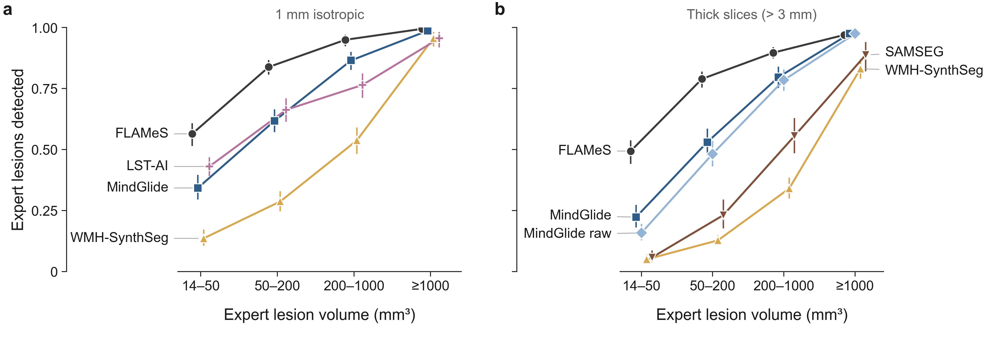

^1^ Universidad Nacional de Colombia. ^2^ SRH University München. ^3^ Daita AI. [TODO owner: department,
city and country for each affiliation, exactly as they should appear.] The author develops MSTool-AI,
investigational software for MRI in multiple sclerosis (see Conflict of interest).

**Target journal:** *NeuroImage: Clinical* (research article). **Alternative:** *Machine Learning for
Biomedical Imaging (MELBA)*, which publishes reproducibility-oriented benchmarks.

**Running title:** CPU lesion segmenters vs FLAMeS on thick-slice FLAIR

**Keywords:** multiple sclerosis; lesion segmentation; FLAIR; slice thickness; benchmark;
pre-registration; MindGlide; SAMSEG; WMH-SynthSeg; LST-AI; FLAMeS; nnU-Net

## Highlights

- Pre-registered benchmark on 324 public MS scans, 179 with 3.9–8.3 mm FLAIR slices.
- FLAMeS had higher lesion-wise F1 than MindGlide, SAMSEG and WMH-SynthSeg.
- SAMSEG and WMH-SynthSeg had fewer false lesions but missed most small lesions.
- FLAMeS, trained only on voxels of 1.25 mm or less, led on 3.9–8.3 mm FLAIR.
- Every number traces to committed files; incremental CPU cost was 12.55 USD.

## Abstract

**Background.** Clinical archives hold many 2D FLAIR scans with 4–8 mm slices, but most multiple
sclerosis (MS) lesion segmenters are developed on 1 mm 3D FLAIR. Public CPU tools designed for
heterogeneous resolution have not been compared with a FLAIR-only nnU-Net ensemble (FLAMeS) on such
scans.

**Methods.** Two-sided paired comparisons and a reading rule for "outperforms" were registered in a
public repository (2026-10-21, commit 65a95e3) before any tool output existed. Five public cohorts
with expert masks: 179 thick-slice scans (3.9–8.3 mm; 160 patients) and 145 scans on a 1 mm grid
(105 patients). MindGlide, WMH-SynthSeg and SAMSEG ran with default settings on CPU on the
skull-stripped FLAIR used by the FLAMeS 5-fold ensemble; existing LST-AI maps were added on the 1 mm
grid. Co-primary outcomes: lesion-wise F1 and false lesions per scan; cohort-stratified
patient-cluster bootstrap with Holm correction.

**Results.** On thick slices FLAMeS had a higher lesion-wise F1 (0.724) than every tool: ΔF1 −0.170
(95% CI −0.206 to −0.136) for MindGlide, −0.237 (−0.304 to −0.173) for SAMSEG (129 scans) and −0.384
(−0.424 to −0.344) for WMH-SynthSeg (all p~Holm~ < 0.002). SAMSEG and WMH-SynthSeg had 5.15 and 3.88
fewer false lesions per scan (p~Holm~ < 0.002) but detected only 6% and 5% of expert lesions of
14–50 mm³ (FLAMeS 49%); MindGlide's false-lesion difference was not significant (+0.57, −0.89 to
+2.21). No tool met the pre-specified rule for outperforming FLAMeS, and none was equivalent. On the
1 mm grid FLAMeS also led (LST-AI −0.180, −0.212 to −0.150). Incremental compute cost: 12.55 USD.

**Conclusions.** In pre-registered paired comparisons on real thick-slice FLAIR, FLAMeS had a higher
lesion-wise F1 than every public CPU tool tested, and none met the pre-specified criterion for
outperforming it. Fewer false lesions from conservative tools came at a large cost in sensitivity.
No clinical utility is claimed.

# 1. Introduction

T2-weighted fluid-attenuated inversion recovery (FLAIR) lesions are central to the diagnosis and
monitoring of multiple sclerosis (MS) [@thompson2018mcdonald; @filippi2019lesions]. The 2021
MAGNIMS–CMSC–NAIMS recommendations make 3D FLAIR the core brain sequence and accept high-quality 2D
acquisitions with slices of at most 3 mm and no gap as an alternative [@wattjes2021magnims]. Many clinical archives predate or do not follow these recommendations: the three public clinical
cohorts used here, for example, contain axial 2D FLAIR with 3.9–8.3 mm between slice centres. The
developers of recent segmentation tools note that high-resolution 3D scans are still not always
acquired in routine practice [@dereskewicz2025flames] and have built tools to reuse such archives
[@goebl2025mindglide]. Slice thickness affects both how many MS
lesions are detected and how their volume is measured [@molyneux1998thickness]. Partial-volume
averaging across thick slices blurs small lesions into the surrounding tissue, so tools trained on
1 mm data meet both a resolution shift and a change in lesion appearance.

Most automated MS lesion segmenters were developed and challenged on 3D or near-isotropic research
data, such as the ISBI-2015 and MSSEG-2016 challenges [@carass2017isbi; @commowick2018msseg;
@commowick2021msseg]; their clinical integration and the evidence for commercial tools have been
reviewed [@spagnolo2023clinical; @mendelsohn2023commercial], and distribution shift between sites is
a recognised challenge [@malinin2022shifts]. Three families of public tools address
heterogeneous resolution explicitly. Domain-randomised networks are trained on synthetic images of
random contrast and resolution: SynthSeg and SynthSR for anatomy [@billot2023synthseg;
@iglesias2023synthsr], WMH-SynthSeg for white-matter hyperintensities [@laso2024wmhsynthseg], and
MindGlide, which was trained on real archive scans plus synthetic scans with resolutions of 1–9 mm
[@goebl2025mindglide]. Generative, contrast-adaptive models such as SAMSEG fit an atlas and a lesion
shape model to each scan [@cerri2021samseg]. Supervised ensembles such as LST-AI (FLAIR plus T1)
[@wiltgen2024lstai] and FLAMeS (FLAIR only; nnU-Net [@isensee2021nnunet]) are trained on labelled real
scans [@dereskewicz2025flames]. All of them run on a CPU, which matters in hospitals without graphics processors.

Our prior expectation, which was not part of the protocol, was that a tool built for heterogeneous
resolution might do better on thick slices than a model trained on high-resolution data. To our
knowledge this has not been tested on real thick-slice 2D FLAIR with expert masks from several
sources. Tool comparisons are often run by a tool's developers, on data that may overlap with training
sets, with analysis choices made after the results are seen [@varoquaux2022failures;
@kapoor2023leakage]. Pre-registration fixes the questions, metrics and tests before outcomes exist, so that a result is
informative whichever way it falls [@nosek2018prereg].

We therefore pre-registered a paired benchmark of three public CPU tools — MindGlide, WMH-SynthSeg and
SAMSEG — against the FLAMeS 5-fold ensemble on 179 real thick-slice FLAIR scans from three public
cohorts, with LST-AI added on scans with a 1 mm grid. The primary question was two-sided: does any tool
achieve a different lesion-wise F1, or a different number of false lesions per scan, than FLAMeS on
thick slices? A pre-stated reading rule defined when a tool "outperforms" FLAMeS. Secondary questions
were the same comparison on the 1 mm grid, a between-band contrast of each tool's difference from
FLAMeS (registered as a "degradation contrast"), and whether giving MindGlide the non-skull-stripped
FLAIR it was designed for changes its results. An exploratory question asked whether disagreement
with a second tool flags scans on which FLAMeS performs poorly. FLAMeS had the higher lesion-wise F1
in every primary comparison, and no tool met the reading rule.

# 2. Methods

## 2.1 Design, pre-registration and reporting

This is a retrospective, paired, multi-cohort benchmark on public de-identified data. The protocol
(version 1.0, 2026-10-21), the metric code (`research/paper_f/metrics.py`), the evaluation code
(`research/paper_f/evaluate.py`) and the frozen list of input files with their SHA-256 hashes
(`research/paper_f/flames_inputs.json`) were recorded in commit
`65a95e310168071703398aab3a53ba9fc0086e1a` (2026-10-21 20:45 UTC). The branch containing it was first
pushed to the public GitHub repository `nicolasbonilla/medical-imaging-viewer` at 2026-10-21 20:58 UTC
(GitHub repository activity log), 40 minutes before the first tool container started (21:39 UTC; the
first virtual machine had been created at 21:31 UTC). The
SHA-256 of the protocol file as stored at that commit is
`587ba9ffc1f07d559a0008728e97ec9e1e9455eaf0037e37bbcc52b8f5f284e2`. Every later change was logged with
its date, reason and what had been seen (Section 2.10, Table 6). The pre-registration is time-stamped by git and GitHub; it was not lodged with an independent
registry, and the public visibility of the branch on 2026-10-21 rests on GitHub's activity log [TODO
owner: archive the protocol as of commit 65a95e3 on OSF or Zenodo with a DOI, and cite it as a
retrospective archive of a time-stamped protocol]. The protocol registered two-sided questions and a
reading rule; it stated no directional hypothesis. Reporting was guided by the CLAIM 2024 checklist
[@tejani2024claim] [TODO owner: complete and attach the checklist]. The final analysis ran once on the
full outputs from commit `7a9a24e8fa92c83ded210854fd8614f7be4dcd50` (2026-10-29 00:11 UTC; pushed
00:01 UTC), which records the SHA-256 of all 3,059 input files read; an earlier, unplanned interim
analysis is described in Section 2.10.

**Roles in the research process, including an AI coding agent.** The author chose the research
question and set the constraints (CPU only, a budget cap, no clinical claims). An AI coding agent
(Claude Opus 5.5, Anthropic, used through Claude Code) drafted the protocol and the runbook, wrote all
analysis and cloud-job code and its tests, and ran the analyses. Acting as the run coordinator, the
agent also took run-time decisions: it applied the runbook's memory rule that led to the WMH-SynthSeg
`--crop` deviation and applied the pre-stated budget rule that selected the SAMSEG scan set (Table 6).
It verified the references and wrote the first draft of this manuscript. All 13 commits of the study
branch carry a `Co-Authored-By` trailer naming the agent. [Owner to confirm: whether the author
reviewed and approved the protocol and each amendment before the runs, and who launched each cloud
run. The repository holds no record of these approvals, and this manuscript does not assert them.]

## 2.2 Cohorts

Five public cohorts with expert lesion masks were fixed in the protocol (Table 1): 324 scans of 265
patients. The inputs were the exact FLAIR files on which the FLAMeS maps had been computed; masks were
on the same grid.

**1 mm-grid band ("iso"; 145 scans, 105 patients).** MSLesSeg, the dataset of the ICPR 2024
challenge [@guarnera2025mslesseg; @guarnera2025mslessegdata; @rondinella2025icpr], provides 115
longitudinal scans of 75 patients (1.5 T, Catania) as skull-stripped images on a 1 mm MNI grid; masks
were drawn by one rater and validated by a neuroradiologist and a neurologist. Its native FLAIR is not
1 mm: the data paper reports a mean slice thickness of 2.61 mm (SD 0.62), and the images were
registered with FLIRT to the 1 mm MNI152 template [@guarnera2025mslesseg]. Ljubljana
[@lesjak2018ljubljana] provides 30 patients scanned with near-isotropic 3D FLAIR at 3 T (0.47 × 0.47 ×
0.8–0.9 mm voxels), with a multi-rater consensus mask, also used on the 1 mm MNI grid. As the protocol
(Section 6) anticipated, "iso" therefore describes the grid the tools received, not the acquisition:
115 of its 125 FLAMeS comparison scans were acquired with slices of about 2.6 mm.

**Thick band (> 3 mm; 179 scans, 160 patients).** MS3SEG [@bawil2026ms3seg; @bawil2026ms3segdata]:
100 patients, one 1.5 T Toshiba scanner, axial 2D FLAIR, 0.898 × 0.898 mm in plane, 6.0–8.1 mm slice
spacing (median 7.2 mm). Its MS-lesion mask excludes periventricular hyperintensities that the
annotators judged not to be MS lesions. Muslim et al. [@muslim2022dib; @muslim2022data]: 51 axial
scans (of 60; 9 coronal or sagittal scans were excluded by a pre-stated rule), 1.5 T, about 20
centres, 4.86–8.3 mm slice spacing (median 6.0 mm). The files carry no geometry, so the in-plane pixel
size (0.41–0.97 mm) was estimated from head dimensions calibrated on MS3SEG (expected error about ±5%
per axis); left and right cannot be recovered. PediMS [@popa2025pedims; @popa2025pedimsdata]: 28
longitudinal scans of 9 children, 3 T Siemens Skyra, 0.75 × 0.75 × 3.9 mm; one child has Baló's
concentric sclerosis.

Skull stripping: MSLesSeg and Ljubljana were distributed skull-stripped; PediMS ships SynthStrip
brains [@hoopes2022synthstrip]; MS3SEG and Muslim (151 of the 179 thick scans) were stripped with
HD-BET 2.0.1 on CPU without test-time augmentation [@isensee2019hdbet], whose model parameters are
licensed for non-commercial use only (CC BY-NC 4.0; Table 7). Bands were defined by the largest voxel dimension of the
grid the tools received: iso ≤ 1.5 mm and thick > 3 mm, with exploratory sub-bands 3–5.5 mm (PediMS
and 24 Muslim scans) and > 5.5 mm (MS3SEG and 27 Muslim scans).

**Table 1.** Cohorts. Slice spacing from the headers of the files the tools received
(`data/extra_numbers.json`); expert lesions counted after the 14.1 mm³ size filter.

| Cohort (licence) | Scans / patients | Field, acquisition | Grid given to the tools | Skull stripping | Reference standard |
|---|---|---|---|---|---|
| MSLesSeg (CC BY 4.0) | 115 / 75 | 1.5 T, one city, longitudinal; native slices ~2.6 mm | MNI 1 mm (resampled) | provided | one rater, validated by neuroradiologist and neurologist |
| Ljubljana (CC BY-NC-ND per the lab; CC BY per the mirror) | 30 / 30 | 3 T Siemens, 3D FLAIR | MNI 1 mm | provided | three-rater consensus |
| MS3SEG (CC BY 4.0) | 100 / 100 | 1.5 T Toshiba, axial 2D | 0.898² × 6.0–8.1 mm | HD-BET 2.0.1 | junior annotator and senior neuroradiologist; "normal" WMH excluded |
| Muslim et al. (CC BY 4.0) | 51 / 51 | 1.5 T, ~20 centres, axial 2D | 0.41–0.97² (estimated) × 4.86–8.3 mm | HD-BET 2.0.1 | resident → consultant radiologist → neurologist |
| PediMS (CC BY 4.0) | 28 / 9 | 3 T Siemens, 2D, children | 0.75² × 3.9 mm | SynthStrip (dataset) | one rater, validated by paediatric neurologist and radiologist |

In the isotropic band the FLAMeS comparison set contained 3,463 expert lesions, 1,209 (34.9%) of them
14–50 mm³; in the thick band 5,993 expert lesions, 1,248 (20.8%) of them 14–50 mm³. No scan had an
empty reference.

## 2.3 Tools

Table 2 lists the tools; full container digests and weight hashes are in Appendix Table A1.
**FLAMeS** is an nnU-Net v2 [@isensee2021nnunet] FLAIR-only model released as five cross-validation
folds (Zenodo 17955359, version 2.0, CC BY 4.0) [@larosa2025flameszenodo; @dereskewicz2025flames;
@dereskewicz2025flamespreprint; @jon2025flamescorrection]. Its maps had been computed for earlier
studies on the same inputs (4 vCPU, tile step 0.5 with Gaussian weighting, PyTorch 2.14.1 CPU build;
nnU-Net package version frozen in the job's lock file but not recorded in the run manifests [TODO
owner: read it from the lock file]); the prediction was the mean of the five fold probabilities
thresholded at 0.5. Test-time mirroring, nnU-Net's default, was switched off to save CPU time, whereas
the comparators ran at their defaults; mirroring usually helps slightly, so this choice is unlikely to
have favoured FLAMeS. **LST-AI** 1.2.0 (three U-Nets, FLAIR + T1) [@wiltgen2024lstai]
had been run on the 1 mm cohorts only (144 scans; one MSLesSeg scan has a blank T1); its ensemble
probability was thresholded at 0.5, LST-AI's own binarisation. **MindGlide** 1.3.0
[@goebl2025mindglide] returns a label map on the input grid (lesion = label 18). **WMH-SynthSeg**
[@laso2024wmhsynthseg] and **SAMSEG** with its lesion model [@cerri2021samseg] were run from
FreeSurfer 8.2.0 [@fischl2012freesurfer] (labels 77 and 99). LST-AI was not run on the thick cohorts
because it needs a co-registered T1 that was not prepared; tools needing a GPU, MATLAB or per-site
training were excluded in the protocol.

**Table 2.** Tools, training data and overlap with the five cohorts.

| Tool | Version | Input; lesion output | Training data (as published) | Overlap with our cohorts |
|---|---|---|---|---|
| FLAMeS (reference) | weights v2.0 (2025-12-16), nnU-Net v2, 5 folds | FLAIR; mean fold probability > 0.5 | 668 FLAIR scans of 575 people with MS from seven sites, including ISBI-2015 (20 scans), MSSEG-2016 (53) and Ljubljana (20); every voxel dimension in the released fingerprint ≤ 1.25 mm | 20 Ljubljana scans in training → excluded from every FLAMeS comparison; MSLesSeg was one of its external test sets |
| LST-AI | 1.2.0 (Docker digest, Table A1) | FLAIR + T1; probability > 0.5 | 491 in-house 3D FLAIR + T1 scans, one centre | none; Ljubljana was one of its published test sets |
| MindGlide | 1.3.0 (container and weights hash, Table A1) | FLAIR; label 18 | 4,247 real scans from clinical-trial and academic archives + 4,303 synthetic scans of random 1–9 mm resolution; labels from an automated method | none; Ljubljana and ISBI-2015 in its external test |
| WMH-SynthSeg | FreeSurfer 8.2.0; model v10 (231110) | FLAIR; label 77 (WMH) | synthetic images generated from label maps (including ISBI-2015 and MSSEG-2016), random slice spacing 2.5–8.5 mm | none |
| SAMSEG `--lesion` | FreeSurfer 8.2.0 | FLAIR; label 99 | atlas from 20 subjects; lesion shape model from 212 MS subjects | none |

**Training overlap with FLAMeS** (details in Appendix B). FLAMeS was trained on 20 of the 30 Ljubljana
scans; we identified them exactly from the dataset fingerprint shipped with the weights (patients
01–15 and 21–25) and excluded them from every comparison with FLAMeS (they appear only in sensitivity
analysis S5). MSLesSeg was not a FLAMeS training source but one of its external test sets, and no
FLAMeS training case has a voxel dimension above 1.25 mm, so no thick-slice scan was a training case
at its own geometry.

## 2.4 Processing

Every tool received the byte-identical skull-stripped FLAIR used for FLAMeS (SHA-256 checked on each
machine against the frozen list; no mismatch occurred), with default settings and only the flags
below, on 4 vCPUs, inside containers pinned by digest and run without network access. MindGlide:
`--device cpu`. WMH-SynthSeg: `mri_WMHsynthseg --device cpu --threads 4 --save_lesion_probabilities`.
SAMSEG: `run_samseg --lesion --lesion-mask-pattern 1 --pallidum-separate --threads 4 --random-seed
12345 --save-posteriors Lesions`. MindGlide and SAMSEG return the input grid (identity transfer).
WMH-SynthSeg returns a 1 mm grid; for thick scans each FLAMeS voxel received the mean lesion fraction
over its footprint (sampled at ⌈edge length in source voxels⌉ points per axis) and was labelled lesion
when the fraction was ≥ 0.5 (179 scans); 1 mm outputs were mapped trilinearly (145 scans). This
majority rule, fixed in the protocol, is the only resampling applied to any tool's output; because it
can remove thin lesions from a thick voxel, a post hoc sensitivity analysis uses WMH-SynthSeg's saved
lesion probabilities instead (Section 3.4). A run that failed or exceeded 45 minutes was to be scored
as an empty prediction; no scan ended that way.

## 2.5 Outcomes

Definitions were fixed in code before any output existed. A lesion is a 3D connected component with
26-connectivity on the FLAMeS grid. Components smaller than 14.137 mm³ (a sphere of 3 mm diameter)
were removed from prediction and reference before matching. A predicted component is a true positive
if it overlaps any reference component by at least one voxel; a reference lesion is detected if any
predicted component overlaps it. Lesion-wise precision = matched predicted / predicted; recall
(sensitivity) = detected reference / reference; F1 = 2PR/(P+R), set to 0 when nothing is predicted.
**Co-primary outcomes:** lesion-wise F1 and false lesions per scan (predicted components touching no
reference lesion). **Secondary outcomes:** voxel-wise Dice on the unfiltered masks [@dice1945],
lesion-wise precision and recall, detection by reference lesion size (14–50, 50–200, 200–1000 and
≥ 1000 mm³), predicted and reference lesion volume, failure rate, CPU time and peak memory. The choice
of instance-level metrics is consistent with current recommendations for detection-type tasks
[@maierhein2024metrics].

## 2.6 Statistical analysis

For every comparison we computed per-scan differences (tool − FLAMeS) on scans where both outputs
were usable and neither was contaminated. The estimate was the mean over cohorts of the per-cohort
mean difference (each cohort counts once). Uncertainty came from a patient-cluster bootstrap
stratified by cohort [@field2007clustered; @efron1993bootstrap]: patients were resampled with
replacement within each cohort, 10,000 replicates, seed 20261021, percentile 95% intervals. The
two-sided bootstrap p was twice the smaller tail proportion of replicates at or beyond zero. When no
replicate fell on the other side of zero, p is below the resolution of the bootstrap (2/10,000); we
report such Holm-adjusted values as p~Holm~ < 0.002 (families of 4 or 6 tests) or < 0.003 (family of
11), rather than the "< 0.0001" printed by the analysis tables. With 10,000 replicates the Monte Carlo
standard error of a bootstrap p near 0.45 is about 0.008, so other p-values are given to two
significant figures. Equivalence was declared when the 90% interval lay inside ±0.05 F1 or ±1 false
lesion per scan, the interval form of two one-sided tests [@schuirmann1987tost]. The protocol did not
justify these margins; for scale, 0.05 is 6.9% of FLAMeS's thick-band F1 and one false lesion is 14% of
its 6.9 false lesions per scan.

**Primary family (6 tests, Holm [@holm1979], α = 0.05):** ΔF1 and Δ false lesions per scan for
MindGlide, WMH-SynthSeg and SAMSEG vs FLAMeS on the thick band. **Reading rule:** a tool
*outperforms* FLAMeS only if p~Holm~ < 0.05 with ΔF1 > 0 and Δ false lesions not worse than +1 per
scan, or p~Holm~ < 0.05 with fewer false lesions and ΔF1 not below −0.05. **Secondary family (11 tests, Holm):** the same two outcomes on the iso band for the three tools and
LST-AI (8 tests), and, for the three tools, the contrast registered as the "degradation contrast": the
tool's paired ΔF1 on the thick band minus its paired ΔF1 on the iso band (3 tests). The two bands share
no patient, so their bootstraps are independent; the contrast compares different cohorts, acquired
differently, and is therefore not a measure of slice thickness alone. **Raw-input arm (4 tests, Holm;
registered before any full-run output was examined, Section 2.10):** MindGlide on the FLAIR before
skull stripping vs FLAMeS, and vs MindGlide on the stripped FLAIR, on the thick band. Tests that could
not be run are reported as "not run" and enter the Holm procedure over the registered family size as
p = 1 (protocol Sections 4.4 and 12); a tool not run on a cell is never imputed.

**Sensitivity analyses (primary family, no adjustment):** S1 no size filter; S2 3 mm³ filter; S3
in-plane 8-connectivity (components do not join across thick slices); S4 complete cases; S5 iso
comparisons including the 20 FLAMeS training scans; S6 thick band without Muslim; S7 scan-weighted
estimate. **Exploratory (labelled as such):** E1, the area under the ROC curve [@hanley1982auc] of
tool–FLAMeS disagreement (1 − lesion-wise F1 between the two outputs) for identifying scans with
FLAMeS lesion-wise F1 < 0.5; E2, keeping only FLAMeS lesions that the tool also marks.
**Post hoc additions** (not in the protocol; labelled wherever used; scripts
`compute_extra_numbers.py`, `wmh_resampling_posthoc.py`, `fingerprint_check.py`): an interval, a
cohort-stratified version and FLAMeS-only baselines for E1; precision, recall and Dice per band;
paired-set, per-cohort and scan-pooled (micro-averaged) analyses; the WMH-SynthSeg resampling analysis,
whose variants were fixed before any was computed; and the fingerprint check of Section 2.3.

**Precision and weighting.** With a per-scan SD of 0.15 for ΔF1, the protocol anticipated a 95%
half-width of about ±0.04 F1 on the thick band. Because each cohort counts once, the 9 PediMS children
weigh as much as the 100 MS3SEG patients, and on the iso band the 10 FLAMeS-clean Ljubljana patients
carry half of every estimate against 115 MSLesSeg scans. Software: Python 3.11.4 and NumPy 1.26.4.

## 2.7 SAMSEG analysis set: pre-stated budget tiers

The protocol fixed a run order (cheapest tool first) and budget tiers that depended only on measured
runtime, never on accuracy, so that the projected total spend stayed ≤ 15 USD: tier A all 324 scans,
tier B the 179 thick scans, tier C a fixed thick subsample of 129 scans (all PediMS, all Muslim and the
50 odd-numbered MS3SEG scans). Applied after the other tools had run, with the real spend so far, the
rule selected tier C (projected total 13.76 USD). SAMSEG comparisons are therefore paired on 129 thick
scans of 110 patients, and the three SAMSEG tests of the secondary family were not run.

## 2.8 Compute environment and cost

All tool runs used Google Cloud virtual machines with 4 vCPUs (n2d-standard-4, n2-standard-4,
e2-standard-4; n2d-highmem-4 with 32 GB for WMH-SynthSeg) in region us-central1. Costs are list prices
recorded per run in a compute ledger (snapshot `data/compute_ledger_c8b4239.csv`). The study's own runs used 14 virtual machines, 61.90 machine-hours and 12.55 USD (incremental cost;
Table 5). The FLAMeS, HD-BET and LST-AI maps came from earlier runs on the same inputs; including them,
the total is 101.97 machine-hours and 19.84 USD at list price (list prices are not yet reconciled with
billing).

## 2.9 Integrity checks and blinding

Before the analysis, a script checked every planned output against the run manifests (presence,
SHA-256, failures; `results/verify_runs.json`). A structural check (`evaluate.py check`) then confirmed
that every mask lay on the exact FLAMeS grid and was binary. That check also computes, for every
output, the Dice, lesion-wise F1 and predicted volume against the expert mask, and flags a Dice below
0.1 as a probable label or orientation error (`results/structural_check_wmhsynthseg.json` and
`results/structural_check_samseg.json`; `results/RESULTS.md` quotes median Dice values from them). For
WMH-SynthSeg and SAMSEG it was run on 2026-10-29 at 00:01:59 UTC, 21 s after the decisions of that date
were pushed (00:01:38 UTC) and nine minutes before the final analysis (00:11 UTC). The repository does not prove
this order: the timestamp comes from the agent's session log, which is kept outside the repository,
and the check's output files carry no time stamp [TODO owner: decide whether to archive the relevant
session-log excerpt]. Otherwise, for each tool the only accuracy numbers looked at before its full run
were pilot plausibility checks on three scans; the interim analysis of Section 2.10 is the exception.

## 2.10 Deviations from the protocol

All deviations are listed in Table 6 (times in UTC). In short: a secondary arm with MindGlide on the
raw FLAIR was registered before any full-run output was examined (the MindGlide full-run machines had
started about ten minutes earlier, so some outputs probably existed); WMH-SynthSeg ran without the
pre-stated `--crop` memory fallback (one out-of-memory scan was re-run with it); the budget rule gave
SAMSEG tier C; Holm was applied over the registered family size with tests not run entered as p = 1;
and an interim analysis of MindGlide and LST-AI was run on 2026-10-22, although the protocol stated
that the analysis would run once on the full outputs. The interim included the exploratory E1 AUROC of
0.78, which the product-planning note (`docs/research/paper-f/APP-FEATURE.md`) then read as meeting
its criterion for a "second-opinion" feature. That interim look was not logged as a deviation at the
time; it was identified while writing this report. No outcome definition, band, threshold or test
changed.

# 3. Results

## 3.1 Completeness

All planned outputs were present — WMH-SynthSeg 324/324, MindGlide 324/324, MindGlide on raw input
179/179 and SAMSEG 129/129 — and all but one matched the hash recorded on the machine (Table A2). One WMH-SynthSeg run
(muslim_16) stopped for lack of memory and was re-run with `--crop`, as pre-stated. The three MindGlide pilot scans failed in the first pilot runs because the container could not write
to its output folder, and were re-run after the fix. One SAMSEG
output (ms3seg_001, pilot) has no manifest record because the pilot's manifest write crashed; the file
was verified by its lesion-voxel count (1,129) and kept. No scan was scored as a failure, no input
hash mismatched, and every mask passed the structural check. SAMSEG predicted no lesion after the size
filter in 3 of 129 scans; every other tool predicted at least one lesion in every scan.

## 3.2 Primary comparisons: thick-slice FLAIR

FLAMeS had a cohort-weighted lesion-wise F1 of 0.724 (95% CI 0.702–0.745) and 6.9 false lesions per
scan on the 179 thick scans (Table 4). All three CPU tools had a lower lesion-wise F1 than FLAMeS
(Table 3, Figure 1): MindGlide by 0.170 (95% CI 0.136–0.206), SAMSEG by 0.237 (0.173–0.304) and
WMH-SynthSeg by 0.384 (0.344–0.424); p~Holm~ < 0.002 for each. SAMSEG had 5.15 fewer false lesions per
scan (95% CI 3.91–6.30) and WMH-SynthSeg 3.88 fewer (2.27–5.21), both p~Holm~ < 0.002. For MindGlide
the difference in false lesions was +0.57 per scan (−0.89 to +2.21; p~Holm~ = 0.45): no difference was
shown and equivalence within ±1 was not shown either. Of the six primary tests, five rejected the null
hypothesis of no difference: the three F1 tests in favour of FLAMeS and the two false-lesion tests in
favour of SAMSEG and WMH-SynthSeg. Under the pre-stated reading rule no tool outperformed FLAMeS,
because every ΔF1 was far below −0.05, and no tool was equivalent to FLAMeS. On the 129 SAMSEG scans,
FLAMeS had F1 0.729 and 6.97 false lesions per scan, against 0.492 and 1.82 for SAMSEG. The direction
held in every cohort: on the thick cohorts the per-cohort ΔF1 ranged from −0.123 to −0.226 for
MindGlide, from −0.226 to −0.255 for SAMSEG and from −0.279 to −0.467 for WMH-SynthSeg, every 95%
interval excluding zero (post hoc; Table A3).

![**Figure 1.** Paired differences from FLAMeS (tool − FLAMeS) in lesion-wise F1 (a) and false lesions per scan (b); the estimate and its 95% CI are printed beside each row. Rows give scans / patients. Shaded bands are the pre-registered equivalence margins (±0.05 F1; ±1 false lesion per scan). Thin lines are 95% and thick, lighter lines 90% patient-cluster bootstrap intervals (the 90% interval is the equivalence criterion), from 10,000 replicates stratified by cohort. p-values are Holm-adjusted over the registered family size, with tests not run counted as p = 1; '< 0.002' and '< 0.003' mean that no replicate crossed zero. Each tool keeps one colour and marker in every figure; FLAMeS, the reference, is dark grey.](figures/fig1_forest_vs_flames.png)

**Table 3.** Pre-registered comparisons (difference = tool − reference; patient-cluster bootstrap
stratified by cohort; `results/comparisons.json`).

| Family | Comparison | Band | Scans / patients | ΔF1 (95% CI) | p~Holm~ | Δ false lesions / scan (95% CI) | p~Holm~ |
|---|---|---|---|---|---|---|---|
| Primary (6) | MindGlide − FLAMeS | thick | 179 / 160 | −0.170 (−0.206 to −0.136) | < 0.002 | +0.57 (−0.89 to +2.21) | 0.45 |
| Primary (6) | WMH-SynthSeg − FLAMeS | thick | 179 / 160 | −0.384 (−0.424 to −0.344) | < 0.002 | −3.88 (−5.21 to −2.27) | < 0.002 |
| Primary (6) | SAMSEG − FLAMeS | thick | 129 / 110 | −0.237 (−0.304 to −0.173) | < 0.002 | −5.15 (−6.30 to −3.91) | < 0.002 |
| Secondary (11) | MindGlide − FLAMeS | iso | 125 / 85 | −0.272 (−0.319 to −0.229) | < 0.003 | +3.07 (+1.78 to +4.32) | < 0.003 |
| Secondary (11) | WMH-SynthSeg − FLAMeS | iso | 125 / 85 | −0.363 (−0.429 to −0.297) | < 0.003 | −1.32 (−2.58 to −0.23) | 0.086 |
| Secondary (11) | LST-AI − FLAMeS | iso | 124 / 85 | −0.180 (−0.212 to −0.150) | < 0.003 | +3.79 (+2.53 to +4.95) | < 0.003 |
| Secondary (11) | SAMSEG − FLAMeS | iso | — | not run (tier C)^b^ | — | not run^b^ | — |
| Secondary (11) | Between-band contrast^c^, MindGlide | thick − iso | 304 / 245 | +0.102 (+0.047 to +0.160) | < 0.003 | — | — |
| Secondary (11) | Between-band contrast^c^, WMH-SynthSeg | thick − iso | 304 / 245 | −0.021 (−0.098 to +0.056) | 1.0 | — | — |
| Secondary (11) | Between-band contrast^c^, SAMSEG | thick − iso | — | not run^b^ | — | — | — |
| Raw arm (4) | MindGlide raw − FLAMeS | thick | 179 / 160 | −0.186 (−0.222 to −0.150) | < 0.002 | +0.38 (−0.94 to +1.88) | 0.99 |
| Raw arm (4) | MindGlide raw − MindGlide | thick | 179 / 160 | −0.016 (−0.028 to −0.004) | 0.037 | −0.19 (−0.75 to +0.32) | 0.99 |

^b^ Not run: SAMSEG was run only on its thick tier-C scans. A test not run enters Holm over the registered
family size as p = 1 (a conservative convention registered before any WMH-SynthSeg or SAMSEG accuracy
was computed); it changed one conclusion, the WMH-SynthSeg false-lesion test on the iso band (Holm over
the eight tests performed: 0.034). ^c^ Registered as the "degradation contrast": the tool's paired ΔF1
on the thick band minus that on the iso band; the bands are different cohorts (Section 3.5).

**Table 4.** Absolute performance per band (cohort-weighted mean, 95% CI). F1, false lesions and Dice
from `results/tables.md` (Table 2); precision and recall descriptive (`data/extra_numbers.json`). The
rows are not all on the same scans (see the notes); paired comparisons are in Table 3.

| Band | Tool | Scans | Lesion-wise F1 | False lesions / scan | Precision | Recall | Dice |
|---|---|---|---|---|---|---|---|
| iso | FLAMeS | 125 | 0.765 (0.727–0.798) | 3.8 (2.8–5.0) | 0.819 | 0.740 | 0.657 |
| iso | LST-AI | 144 | 0.620 (0.588–0.650) | 8.4 (7.2–9.8) | 0.690 | 0.589 | 0.520 |
| iso | MindGlide | 145 | 0.518 (0.490–0.543) | 6.3 (5.6–7.0) | 0.569 | 0.599 | 0.418 |
| iso | WMH-SynthSeg | 145 | 0.387 (0.354–0.419) | 2.3 (1.9–2.6) | 0.752 | 0.312 | 0.306 |
| thick | FLAMeS | 179 | 0.724 (0.702–0.745) | 6.9 (6.0–7.8) | 0.738 | 0.758 | 0.642 |
| thick | MindGlide | 179 | 0.554 (0.517–0.589) | 7.5 (6.7–8.5) | 0.600 | 0.593 | 0.493 |
| thick | MindGlide, raw input | 179 | 0.538 (0.503–0.572) | 7.3 (6.6–8.0) | 0.606 | 0.549 | 0.508 |
| thick | WMH-SynthSeg | 179 | 0.341 (0.308–0.373) | 3.0 (2.4–3.9) | 0.707 | 0.248 | 0.250 |
| thick | SAMSEG (tier C) | 129 | 0.492 (0.427–0.553) | 1.8 (1.4–2.3) | 0.837^a^ | 0.397 | 0.479 |

^a^ 126 scans; precision is undefined when no lesion is predicted. On the same tier-C scans FLAMeS's
precision was 0.743. Iso rows for the tools include all 30 Ljubljana scans; FLAMeS includes only the
10 it was not trained on.

## 3.3 Why the conservative tools had fewer false lesions

WMH-SynthSeg and SAMSEG marked much less lesion than the experts (Figure 2). On thick scans the mean
predicted lesion volume per cohort was 4.2–5.2 mL for WMH-SynthSeg and 6.8–9.7 mL for SAMSEG, against
expert volumes of 12.6–19.8 mL and FLAMeS volumes of 13.1–18.4 mL (`results/tables.md`, Table 1).
Their lesion-wise precision was higher than or similar to that of FLAMeS (SAMSEG 0.837 against 0.743
for FLAMeS on the same 129 scans; WMH-SynthSeg 0.707 against 0.738), but their recall was much lower
(0.397 and 0.248 vs 0.758). The deficit concentrated in small lesions (Figure 3): of the 1,248
expert lesions of 14–50 mm³ on thick scans, FLAMeS detected 0.49 (95% CI 0.44–0.54), MindGlide 0.22
(0.18–0.27), SAMSEG 0.06 (0.04–0.09; 935 lesions in its scans) and WMH-SynthSeg 0.05 (0.03–0.07). For
lesions ≥ 1000 mm³, FLAMeS and MindGlide both detected 0.97, SAMSEG 0.89 and WMH-SynthSeg 0.83. The fewer false lesions of these two tools thus reflect a more conservative operating point; they
are not evidence of a better trade-off, because sensitivity fell far more than false lesions did.

## 3.4 Sensitivity analyses

All six thick-band sensitivity analyses (S1–S4, S6, S7) kept the sign and the 95% interval of ΔF1
below zero for all three tools (range −0.153 to −0.194 for MindGlide, −0.212 to −0.244 for SAMSEG and −0.373 to −0.436
for WMH-SynthSeg; `results/tables.md`, Table 5). The fewer false lesions of WMH-SynthSeg (−3.66 to
−4.87) and SAMSEG (−5.00 to −8.25) persisted in every analysis. For MindGlide the false-lesion
difference depended on the lesion definition: it became significantly positive without a size filter
(S1, +2.42, 95% CI +0.10 to +5.06) and with in-plane components (S3, +8.09, +4.51 to +12.35), and stayed
inconclusive in the others (for example S7, scan-weighted, +0.85, −0.34 to +2.01). Excluding Muslim (S6), whose in-plane spacing is estimated, did not change any conclusion.

*Post hoc: scan-pooled F1.* Per-scan F1 is unstable when a scan has few lesions (4 thick scans have
fewer than 5 reference lesions, 3 of them 2 or fewer). Pooling lesions over scans (micro-averaged F1)
gave the same picture: tool minus FLAMeS −0.173 (95% CI −0.202 to −0.148) for MindGlide, −0.285
(−0.352 to −0.216) for SAMSEG and −0.429 (−0.465 to −0.391) for WMH-SynthSeg on the thick band.

*Post hoc: resampling of WMH-SynthSeg.* WMH-SynthSeg is the only tool whose output was resampled, by
the majority rule of Section 2.4. Re-scoring it from its own footprint-mean lesion probability
(Table A4) changed its F1 on the thick band from 0.341 (pre-registered mask) to 0.315, 0.413 and 0.469
at probability thresholds of 0.50, 0.25 and 0.10. Its predicted volume rose from 4.55 to 13.48 mL and
its detection of 14–50 mm³ lesions from 0.050 to 0.104. Even the most permissive variant stayed far
below FLAMeS (ΔF1 −0.256, 95% CI −0.309 to −0.208) and still had fewer false lesions (−5.69 per scan).
The resampling rule therefore explains part of WMH-SynthSeg's under-segmentation on thick slices, but
not its F1 deficit.

## 3.5 Secondary comparisons: the 1 mm grid and the between-band contrast

On the 1 mm-grid scans FLAMeS had F1 0.765 (0.727–0.798). It had a higher F1 than MindGlide (ΔF1 −0.272),
WMH-SynthSeg (−0.363) and LST-AI (−0.180), all p~Holm~ < 0.003 (Table 3). MindGlide (+3.07) and LST-AI
(+3.79) produced more false lesions than FLAMeS. WMH-SynthSeg produced 1.32 fewer (95% CI 0.23–2.58);
this was not significant after Holm correction over the registered family (p~Holm~ = 0.086), although
Holm over only the eight tests performed would have given 0.034. The registered rule governs.
Including the 20 Ljubljana scans used in FLAMeS training (S5) gave the same conclusions (ΔF1 −0.258,
−0.389 and −0.156 for MindGlide, WMH-SynthSeg and LST-AI). Because each cohort counts once, the 10
Ljubljana patients carry half of each iso estimate; per cohort, WMH-SynthSeg's ΔF1 was −0.286 on
MSLesSeg (115 scans) and −0.440 on Ljubljana (10 scans), and MindGlide's −0.227 and −0.318 (post hoc;
Table A3).

FLAMeS F1 was 0.765 in the iso band and 0.724 in the thick band. MindGlide's F1 was higher in the
thick band: 0.554, against 0.518 on all 145 iso scans and 0.492 on the 125 iso scans paired with
FLAMeS (Figure 4a). In the registered between-band contrast, MindGlide's deficit relative to FLAMeS was
0.102 smaller in the thick cohorts than in the iso cohorts (95% CI 0.047–0.160; p~Holm~ < 0.003). This
is statistically significant but cannot be read as smaller degradation with slice thickness: it arises
because FLAMeS's F1 was lower and MindGlide's higher in the thick cohorts, and a tool whose accuracy
rises when slices get thicker points to differences between cohorts, not to an effect of thickness.
One such difference is MindGlide's over-segmentation on MSLesSeg (28.4 mL predicted vs 11.8 mL expert;
`results/tables.md`, Table 1). For WMH-SynthSeg no difference was shown (−0.021, −0.098 to +0.056;
p~Holm~ = 1.0). The three SAMSEG tests were not run. The iso and thick bands differ in site, scanner,
population, annotation protocol and native acquisition (Section 4.3), not only in slice thickness.

![**Figure 4.** (a) Lesion-wise F1 per band: each dot is one scan; the marker gives the cohort-weighted mean with its 95% CI (open: 1 mm; filled: > 3 mm). FLAMeS is shown without the 20 Ljubljana scans used in its training. (b) Paired difference from FLAMeS in each band (95% CI); the slope of each line is the degradation contrast, printed at right with its 95% CI and Holm-adjusted p for the registered tests (SAMSEG: not run, because tier C is thick-only). The two bands are different cohorts, so the contrast is confounded with site.](figures/fig4_degradation_1mm_to_thick.png)

## 3.6 MindGlide on the raw FLAIR

Giving MindGlide the FLAIR before skull stripping, as its documentation recommends, did not help.
Against FLAMeS, raw-input MindGlide had ΔF1 −0.186 (−0.222 to −0.150; p~Holm~ < 0.002) and +0.38 false
lesions per scan (−0.94 to +1.88; p~Holm~ = 0.99). Against MindGlide on the stripped input it had
ΔF1 −0.016 (−0.028 to −0.004; p~Holm~ = 0.037) and −0.19 false lesions (−0.75 to +0.32); both
differences were within the equivalence margins, so the two inputs were equivalent.

## 3.7 Exploratory: disagreement as a "second opinion", and a FLAMeS-only baseline

On thick scans, FLAMeS had a lesion-wise F1 below 0.5 in 14 of 179 scans (10 Muslim, 4 MS3SEG,
0 PediMS). Disagreement between MindGlide and FLAMeS identified these scans with an AUROC of 0.779;
post hoc, its 95% bootstrap interval was 0.597–0.925 and the cohort-stratified AUROC was 0.819.
Disagreement with WMH-SynthSeg (0.593; post hoc CI 0.385–0.787) or SAMSEG (0.488; 11 poor scans of
129) did not. On the 1 mm grid only 2 scans were poor, so the AUROCs there (MindGlide 0.813, LST-AI 0.803,
WMH-SynthSeg 0.520) carry little information. Keeping only the FLAMeS lesions that a second tool also
marked removed false lesions but always cost F1: with MindGlide on thick scans, −3.8 false lesions per
scan (95% CI −4.7 to −2.8) and ΔF1 −0.074 (−0.111 to −0.040).

A score computed from the FLAMeS output alone did better than disagreement (post hoc, same 179 scans).
Ranking scans by how few lesions FLAMeS predicted identified the poor scans with an AUROC of 0.932
(95% CI 0.861–0.987; cohort-stratified 0.956); ranking by smaller FLAMeS lesion volume gave 0.840.
Combining the lesion count with MindGlide disagreement (sum of ranks) gave 0.884, lower than the count
alone, and the cohort label alone (Muslim et al. or not) gave 0.733. The poor-scan label is itself
fragile: three of the four poor MS3SEG scans had only 1–4 reference lesions. In these data, therefore,
disagreement with MindGlide added nothing to what FLAMeS's own lesion count already showed.

## 3.8 Runtime and cost

Median times per scan on 4 vCPUs were 77–84 s for MindGlide (n2d-standard-4 and n2-standard-4; peak
memory ≤ 5.91 GB), 253–286 s for MindGlide on raw input (e2-standard-4, an older and slower machine
type; peak 13.3 GB), 216 s for WMH-SynthSeg (n2d-highmem-4; peak 31.3 GB plus up to 14.4 GB of swap)
and 470–524 s per run for SAMSEG on thick scans (n2d-standard-4 and n2-standard-4; peak ≤ 7.1 GB,
pilot included); all met the pre-stated CPU rule of ≤ 15 minutes per scan. For comparison, FLAMeS took
67.5–69.1 s per fold and scan on the same two machine types (about 5.7 minutes for the five folds
without test-time mirroring). Processor families differed (AMD Milan, Intel Cascade Lake, Intel Broadwell), so runtimes are
indicative. Table 5 gives the cost.

**Table 5.** Compute for this study (list prices; `data/compute_ledger_c8b4239.csv`).

| Component | Runs | Machine-hours | USD |
|---|---|---|---|
| Pilots (MindGlide, FreeSurfer tools) | 5 | 1.54 | 0.30 |
| MindGlide, primary arm (324 scans) | 2 | 6.78 | 1.32 |
| MindGlide, raw-input arm (179 scans) | 2 | 13.07 | 1.93 |
| WMH-SynthSeg (324 scans, incl. one `--crop` re-run) | 2 | 22.65 | 5.63 |
| SAMSEG, tier C (127 scans + 2 from pilots) | 3 | 17.86 | 3.37 |
| **Total, this study** | **14** | **61.90** | **12.55** |
| Earlier runs reused: FLAMeS maps, 1 mm cohorts | 3 | 14.24 | 2.62 |
| Earlier runs reused: HD-BET + FLAMeS maps, thick cohorts | 2 | 21.79 | 3.83 |
| Earlier runs reused: LST-AI maps | 1 | 4.05 | 0.84 |
| **Total including reused runs** | **20** | **101.97** | **19.84** |

With the real per-scan cost of SAMSEG, tier B (all 179 thick scans) would have fitted under the cap
(about 13.9 USD in total) but tier A would not (about 17.8 USD) (`results/RESULTS.md`, Section 5).

# 4. Discussion

## 4.1 What the comparisons show

The registered questions were two-sided, and the answer is clear. On real thick-slice FLAIR, FLAMeS
had a significantly higher lesion-wise F1 than each public CPU tool; SAMSEG and WMH-SynthSeg had
significantly fewer false lesions; MindGlide's false-lesion count did not differ detectably. No tool
met the reading rule for outperforming FLAMeS, and none was equivalent to it. The F1 deficits (0.17–0.38
F1) are several times the ±0.04 precision the protocol anticipated, every 95% interval lay below the
margin of −0.05, and every cohort showed the same direction, although FLAMeS's training data, as
recorded in its released fingerprint, contained no voxel dimension larger than 1.25 mm. The data do not
say that these tools are poor for their intended purposes: WMH-SynthSeg targets white-matter
hyperintensities of any cause in heterogeneous and low-field scans [@laso2024wmhsynthseg], SAMSEG
provides whole-brain anatomy with lesions [@cerri2021samseg], and MindGlide extracts brain and lesion
volumes from clinical archives for research [@goebl2025mindglide]. Lesion-by-lesion detection against
expert masks at default settings is a stricter, different task.

The conditions matter: identical skull-stripped input, default settings and binarisations, 3D
components ≥ 14.1 mm³ matched by any overlap, and each cohort's own reference protocol. The direction of
the F1 differences was robust to the lesion definition (S1–S3), weighting (S7), the cohort with
estimated geometry (S6), failure handling (S4), pooling across scans and, for WMH-SynthSeg, the
resampling rule; for MindGlide, skull stripping was not the cause. The matching rule needs its own
caution: any-overlap matching of 26-connected components across 6–8 mm slices rewards large merged
components, which favours over-segmenting tools on false-lesion counts, whereas the MSSEG-2016
evaluation required a minimum overlap and limited how far a detecting component may extend beyond the
reference lesion [@commowick2018msseg]. Our false-lesion outcome is fragile in this way: MindGlide's
difference moved from +0.57 to +8.09 when components could not join across slices (S3), while the F1
ranking did not change.

## 4.2 Fewer false lesions are not a better operating point

SAMSEG and WMH-SynthSeg produced significantly fewer false lesions than FLAMeS, which in isolation
might suggest that they suit thick-slice archives better. Figures 2 and 3 show why not: both mark a
fraction of the expert lesion volume, detect only 5–6% of small expert lesions and miss most lesions
below 200 mm³. Their precision is similar to or higher than that of FLAMeS but their recall is far
lower; fewer false lesions are the price of under-segmentation. Other probability thresholds would move
them along their precision–recall curves, which this study, keeping defaults, did not explore beyond
the post hoc WMH-SynthSeg analysis. The MindGlide paper reported that WMH-SynthSeg failed
on 15% of visually assessed contrasts, particularly with slices thicker than 5 mm
[@goebl2025mindglide]. We saw no outright failures, but on thick slices WMH-SynthSeg marked only about a quarter to a third
of the expert lesion volume in every cohort. Part of this is due to our majority rule, which removes
thin lesions; scoring its own probabilities brought its volume close to the expert's, yet its F1 stayed
far below that of FLAMeS (Section 3.4). Part of WMH-SynthSeg's apparent false-lesion
count on MS3SEG may also come from the dataset's exclusion of "normal" periventricular
hyperintensities from the reference.

## 4.3 Contamination and site confounding

**Training overlap.** FLAMeS was trained on ISBI-2015, MSSEG-2016 and 20 Ljubljana scans
[@dereskewicz2025flames]; we identified the 20 from the released fingerprint and excluded them, and
including them (S5) changed no conclusion. ISBI-2015 and MSSEG-2016 are not among our cohorts, but
they shaped WMH-SynthSeg (training label maps) and SAMSEG (evaluation), and Ljubljana served as an
external test set of MindGlide and LST-AI; these overlaps concern development history, not the scans
evaluated here. The FLAMeS developers reported results on 51 MSLesSeg cases before release; if that
influenced model selection, FLAMeS may be slightly favoured on the iso band, but not in the thick-band
primary comparison. The thick cohorts (MS3SEG data 2025, article 2026) were all public before the
FLAMeS v2.0 weights, yet no FLAMeS training case has a voxel dimension above 1.25 mm (Section 2.3).

**Site confounding.** The primary comparisons are paired within scan, so scanner, population and
annotation protocol affect FLAMeS and the comparator alike, and the cohort weighting prevents the
largest cohort from dominating. Two analyses are not protected. First, the between-band ("degradation") contrast compares different cohorts, which differ in field
strength, vendor, age group, skull stripping, rater protocol and native acquisition: 115 of its 125
FLAMeS comparison scans come from MSLesSeg, acquired with slices of about 2.6 mm and resampled to 1 mm,
and 10 Ljubljana patients carry half of every iso estimate. MindGlide's F1 was higher in the thick
cohorts, which slice thickness cannot explain; its 2.4-fold over-segmentation of lesion volume on
MSLesSeg (28.4 mL predicted vs 11.8 mL expert) is one cohort-specific cause. The contrast is therefore
not evidence that any tool tolerates thick slices better than FLAMeS; a within-subject design, with
the same patients scanned or resampled at both resolutions, would be needed. Second, cohort-level differences in reference standards (for
example MS3SEG's exclusion of normal hyperintensities and the sequential correction chain in Muslim et
al.) affect absolute values and cross-cohort comparisons. They do not explain away paired
differences of the size observed.

## 4.4 The exploratory disagreement signal does not survive a simple baseline

Disagreement between MindGlide and FLAMeS ranked the thick scans on which FLAMeS performed poorly
with an AUROC of 0.78 (exploratory; post hoc 95% interval about 0.60 to 0.93). A score that needs no
second model did better: ranking scans by how few lesions FLAMeS itself predicted gave an AUROC of 0.93
(post hoc), and adding the disagreement score did not improve it. In these data the disagreement score
therefore mostly tracks "FLAMeS marked few lesions". Both analyses rest on 14 poor scans, 10 of them
from one cohort, and the poor-scan label is unstable for scans with very few reference lesions; using
a second tool as a lesion filter also always cost F1. We therefore do not propose a "second-opinion"
flag on the basis of this study. Any quality-control rule, including one based on FLAMeS's own lesion
count, would need its own pre-specified threshold and validation on independent data. We make no claim
about clinical value.

## 4.5 Relation to previous work and implications

The FLAMeS developers compared FLAMeS with SAMSEG, LST-LPA and LST-AI and reported that it
outperformed them on their external test sets, which included a small clinical cohort with 2D
anisotropic FLAIR [@dereskewicz2025flames]; our 1 mm-grid results agree in direction, and our results
extend the comparison to 179 thick-slice scans from three further sources. LST-AI, which uses a T1 as
well, had a lower F1 and more false lesions than FLAMeS on the 1 mm grid. To our knowledge,
this is the first pre-registered, paired comparison on real thick-slice FLAIR from several sources
with expert masks. For researchers working with thick-slice archives, the results suggest three
practical points: (i) report lesion-wise metrics stratified by slice thickness and lesion size, not
only Dice or total volume; (ii) treat low false-lesion counts with suspicion until sensitivity is
reported alongside them; and (iii) where a CPU is the constraint, a 5-fold nnU-Net ensemble ran in about 5.7 minutes per scan on 4 vCPUs here, so a GPU is not required to use it. None of this
establishes clinical utility, which would need clinical end points, reader studies and prospective
data.

# 5. Limitations

*Data and inputs.* SAMSEG covers 129 of the 179 thick scans and no 1 mm-grid scan; tier B would have
fitted the budget, and completing it on the other 50 MS3SEG scans would need new cloud compute. All
tools received skull-stripped input; SAMSEG's atlas registration prefers images with skull, and only
MindGlide was also tested on raw input. The reference standards are single masks made under different
protocols, the iso band is mostly MSLesSeg resampled from ~2.6 mm slices, Muslim et al. pixel sizes are
estimated, and the data are research-grade public scans; no clinical outcome was studied.

*Analysis.* Default operating points differ between tools; only WMH-SynthSeg's output was resampled;
any-overlap matching across thick slices makes the false-lesion outcome fragile (S3); the cohort
weighting gives small cohorts large weight; the between-band contrast cannot isolate slice thickness;
and the exploratory analyses rest on 14 poor scans. The Results and Discussion report how each of these affects the findings.

*Process.* The protocol was time-stamped in a public git repository, not an independent registry.
One author, whose software uses the reference model, designed and analysed the study with an AI coding
agent, and no independent statistician audited it [TODO owner: consider an independent co-author or
statistical audit]. An unplanned interim analysis was run, and the timing of the structural check
rests on a session log kept outside the repository (Table 6). The nnU-Net version of the FLAMeS runs
was not recorded in the manifests [TODO owner].

# 6. Conclusion

In pre-registered, paired comparisons on 179 real thick-slice FLAIR scans from three public cohorts,
the FLAMeS 5-fold ensemble had a substantially higher lesion-wise F1 than MindGlide, WMH-SynthSeg and
SAMSEG, and no tool met the pre-specified criterion for outperforming it. The two FreeSurfer tools
produced fewer false lesions only by missing most small lesions. On the 1 mm grid FLAMeS also had the
highest F1 of the tools tested there, including LST-AI (SAMSEG was not run on them). Neither the
between-band contrast nor the exploratory disagreement score gave an interpretable signal: the first
mixes cohorts, and the second was outperformed by FLAMeS's own lesion count. The protocol, every
per-scan metric and the code are public so that others can test other tools under the same rules.

# Pre-registration deviations

**Table 6.** Deviations and notable events (protocol Section 12, plus one item identified while
writing this manuscript). "Seen before" lists what had been observed when the change was made.

| Time (UTC) | Change | Reason | Seen before |
|---|---|---|---|
| 2026-10-21 20:55 (commit; first push 20:58) | Wording of the MindGlide command description (its cleanup step acts on the whole label map) | clarification; no rule changed | nothing launched |
| 2026-10-21 22:43 (commit and push) | Secondary arm 7.6 registered: MindGlide on the raw FLAIR (thick band), own Holm family of 4 | MindGlide's documentation asks for raw input | MindGlide pilot only (3 scans: timings, one lesion volume). The MindGlide full-run machines had started at 22:32–22:34 and were computing, so some full-run outputs probably existed; none had been examined |
| 2026-10-22 20:08 (push of 6d507c4) | **Unplanned interim analysis** of MindGlide (both arms) and LST-AI vs FLAMeS, although the protocol stated a single analysis on full outputs; not logged at the time, identified while writing this manuscript | progress report while the FreeSurfer tools awaited a licence | interim results for MindGlide, LST-AI and FLAMeS on all cohorts, including the exploratory E1 AUROC of 0.78, which the product-planning note then read as meeting its "second-opinion" criterion; the final analysis reproduces the interim numbers exactly. All later decisions below were taken after this interim, but before any WMH-SynthSeg or SAMSEG accuracy output |
| 2026-10-24 19:37 (push) | WMH-SynthSeg run without `--crop` although the pilot peak (31.32 GB) exceeded the pre-stated 30 GB trigger; kept for all scans; one out-of-memory scan re-run with `--crop`. The decision was taken by the AI agent acting as run coordinator, which applied a conflicting runbook rule | conflicting rule in the runbook; uniform processing preferred | runtime and memory only |
| 2026-10-24 19:37 and 2026-10-28 14:54 (pushes) | Budget rule (pre-stated) first dropped SAMSEG on projected cost, then, re-run with the real spend, selected tier C (129 scans); boot disk 80 GB instead of 150 GB | application of the pre-stated rule | runtime and cost only |
| 2026-10-29 00:01 (push of 7a9a24e) | SAMSEG analysis set = tier C; its one 1 mm pilot output enters no comparison; three SAMSEG secondary tests not run | a single 1 mm scan gives a one-cluster bootstrap | run-integrity checks only |
| 2026-10-29 00:01 (same push) | Holm over the registered family size, tests not run entered as p = 1 | the secondary family could not be complete | run-integrity checks only |
| 2026-10-29 00:01:59 (session log; not in the repository) | Structural check of the WMH-SynthSeg and SAMSEG outputs, which also computes per-scan Dice, lesion-wise F1 and volume (Section 2.9) | planned check before the analysis | — (run 21 s after the push above and 9 min before the final analysis at 00:11) |
| 2026-10-29 (note) | One SAMSEG pilot output (ms3seg_001) lacks a manifest record; verified by voxel count and kept | pilot manifest write crashed (bug fixed) | voxel count only |
| 2026-10-31 | Post hoc, labelled additions in this manuscript: E1 interval, stratified AUROC and FLAMeS-only baselines; precision, recall and Dice per band; FLAMeS on the SAMSEG set; paired-set absolute F1; per-cohort differences; scan-pooled F1; WMH-SynthSeg resampling variants (fixed in the script before computing); fingerprint check | interpretation; internal review | all results |

# Declarations

## Data availability

All five cohorts are public (Table 7). MSLesSeg, MS3SEG, Muslim et al. and PediMS are distributed
under CC BY 4.0. Ljubljana is distributed under CC BY-NC-ND according to its laboratory's page (a
GitHub mirror states CC BY); we follow the stricter licence, so no mask derived from Ljubljana will be
deposited. The per-scan metrics of every tool
(`research/paper_f/results/per_scan.csv.gz`, 6,906 rows), all comparisons, the run-integrity report,
the compute ledger snapshot and the numbers added for this manuscript are in the public repository
<https://github.com/nicolasbonilla/medical-imaging-viewer> (branch `research/paper-f-tool-benchmark`,
results commit `1d3be48`; manuscript branch `research/paper-f-manuscript`). The SHA-256 of every input
file is in `run_info.json`. The tool output masks are kept in the authors' research storage [TODO owner: decide whether to
deposit the derived masks of MSLesSeg, MS3SEG, Muslim et al. and PediMS, e.g. on Zenodo with a DOI,
respecting the dataset and tool licences; Ljubljana-derived masks are excluded (ND), and the MS3SEG
and Muslim inputs were skull-stripped with non-commercial HD-BET parameters]. Every number in this manuscript is mapped to its source file and field in
`NUMBERS_CHECK.md`.

## Code availability

Analysis code (`metrics.py`, `evaluate.py`, `summarize.py`, `verify_runs.py`, `plan_budget.py`), the
cloud job scripts (`research/cloud/`), the figure script (`make_figures.py`) and the post hoc scripts
(`compute_extra_numbers.py`, `wmh_resampling_posthoc.py`, `fingerprint_check.py`) are in the same
repository; local tests are in `research/paper_f/tests/`.
[TODO owner: the repository has no licence file; add one (for example MIT for the research code) and
archive a tagged release with a DOI before submission.]

## Ethics statement

This study used only public, de-identified datasets released by their authors under open licences,
with ethics approval and consent handled by the original studies as described in their data papers.
No new data were collected and no participant was contacted. [TODO owner: confirm whether the journal
or the author's institution requires a formal waiver statement for secondary analysis of public data.]

## Licences

**Table 7.** Licences of data and software as used here (checked 2026-10-21, 2026-10-28 and 2026-10-31).

| Item | Licence | Consequence for this study |
|---|---|---|
| MSLesSeg data | CC BY 4.0 | attribution; changes stated |
| Ljubljana (Lesjak et al. 2018) | CC BY-NC-ND according to the laboratory's page (checked 2026-10-28); the open_ms_data GitHub mirror states CC BY in its README and has no licence file | we follow the stricter licence: academic research only; no derived masks deposited (ND); no use for product calibration, thresholds or marketing (NC) |
| MS3SEG data | CC BY 4.0 (article text CC BY-NC-ND 4.0) | attribution; changes stated |
| Muslim et al. data | CC BY 4.0 | attribution; reorientation and estimated pixel size stated |
| PediMS data | CC BY 4.0 | attribution |
| FLAMeS weights | CC BY 4.0; nnU-Net code Apache-2.0 | attribution |
| LST-AI | MIT; documented as research-only and not approved for clinical use | research use |
| MindGlide | code MIT; no licence stated for the weights | research use; ask the authors before any other use |
| FreeSurfer 8.2.0 (WMH-SynthSeg, SAMSEG) | FreeSurfer Software License Agreement (registration); states research purposes, clinical applications not advised | research use |
| HD-BET 2.0.1 | code Apache-2.0; model parameters CC BY-NC 4.0 (Zenodo record 14445620, downloaded by HD-BET 2.x) [@hdbet2024params] | used to skull-strip 151 of the 179 thick scans (MS3SEG, Muslim et al.): non-commercial use only. The thick-band results rest on these inputs, so neither the stripped images nor numbers derived from them should be used for commercial purposes without a separate licence or a different skull stripper |

## Conflict of interest

Nicolás Bonilla Vargas (Universidad Nacional de Colombia; SRH University München; Daita AI) develops
MSTool-AI, investigational software for MRI in multiple sclerosis. MSTool-AI's research pipeline
already uses FLAMeS, the reference model of this study, so a result in favour of FLAMeS supports a
choice the author has already made for his software: the result favours the author's commercial
interest. The product-planning note committed with the protocol
(`docs/research/paper-f/APP-FEATURE.md`) pre-specified product features that would use this paper's
numbers: a thick-slice "reliability notice" quoting the F1 and false-lesion figures reported here, and
an exploratory "second-opinion" flag based on analysis E1, which this study no longer supports
(Section 4.4). The reference model was chosen by the author, and the same author, assisted by an AI
coding agent, designed, ran and analysed every arm; no independent statistician audited the analysis.
The author has no financial relationship with the developers of any tool tested. [TODO owner: confirm
this statement; declare any role or financial interest in Daita AI or SRH University relevant to this
work; add co-authors' declarations.]

## Funding

This research received no specific grant from any funding agency in the public, commercial or
not-for-profit sectors. Cloud compute was paid from the promotional free-trial credit of the author's
Google Cloud account. Role of the author's company interests: none beyond those stated under Conflict
of interest; the planned product use of the results is disclosed there.

## Author contributions (CRediT)

Nicolás Bonilla Vargas: Conceptualization, Project administration, Resources, Writing – review &
editing [owner to confirm, and to add any other roles he performed]. Software, formal analysis,
visualisation and the original draft were produced by an AI coding agent (Section 2.1 and the
declaration below); CRediT roles apply to human authors only. [TODO owner: co-authors and their
roles.]

## Acknowledgements

We thank the creators of MSLesSeg, the Ljubljana dataset, MS3SEG, the Muslim et al. dataset and PediMS
for releasing their data, and the developers of FLAMeS, nnU-Net, LST-AI, MindGlide, FreeSurfer,
WMH-SynthSeg, SAMSEG, HD-BET and SynthStrip for releasing their software.

# Appendix

**Table A1.** Software identity.

| Component | Identifier |
|---|---|
| MindGlide 1.3.0 container | `ghcr.io/ms-pinpoint/mindglide@sha256:14e88f61d6cba18322d03774b168682e255383387aaab55e6a5aa33a2dbdd971` |
| MindGlide weights | `_20240404_conjurer_trained_dice_7733.pt`, SHA-256 `881e30efd9444a25ee70c01d795dd9fb21ac750a48f1ba8070fcd79fb75e76ca` |
| FreeSurfer 8.2.0 container | `freesurfer/freesurfer@sha256:5648104ca75a24f6ee5a8786146f99b405c2bda1da12bff723a15056da8ddf6b` (build `freesurfer-linux-rocky8_x86_64-8.2.0-20260314-d932c45`) |
| WMH-SynthSeg model | `WMH-SynthSeg_v10_231110.pth`, 790,531,383 bytes, SHA-256 `0ece39dd651357aa95222fc4d45fa32d00f11e763d2583cae3f869989ce35988` |
| LST-AI 1.2.0 container | `jqmcginnis/lst-ai@sha256:2b2a0d6454e6efff60a350df3c650ae9584f1926338dec7842f9e71912cc6c85` |
| FLAMeS weights | Zenodo 10.5281/zenodo.17955359, version 2.0 (`Dataset004_WML.zip`) |
| Protocol at registration | commit `65a95e3`; `PROTOCOL.md` SHA-256 `587ba9ff…f284e2`; `metrics.py` `8aae0587…5637f`; `evaluate.py` `93512380…f3032`; `flames_inputs.json` `4847df6d…e398d` |
| Final analysis | commit `7a9a24e`; input-list digest `d50d356bcd6676b38fb10545f1f0a659a49582ba4d83ad8c5567bdcc9dd0b43b` |

**Table A2.** Run integrity (`results/verify_runs.json`).

| Tool | Planned | Present, hash = machine record | Never recovered | Failed, then re-run |
|---|---|---|---|---|
| WMH-SynthSeg | 324 | 324 | 0 | 1 (out of memory → `--crop`) |
| MindGlide, primary | 324 | 324 | 0 | 3 (pilot setup error) |
| MindGlide, raw input | 179 | 179 | 0 | 3 (10 h time guard) |
| SAMSEG, tier C | 129 | 128 + 1 verified by voxel count | 0 | 0 |

**Appendix B. Training-overlap checks against the released FLAMeS weights.** The FLAMeS paper lists 20 Ljubljana scans in training
without naming them [@dereskewicz2025flames]. The released weights include nnU-Net's dataset
fingerprint (per-case spacing and cropped brain size of all 668 training cases). Twenty consecutive
entries matched the bounding box of exactly one Ljubljana patient each with zero voxels of difference
(patients 01–15 and 21–25), leaving patients 16–20 and 26–30 never seen by any fold
(`data/flames_ljubljana_split_87e998d.json`). These 20 scans were excluded from every comparison with
FLAMeS and appear only in sensitivity analysis S5. MSLesSeg was not in FLAMeS training; the FLAMeS developers used 51 MSLesSeg cases as an external
test set. The same fingerprint gives two further checks. None of the 115 MSLesSeg scans matches the
bounding box of any of the 319 training entries with 1 mm spacing
(`data/mslesseg_flames_overlap_check_87e998d.json`). None of the 668 training entries has a voxel
dimension above 1.25 mm (`data/flames_fingerprint_check.json`), so no thick-slice scan of MS3SEG,
Muslim et al. or PediMS was a FLAMeS training case at its own geometry; a resampled copy cannot be
excluded by this check, although the three cohorts come from centres not listed among the training
sources of FLAMeS, MindGlide, WMH-SynthSeg, SAMSEG or LST-AI, and all three were public before the
FLAMeS v2.0 weights (2025-12-16): Muslim et al. in 2022, PediMS in May 2025 and the MS3SEG data in
October 2025. The fingerprint also shows that FLAMeS never saw a voxel dimension larger than 1.25 mm in
training.

**Table A3.** Per-cohort paired differences from FLAMeS (post hoc; tool − FLAMeS, mean over scans with a
single-cohort patient bootstrap; `data/extra_numbers.json`, `revision.per_cohort_paired_differences`).

| Tool | Cohort | Scans | ΔF1 (95% CI) | Δ false lesions / scan |
|---|---|---|---|---|
| MindGlide | MS3SEG | 100 | −0.162 (−0.182 to −0.143) | +1.31 |
| MindGlide | Muslim et al. | 51 | −0.123 (−0.157 to −0.089) | +0.43 |
| MindGlide | PediMS | 28 | −0.226 (−0.324 to −0.127) | −0.04 |
| MindGlide | MSLesSeg | 115 | −0.227 (−0.256 to −0.200) | +3.33 |
| MindGlide | Ljubljana | 10 | −0.318 (−0.408 to −0.235) | +2.80 |
| WMH-SynthSeg | MS3SEG | 100 | −0.404 (−0.436 to −0.371) | −5.24 |
| WMH-SynthSeg | Muslim et al. | 51 | −0.279 (−0.333 to −0.224) | −4.33 |
| WMH-SynthSeg | PediMS | 28 | −0.467 (−0.570 to −0.368) | −2.07 |
| WMH-SynthSeg | MSLesSeg | 115 | −0.286 (−0.324 to −0.250) | −0.93 |
| WMH-SynthSeg | Ljubljana | 10 | −0.440 (−0.567 to −0.313) | −1.70 |
| SAMSEG | MS3SEG (odd ids) | 50 | −0.229 (−0.275 to −0.186) | −5.86 |
| SAMSEG | Muslim et al. | 51 | −0.226 (−0.288 to −0.165) | −5.45 |
| SAMSEG | PediMS | 28 | −0.255 (−0.444 to −0.077) | −4.14 |
| LST-AI | MSLesSeg | 114 | −0.214 (−0.253 to −0.177) | +4.08 |
| LST-AI | Ljubljana | 10 | −0.147 (−0.199 to −0.098) | +3.50 |

**Table A4.** WMH-SynthSeg on the thick band under the pre-registered resampling and three post hoc
variants that threshold its footprint-mean lesion probability (179 scans; cohort-weighted; ΔF1 vs
FLAMeS with 95% CI; `data/wmh_resampling_posthoc.json`).

| Variant | Lesion-wise F1 | ΔF1 vs FLAMeS (95% CI) | Δ false lesions / scan | Recall | Predicted mL | 14–50 mm³ detected |
|---|---|---|---|---|---|---|
| Pre-registered: footprint majority of the hard label | 0.341 | −0.384 (−0.424 to −0.344) | −3.88 | 0.248 | 4.55 | 0.050 |
| Probability ≥ 0.50 | 0.315 | −0.409 (−0.451 to −0.367) | −4.28 | 0.224 | 4.08 | 0.044 |
| Probability ≥ 0.25 | 0.413 | −0.312 (−0.360 to −0.266) | −5.17 | 0.304 | 8.49 | 0.072 |
| Probability ≥ 0.10 | 0.469 | −0.256 (−0.309 to −0.208) | −5.69 | 0.352 | 13.48 | 0.104 |

Supplementary tables (per cohort, sub-bands, sensitivity analyses, size bins, exploratory analyses)
are `research/paper_f/results/tables.md`, generated by `summarize.py` from the pre-registered outputs.

## Declaration of generative AI and AI-assisted technologies in the writing process

During the preparation of this work the author used an AI coding agent (Claude Opus 5.5, Anthropic,
used through Claude Code) to verify the references, to compute and check every number in the text,
and to write the first draft of the manuscript and its revision; its role in the research itself
(protocol drafting, all code, run-time decisions and the analyses) is described in Methods,
Section 2.1. [Owner to confirm: "After using this tool, the author reviewed and edited the content as
needed and takes full responsibility for the content of the publication." This sentence must be true
before submission and must be confirmed by the author himself.] The agent is not an author. No
generative AI system created or altered any image or mask: all masks were produced by the named
segmentation tools, which are themselves AI models, and all measurements by the committed scripts.

# References
