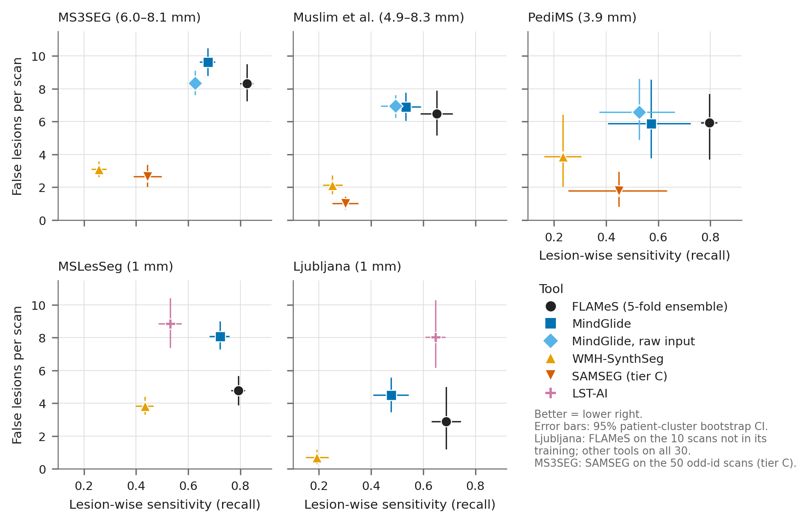
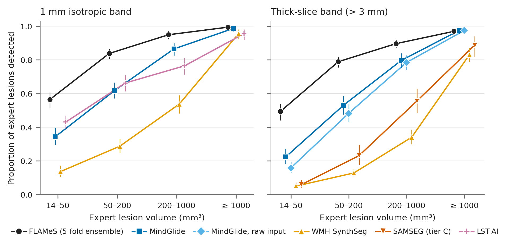
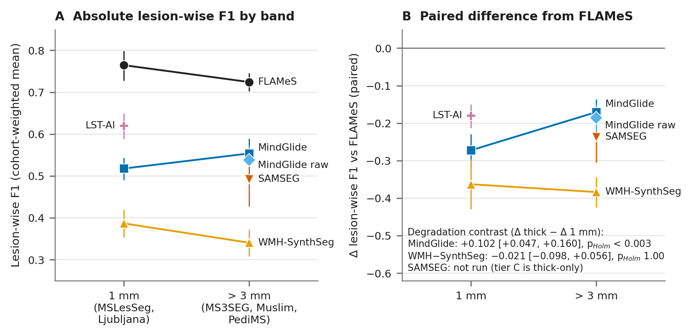

^1^ MSTool-AI [TODO owner: confirm the affiliation exactly as it should appear — legal name, city, country].

**Target journal:** *NeuroImage: Clinical* (research article). **Alternative:** *Machine Learning for
Biomedical Imaging (MELBA)*, which publishes reproducibility-oriented and negative benchmarks.

**Running title:** CPU lesion segmenters vs FLAMeS on thick-slice FLAIR

**Keywords:** multiple sclerosis; lesion segmentation; FLAIR; slice thickness; benchmark;
pre-registration; negative result; MindGlide; SAMSEG; WMH-SynthSeg; LST-AI; FLAMeS; nnU-Net

## Highlights

- Pre-registered benchmark on 324 public MS scans, 179 with 3.9–8.3 mm FLAIR slices.
- No CPU tool beat the FLAMeS ensemble on thick slices; all had lower lesion-wise F1.
- SAMSEG and WMH-SynthSeg had fewer false lesions but missed most small lesions.
- MindGlide lost less F1 than FLAMeS from 1 mm to thick slices, yet stayed below it.
- Every number traces to committed files; the study cost 12.55 USD of cloud CPU.

## Abstract

**Background.** Clinical archives contain many 2D FLAIR scans with 4–8 mm slices, whereas most
multiple sclerosis (MS) lesion segmenters are developed on 1 mm 3D FLAIR. Whether public CPU tools
designed for heterogeneous resolution outperform a FLAIR-only nnU-Net ensemble (FLAMeS) on real
thick-slice scans is unknown.

**Methods.** Paired benchmark pre-registered in a public repository (2026-10-21, commit 65a95e3)
before any tool output existed. Five public cohorts with expert masks: 179 thick-slice scans
(3.9–8.3 mm; 160 patients) and 145 1 mm scans (105 patients). MindGlide, WMH-SynthSeg, SAMSEG and,
on 1 mm scans, LST-AI ran with default settings on the identical skull-stripped FLAIR on CPU and were
compared with the FLAMeS 5-fold ensemble. Co-primary outcomes: lesion-wise F1 and false lesions per
scan. Inference: patient-cluster bootstrap stratified by cohort, Holm correction within families.

**Results.** No tool outperformed FLAMeS on thick slices (FLAMeS F1 0.724). ΔF1 was −0.170
(95% CI −0.206 to −0.136) for MindGlide, −0.237 (−0.304 to −0.173) for SAMSEG (129 scans) and −0.384
(−0.424 to −0.344) for WMH-SynthSeg (all p~Holm~ < 0.002). SAMSEG and WMH-SynthSeg had 5.15 and 3.88
fewer false lesions per scan but detected only 6% and 5% of expert lesions of 14–50 mm³ (FLAMeS 49%);
MindGlide's false-lesion difference was inconclusive (+0.57, −0.89 to +2.21). On 1 mm scans FLAMeS
also led (LST-AI −0.180, −0.212 to −0.150). In a between-cohort contrast, MindGlide lost 0.102 less F1
than FLAMeS on thick slices. Exploratory: MindGlide–FLAMeS disagreement flagged scans where FLAMeS
was poor (AUROC 0.78; 14 such scans). Compute cost: 12.55 USD.

**Conclusions.** The hypothesis that a public CPU segmenter outperforms FLAMeS on thick-slice FLAIR
was not supported. Fewer false lesions from conservative tools came at a large cost in sensitivity.
No clinical utility is claimed.

# 1. Introduction

T2-weighted fluid-attenuated inversion recovery (FLAIR) lesions are central to the diagnosis and
monitoring of multiple sclerosis (MS) [@thompson2018mcdonald; @filippi2019lesions]. The 2021
MAGNIMS–CMSC–NAIMS recommendations make 3D FLAIR the core brain sequence and accept high-quality 2D
acquisitions with slices of at most 3 mm and no gap as an alternative [@wattjes2021magnims]. Many clinical archives predate or do not follow these recommendations: the three public clinical
cohorts used here, for example, contain axial 2D FLAIR with 3.9–8.3 mm between slice centres. The
developers of recent segmentation tools note that high-resolution 3D scans are still not always
acquired in routine practice [@dereskewicz2025flames] and have built tools to reuse such archives
[@goebl2025mindglide]. Slice thickness affects both how many MS
lesions are detected and how their volume is measured [@molyneux1998thickness]. Partial-volume
averaging across thick slices blurs small lesions into the surrounding tissue, so tools trained on
1 mm data meet both a resolution shift and a change in lesion appearance.

Most automated MS lesion segmenters were developed and challenged on 3D or near-isotropic research
data, such as the ISBI-2015 and MSSEG-2016 challenges [@carass2017isbi; @commowick2018msseg;
@commowick2021msseg]. Systematic reviews have examined how far such methods are integrated into clinical workflows and
what evidence supports commercial tools [@spagnolo2023clinical; @mendelsohn2023commercial], and
distribution shift between sites is a recognised challenge [@malinin2022shifts]. Three families of public tools address
heterogeneous resolution explicitly. Domain-randomised networks are trained on synthetic images of
random contrast and resolution: SynthSeg and SynthSR for anatomy [@billot2023synthseg;
@iglesias2023synthsr], WMH-SynthSeg for white-matter hyperintensities [@laso2024wmhsynthseg], and
MindGlide, which was trained on real archive scans plus synthetic scans with resolutions of 1–9 mm
[@goebl2025mindglide]. Generative, contrast-adaptive models such as SAMSEG fit an atlas and a lesion
shape model to each scan [@cerri2021samseg]. Supervised ensembles such as LST-AI (FLAIR plus T1)
[@wiltgen2024lstai] and FLAMeS (FLAIR only; nnU-Net [@isensee2021nnunet]) are trained on labelled real
scans [@dereskewicz2025flames]. All of these run on a CPU, which matters for on-premise use in
hospitals without graphics processors.

A tool built for heterogeneous resolution might be expected to beat a supervised model trained on
mostly high-resolution data when slices are thick. To our knowledge, this has not been tested
head-to-head on real thick-slice 2D FLAIR with expert masks from several independent sources. Tool
comparisons are often run by the developers of one of the tools, on data that may overlap with
training sets, and with analysis choices fixed after the results are seen
[@varoquaux2022failures; @kapoor2023leakage]. Pre-registration fixes the questions, metrics and tests
before outcomes exist, and makes a negative result as informative as a positive one
[@nosek2018prereg].

We therefore pre-registered a paired benchmark of three public CPU tools — MindGlide, WMH-SynthSeg and
SAMSEG — against the FLAMeS 5-fold ensemble on 179 real thick-slice FLAIR scans from three public
cohorts, with LST-AI added on 1 mm scans. The primary question was whether any tool achieves a
different lesion-wise F1 or a different number of false lesions per scan than FLAMeS on thick slices;
a pre-stated reading rule defined when a tool "outperforms" FLAMeS. Secondary questions were the same
comparison on 1 mm FLAIR, whether a tool degrades less than FLAMeS from 1 mm to thick slices, and
whether giving MindGlide the non-skull-stripped FLAIR it was designed for changes its results. An
exploratory question asked whether disagreement with a second tool flags scans on which FLAMeS
performs poorly. The primary hypothesis was not supported.

# 2. Methods

## 2.1 Design, pre-registration and reporting

This is a retrospective, paired, multi-cohort benchmark on public de-identified data. The protocol
(version 1.0, 2026-10-21), the metric code (`research/paper_f/metrics.py`), the evaluation code
(`research/paper_f/evaluate.py`) and the frozen list of input files with their SHA-256 hashes
(`research/paper_f/flames_inputs.json`) were recorded in commit
`65a95e310168071703398aab3a53ba9fc0086e1a` (2026-10-21 20:45 UTC). The branch containing it was first
pushed to the public GitHub repository `nicolasbonilla/medical-imaging-viewer` at 2026-10-21 20:58 UTC
(GitHub repository activity log), 40 minutes before the first tool run started (21:39 UTC). The
SHA-256 of the protocol file as stored at that commit is
`587ba9ffc1f07d559a0008728e97ec9e1e9455eaf0037e37bbcc52b8f5f284e2`. Every later change was logged with
its date, reason and what had been seen (Section 2.10, Table 6). The pre-registration is time-stamped
by git and GitHub; it was not lodged with an independent registry. Reporting was guided by the CLAIM 2024 checklist
[@tejani2024claim] [TODO owner: complete and attach the checklist]. The final analysis ran once on the full outputs from commit `7a9a24e8fa92c83ded210854fd8614f7be4dcd50`
(2026-10-29 00:11 UTC; pushed 00:01 UTC), which records the SHA-256 of all 3,059 input files read.

## 2.2 Cohorts

Five public cohorts with expert lesion masks were fixed in the protocol (Table 1): 324 scans of 265
patients. The inputs were the exact FLAIR files on which the FLAMeS maps had been computed; masks were
on the same grid.

**Isotropic band (1 mm; 145 scans, 105 patients).** MSLesSeg, the dataset of the ICPR 2024 challenge
[@guarnera2025mslesseg; @guarnera2025mslessegdata; @rondinella2025icpr], provides 115 longitudinal scans of 75 patients (1.5 T, Catania) as
skull-stripped images on a 1 mm MNI grid; masks were drawn by one rater and validated by a
neuroradiologist and a neurologist. Ljubljana [@lesjak2018ljubljana] provides 30 patients scanned with
3D FLAIR at 3 T, with a multi-rater consensus mask, also used on the 1 mm MNI grid.

**Thick band (> 3 mm; 179 scans, 160 patients).** MS3SEG [@bawil2026ms3seg; @bawil2026ms3segdata]:
100 patients, one 1.5 T Toshiba scanner, axial 2D FLAIR, 0.898 × 0.898 mm in plane, 6.0–8.1 mm slice
spacing (median 7.2 mm). Its MS-lesion mask excludes periventricular hyperintensities that the
annotators judged not to be MS lesions. Muslim et al. [@muslim2022dib; @muslim2022data]: 51 axial
scans (of 60; 9 coronal or sagittal scans were excluded by a pre-stated rule), 1.5 T, about 20
centres, 4.86–8.3 mm slice spacing (median 6.0 mm). The files carry no geometry, so the in-plane pixel
size (0.41–0.97 mm) was estimated from head dimensions calibrated on MS3SEG (expected error about ±5%
per axis); left and right cannot be recovered. PediMS [@popa2025pedims; @popa2025pedimsdata]: 28
longitudinal scans of 9 children, 3 T Siemens Skyra, 0.75 × 0.75 × 3.9 mm; one child has Baló's
concentric sclerosis.

Skull stripping: MSLesSeg and Ljubljana were distributed skull-stripped; PediMS ships SynthStrip
brains [@hoopes2022synthstrip]; MS3SEG and Muslim were stripped with HD-BET 2.0.1 on CPU without
test-time augmentation [@isensee2019hdbet]. Bands were defined by the largest voxel dimension of the
grid the tools received: iso ≤ 1.5 mm and thick > 3 mm, with exploratory sub-bands 3–5.5 mm (PediMS
and 24 Muslim scans) and > 5.5 mm (MS3SEG and 27 Muslim scans).

**Table 1.** Cohorts. Slice spacing from the headers of the files the tools received
(`data/extra_numbers.json`); expert lesions counted after the 14.1 mm³ size filter.

| Cohort (licence) | Scans / patients | Field, acquisition | Grid given to the tools | Skull stripping | Reference standard |
|---|---|---|---|---|---|
| MSLesSeg (CC BY 4.0) | 115 / 75 | 1.5 T, one city, longitudinal | MNI 1 mm iso | provided | one rater, validated by neuroradiologist and neurologist |
| Ljubljana (CC BY) | 30 / 30 | 3 T Siemens, 3D FLAIR | MNI 1 mm iso | provided | three-rater consensus |
| MS3SEG (CC BY 4.0) | 100 / 100 | 1.5 T Toshiba, axial 2D | 0.898² × 6.0–8.1 mm | HD-BET 2.0.1 | junior annotator and senior neuroradiologist; "normal" WMH excluded |
| Muslim et al. (CC BY 4.0) | 51 / 51 | 1.5 T, ~20 centres, axial 2D | 0.41–0.97² (estimated) × 4.86–8.3 mm | HD-BET 2.0.1 | resident → consultant radiologist → neurologist |
| PediMS (CC BY 4.0) | 28 / 9 | 3 T Siemens, 2D, children | 0.75² × 3.9 mm | SynthStrip (dataset) | one rater, validated by paediatric neurologist and radiologist |

In the isotropic band the FLAMeS comparison set contained 3,463 expert lesions, 1,209 (34.9%) of them
14–50 mm³; in the thick band 5,993 expert lesions, 1,248 (20.8%) of them 14–50 mm³. No scan had an
empty reference.

## 2.3 Tools

Table 2 lists the tools; full container digests and weight hashes are in Appendix Table A1.
**FLAMeS** is an nnU-Net v2 [@isensee2021nnunet] FLAIR-only model released as five cross-validation
folds (Zenodo 17955359, version 2.0, CC BY 4.0) [@larosa2025flameszenodo; @dereskewicz2025flames;
@dereskewicz2025flamespreprint]. Its
maps had been computed for earlier studies on the same inputs (4 vCPU, no test-time mirroring, tile
step 0.5 with Gaussian weighting, PyTorch 2.14.1 CPU build); the prediction was the mean of the five
fold probabilities thresholded at 0.5. **LST-AI** 1.2.0 (three U-Nets, FLAIR + T1) [@wiltgen2024lstai]
had been run on the 1 mm cohorts only (144 scans; one MSLesSeg scan has a blank T1); its ensemble
probability was thresholded at 0.5, LST-AI's own binarisation. **MindGlide** 1.3.0
[@goebl2025mindglide] returns a label map on the input grid (lesion = label 18). **WMH-SynthSeg**
[@laso2024wmhsynthseg] and **SAMSEG** with its lesion model [@cerri2021samseg] were run from
FreeSurfer 8.2.0 [@fischl2012freesurfer] (labels 77 and 99). LST-AI was not run on the thick cohorts
because it needs a co-registered T1 that was not prepared; tools needing a GPU, MATLAB or per-site
training were excluded in the protocol.

**Table 2.** Tools, training data and overlap with the five cohorts.

| Tool | Version | Input; lesion output | Training data (as published) | Overlap with our cohorts |
|---|---|---|---|---|
| FLAMeS (reference) | weights v2.0 (2025-12-16), nnU-Net v2, 5 folds | FLAIR; mean fold probability > 0.5 | 668 FLAIR scans of 575 people with MS from seven sites, including ISBI-2015 (20 scans), MSSEG-2016 (53) and Ljubljana (20) | 20 Ljubljana scans in training → excluded from every FLAMeS comparison; MSLesSeg was one of its external test sets |
| LST-AI | 1.2.0 (Docker digest, Table A1) | FLAIR + T1; probability > 0.5 | 491 in-house 3D FLAIR + T1 scans, one centre | none; Ljubljana was one of its published test sets |
| MindGlide | 1.3.0 (container and weights hash, Table A1) | FLAIR; label 18 | 4,247 real scans from clinical-trial and academic archives + 4,303 synthetic scans of random 1–9 mm resolution; labels from an automated method | none; Ljubljana and ISBI-2015 in its external test |
| WMH-SynthSeg | FreeSurfer 8.2.0; model v10 (231110) | FLAIR; label 77 (WMH) | synthetic images generated from label maps (including ISBI-2015 and MSSEG-2016), random slice spacing 2.5–8.5 mm | none |
| SAMSEG `--lesion` | FreeSurfer 8.2.0 | FLAIR; label 99 | atlas from 20 subjects; lesion shape model from 212 MS subjects | none |

**Identifying the FLAMeS training scans.** The FLAMeS paper lists 20 Ljubljana scans in training
without naming them [@dereskewicz2025flames]. The released weights include nnU-Net's dataset
fingerprint (per-case spacing and cropped brain size of all 668 training cases). Twenty consecutive
entries matched the bounding box of exactly one Ljubljana patient each with zero voxels of difference
(patients 01–15 and 21–25), leaving patients 16–20 and 26–30 never seen by any fold
(`data/flames_ljubljana_split_87e998d.json`). These 20 scans were excluded from every comparison with
FLAMeS and appear only in sensitivity analysis S5. MSLesSeg was not in FLAMeS training; the FLAMeS developers used 51 MSLesSeg cases as an external
test set. The three thick cohorts come from centres not listed
among the FLAMeS, MindGlide, WMH-SynthSeg, SAMSEG or LST-AI training sources; their overlap with the
FLAMeS fingerprint was not checked forensically.

## 2.4 Processing

Every tool received the byte-identical skull-stripped FLAIR used for FLAMeS (SHA-256 checked on each
machine against the frozen list; no mismatch occurred), with default settings and only the flags
below, on 4 vCPUs, inside containers pinned by digest and run without network access. MindGlide:
`--device cpu`. WMH-SynthSeg: `mri_WMHsynthseg --device cpu --threads 4 --save_lesion_probabilities`.
SAMSEG: `run_samseg --lesion --lesion-mask-pattern 1 --pallidum-separate --threads 4 --random-seed
12345 --save-posteriors Lesions`. MindGlide and SAMSEG return the input grid (identity transfer).
WMH-SynthSeg returns a 1 mm grid; for thick scans each FLAMeS voxel received the mean lesion fraction
over its footprint (sampled at ⌈edge length in source voxels⌉ points per axis) and was labelled lesion
when the fraction was ≥ 0.5 (179 scans); 1 mm outputs were mapped trilinearly (145 scans). A run that
failed or exceeded 45 minutes was to be scored as an empty prediction; no scan ended that way.

## 2.5 Outcomes

Definitions were fixed in code before any output existed. A lesion is a 3D connected component with
26-connectivity on the FLAMeS grid. Components smaller than 14.137 mm³ (a sphere of 3 mm diameter)
were removed from prediction and reference before matching. A predicted component is a true positive
if it overlaps any reference component by at least one voxel; a reference lesion is detected if any
predicted component overlaps it. Lesion-wise precision = matched predicted / predicted; recall
(sensitivity) = detected reference / reference; F1 = 2PR/(P+R), set to 0 when nothing is predicted.
**Co-primary outcomes:** lesion-wise F1 and false lesions per scan (predicted components touching no
reference lesion). **Secondary outcomes:** voxel-wise Dice on the unfiltered masks [@dice1945],
lesion-wise precision and recall, detection by reference lesion size (14–50, 50–200, 200–1000 and
≥ 1000 mm³), predicted and reference lesion volume, failure rate, CPU time and peak memory. The choice
of instance-level metrics is consistent with current recommendations for detection-type tasks
[@maierhein2024metrics].

## 2.6 Statistical analysis

For every comparison we computed per-scan differences (tool − FLAMeS) on scans where both outputs
were usable and neither was contaminated. The estimate was the mean over cohorts of the per-cohort
mean difference (each cohort counts once). Uncertainty came from a patient-cluster bootstrap
stratified by cohort [@field2007clustered; @efron1993bootstrap]: patients were resampled with
replacement within each cohort, 10,000 replicates, seed 20261021, percentile 95% intervals. The
two-sided bootstrap p was twice the smaller tail proportion of replicates at or beyond zero. When no
replicate fell on the other side of zero, p is below the resolution of the bootstrap (2/10,000); we
report such Holm-adjusted values as p~Holm~ < 0.002 (families of 4 or 6 tests) or < 0.003 (family of
11), rather than the "< 0.0001" printed by the analysis tables. Equivalence was declared when the 90%
interval lay inside ±0.05 F1 or ±1 false lesion per scan, the interval form of two one-sided tests
[@schuirmann1987tost].

**Primary family (6 tests, Holm [@holm1979], α = 0.05):** ΔF1 and Δ false lesions per scan for
MindGlide, WMH-SynthSeg and SAMSEG vs FLAMeS on the thick band. **Reading rule:** a tool
*outperforms* FLAMeS only if p~Holm~ < 0.05 with ΔF1 > 0 and Δ false lesions not worse than +1 per
scan, or p~Holm~ < 0.05 with fewer false lesions and ΔF1 not below −0.05. **Secondary family (11
tests, Holm):** the same two outcomes on the iso band for the three tools and LST-AI (8 tests), and
the degradation contrast (ΔF1 thick − ΔF1 iso) for the three tools (3 tests). The two bands share no
patient, so their bootstraps are independent; the contrast compares different cohorts and is
therefore confounded with site. **Raw-input arm (4 tests, Holm; added before any full-run output,
Section 2.10):** MindGlide on the FLAIR before skull stripping vs FLAMeS, and vs MindGlide on the
stripped FLAIR, on the thick band. Tests that could not be run count as p = 1 in the Holm procedure
over the registered family size.

**Sensitivity analyses (primary family, no adjustment):** S1 no size filter; S2 3 mm³ filter; S3
in-plane 8-connectivity (components do not join across thick slices); S4 complete cases; S5 iso
comparisons including the 20 FLAMeS training scans; S6 thick band without Muslim; S7 scan-weighted
estimate. **Exploratory (labelled as such):** E1, the area under the ROC curve [@hanley1982auc] of
tool–FLAMeS disagreement (1 − lesion-wise F1 between the two outputs) for identifying scans with
FLAMeS lesion-wise F1 < 0.5; E2, keeping only FLAMeS lesions that the tool also marks.
**Post hoc additions for this manuscript** (not in the protocol; script `compute_extra_numbers.py`):
a bootstrap interval and a cohort-stratified version of the E1 AUROC (only poor and adequate scans of
the same cohort are compared), lesion-wise precision and recall per band, and FLAMeS performance on the
SAMSEG scan set.

**Precision.** With a per-scan SD of 0.15 for ΔF1, the protocol anticipated a cohort-weighted 95%
half-width of about ±0.04 F1 on the thick band, dominated by the 9 PediMS children. Software: Python
3.11.4 and NumPy 1.26.4 for the analysis.

## 2.7 SAMSEG analysis set: pre-stated budget tiers

The protocol fixed a run order (cheapest tool first) and budget tiers that depended only on measured
runtime, never on accuracy, so that the projected total spend stayed ≤ 15 USD: tier A all 324 scans,
tier B the 179 thick scans, tier C a fixed thick subsample of 129 scans (all PediMS, all Muslim and the
50 odd-numbered MS3SEG scans). Applied after the other tools had run, with the real spend so far, the
rule selected tier C (projected total 13.76 USD). SAMSEG comparisons are therefore paired on 129 thick
scans of 110 patients, and the three SAMSEG tests of the secondary family were not run.

## 2.8 Compute environment and cost

All tool runs used Google Cloud virtual machines with 4 vCPUs (n2d-standard-4, n2-standard-4,
e2-standard-4; n2d-highmem-4 with 32 GB for WMH-SynthSeg) in region us-central1. Costs are list prices
recorded per run in a compute ledger (snapshot `data/compute_ledger_c8b4239.csv`). The study used 14
virtual-machine runs, 61.90 machine-hours and 12.55 USD (Table 5). The FLAMeS and LST-AI maps came from
earlier runs on the same inputs and are reported separately.

## 2.9 Integrity checks and blinding

Before the analysis, a script checked every planned output against the run manifests (presence,
SHA-256, failures; `results/verify_runs.json`) and a structural check confirmed that every mask lay on
the exact FLAMeS grid and was binary. For each tool, the only accuracy numbers looked at before its full run were pilot plausibility checks
on three scans (a Dice < 0.1 would have signalled a label or orientation error); the interim analysis
of Section 2.10 is the one exception.

## 2.10 Deviations from the protocol

All deviations are listed in Table 6. In short: a secondary arm with MindGlide on the raw FLAIR was
added before any full-run output; WMH-SynthSeg ran without the pre-stated `--crop` memory fallback
(one out-of-memory scan was re-run with it); the budget rule gave SAMSEG tier C; Holm was applied over
the registered family size with tests not run counted as p = 1; and an interim analysis of MindGlide
and LST-AI was run on 2026-10-22, although the protocol stated that the analysis would run once on the
full outputs. That interim look was not logged as a deviation at the time; we identified it while
writing this report. No outcome definition, band, threshold or test changed.

# 3. Results

## 3.1 Completeness

All planned outputs were present — WMH-SynthSeg 324/324, MindGlide 324/324, MindGlide on raw input
179/179 and SAMSEG 129/129 — and all but one matched the hash recorded on the machine (Table A2). One WMH-SynthSeg run
(muslim_16) stopped for lack of memory and was re-run with `--crop`, as pre-stated. The three MindGlide pilot scans failed in the first pilot runs because the container could not write
to its output folder, and were re-run after the fix. One SAMSEG
output (ms3seg_001, pilot) has no manifest record because the pilot's manifest write crashed; the file
was verified by its lesion-voxel count (1,129) and kept. No scan was scored as a failure, no input
hash mismatched, and every mask passed the structural check. SAMSEG predicted no lesion after the size
filter in 3 of 129 scans; every other tool predicted at least one lesion in every scan.

## 3.2 Primary comparisons: thick-slice FLAIR

FLAMeS had a cohort-weighted lesion-wise F1 of 0.724 (95% CI 0.702–0.745) and 6.9 false lesions per
scan on the 179 thick scans (Table 4). All three CPU tools had a lower lesion-wise F1 than FLAMeS
(Table 3, Figure 1): MindGlide by 0.170 (95% CI 0.136–0.206), SAMSEG by 0.237 (0.173–0.304) and
WMH-SynthSeg by 0.384 (0.344–0.424); p~Holm~ < 0.002 for each. SAMSEG had 5.15 fewer false lesions per
scan (95% CI 3.91–6.30) and WMH-SynthSeg 3.88 fewer (2.27–5.21), both p~Holm~ < 0.002. For MindGlide
the difference in false lesions was +0.57 per scan (−0.89 to +2.21; p~Holm~ = 0.45): no difference was
shown and equivalence within ±1 was not shown either. Under the pre-stated reading rule no tool
outperformed FLAMeS, because every ΔF1 was far below −0.05, and no tool was equivalent to FLAMeS. On
the 129 SAMSEG scans, FLAMeS had F1 0.729 and 6.97 false lesions per scan, against 0.492 and 1.82 for
SAMSEG.

**Table 3.** Pre-registered comparisons (difference = tool − reference; patient-cluster bootstrap
stratified by cohort; `results/comparisons.json`).

| Family | Comparison | Band | Scans / patients | ΔF1 (95% CI) | p~Holm~ | Δ false lesions / scan (95% CI) | p~Holm~ |
|---|---|---|---|---|---|---|---|
| Primary (6) | MindGlide − FLAMeS | thick | 179 / 160 | −0.170 (−0.206 to −0.136) | < 0.002 | +0.57 (−0.89 to +2.21) | 0.450 |
| Primary (6) | WMH-SynthSeg − FLAMeS | thick | 179 / 160 | −0.384 (−0.424 to −0.344) | < 0.002 | −3.88 (−5.21 to −2.27) | < 0.002 |
| Primary (6) | SAMSEG − FLAMeS | thick | 129 / 110 | −0.237 (−0.304 to −0.173) | < 0.002 | −5.15 (−6.30 to −3.91) | < 0.002 |
| Secondary (11) | MindGlide − FLAMeS | iso | 125 / 85 | −0.272 (−0.319 to −0.229) | < 0.003 | +3.07 (+1.78 to +4.32) | < 0.003 |
| Secondary (11) | WMH-SynthSeg − FLAMeS | iso | 125 / 85 | −0.363 (−0.429 to −0.297) | < 0.003 | −1.32 (−2.58 to −0.23) | 0.086 |
| Secondary (11) | LST-AI − FLAMeS | iso | 124 / 85 | −0.180 (−0.212 to −0.150) | < 0.003 | +3.79 (+2.53 to +4.95) | < 0.003 |
| Secondary (11) | SAMSEG − FLAMeS | iso | — | not run (tier C) | (p = 1) | not run | (p = 1) |
| Secondary (11) | Degradation, MindGlide | thick − iso | 304 / 245 | +0.102 (+0.047 to +0.160) | < 0.003 | — | — |
| Secondary (11) | Degradation, WMH-SynthSeg | thick − iso | 304 / 245 | −0.021 (−0.098 to +0.056) | 1.00 | — | — |
| Secondary (11) | Degradation, SAMSEG | thick − iso | — | not run | (p = 1) | — | — |
| Raw arm (4) | MindGlide raw − FLAMeS | thick | 179 / 160 | −0.186 (−0.222 to −0.150) | < 0.002 | +0.38 (−0.94 to +1.88) | 0.986 |
| Raw arm (4) | MindGlide raw − MindGlide | thick | 179 / 160 | −0.016 (−0.028 to −0.004) | 0.037 | −0.19 (−0.75 to +0.32) | 0.986 |

**Table 4.** Absolute performance per band (cohort-weighted mean, 95% CI). F1 and false lesions from
`results/tables.md` (Table 2); precision and recall descriptive (`data/extra_numbers.json`).

| Band | Tool | Scans | Lesion-wise F1 | False lesions / scan | Precision | Recall |
|---|---|---|---|---|---|---|
| iso | FLAMeS | 125 | 0.765 (0.727–0.798) | 3.8 (2.8–5.0) | 0.819 | 0.740 |
| iso | LST-AI | 144 | 0.620 (0.588–0.650) | 8.4 (7.2–9.8) | 0.690 | 0.589 |
| iso | MindGlide | 145 | 0.518 (0.490–0.543) | 6.3 (5.6–7.0) | 0.569 | 0.599 |
| iso | WMH-SynthSeg | 145 | 0.387 (0.354–0.419) | 2.3 (1.9–2.6) | 0.752 | 0.312 |
| thick | FLAMeS | 179 | 0.724 (0.702–0.745) | 6.9 (6.0–7.8) | 0.738 | 0.758 |
| thick | MindGlide | 179 | 0.554 (0.517–0.589) | 7.5 (6.7–8.5) | 0.600 | 0.593 |
| thick | MindGlide, raw input | 179 | 0.538 (0.503–0.572) | 7.3 (6.6–8.0) | 0.606 | 0.549 |
| thick | WMH-SynthSeg | 179 | 0.341 (0.308–0.373) | 3.0 (2.4–3.9) | 0.707 | 0.248 |
| thick | SAMSEG (tier C) | 129 | 0.492 (0.427–0.553) | 1.8 (1.4–2.3) | 0.837^a^ | 0.397 |

^a^ 126 scans; precision is undefined when no lesion is predicted. Iso rows for the tools include all
30 Ljubljana scans; FLAMeS includes only the 10 it was not trained on.

## 3.3 Why the conservative tools had fewer false lesions

WMH-SynthSeg and SAMSEG marked much less lesion than the experts (Figure 2). On thick scans the mean
predicted lesion volume per cohort was 4.2–5.2 mL for WMH-SynthSeg and 6.8–9.7 mL for SAMSEG, against
expert volumes of 12.6–19.8 mL and FLAMeS volumes of 13.1–18.4 mL (`results/tables.md`, Table 1).
Their lesion-wise precision was higher than or similar to that of FLAMeS (SAMSEG 0.837, WMH-SynthSeg
0.707, FLAMeS 0.738), but their recall was much lower (0.397 and 0.248 vs 0.758). The deficit concentrated in small lesions (Figure 3): of the 1,248
expert lesions of 14–50 mm³ on thick scans, FLAMeS detected 0.49 (95% CI 0.44–0.54), MindGlide 0.22
(0.18–0.27), SAMSEG 0.06 (0.04–0.09; 935 lesions in its scans) and WMH-SynthSeg 0.05 (0.03–0.07). For
lesions ≥ 1000 mm³, FLAMeS and MindGlide both detected 0.97, SAMSEG 0.89 and WMH-SynthSeg 0.83. The fewer false lesions of these two tools thus reflect a more conservative operating point; they
are not evidence of a better trade-off, because sensitivity fell far more than false lesions did.

## 3.4 Sensitivity analyses

All six thick-band sensitivity analyses (S1–S4, S6, S7) kept the sign and the 95% interval of ΔF1
below zero for all three tools (range −0.153 to −0.194 for MindGlide, −0.212 to −0.244 for SAMSEG and −0.373 to −0.436
for WMH-SynthSeg; `results/tables.md`, Table 5). The fewer false lesions of WMH-SynthSeg (−3.66 to
−4.87) and SAMSEG (−5.00 to −8.25) persisted in every analysis. For MindGlide the false-lesion
difference depended on the lesion definition: it became significantly positive without a size filter
(S1, +2.42, 95% CI +0.10 to +5.06) and with in-plane components (S3, +8.09, +4.51 to +12.35), and stayed
inconclusive in the others (for example S7, scan-weighted, +0.85, −0.34 to +2.01). Excluding Muslim
(S6), whose in-plane spacing is estimated, did not change any conclusion.

## 3.5 Secondary comparisons: 1 mm FLAIR and degradation

On 1 mm scans FLAMeS had F1 0.765 (0.727–0.798). It had a higher F1 than MindGlide (ΔF1 −0.272),
WMH-SynthSeg (−0.363) and LST-AI (−0.180), all p~Holm~ < 0.003 (Table 3). MindGlide (+3.07) and LST-AI
(+3.79) produced more false lesions than FLAMeS. WMH-SynthSeg produced 1.32 fewer (95% CI 0.23–2.58);
this was not significant after Holm correction over the registered family (p~Holm~ = 0.086), although
Holm over only the eight tests performed would have given 0.034. The registered rule governs.
Including the 20 Ljubljana scans used in FLAMeS training (S5) gave the same conclusions (ΔF1 −0.258,
−0.389 and −0.156 for MindGlide, WMH-SynthSeg and LST-AI).

FLAMeS F1 was 0.765 in the iso band and 0.724 in the thick band; MindGlide's was 0.518 and 0.554
(Figure 4A). In the pre-registered degradation contrast, MindGlide's deficit relative to FLAMeS was
0.102 smaller on thick than on 1 mm scans (95% CI 0.047–0.160; p~Holm~ < 0.003); the secondary hypothesis of smaller degradation was therefore supported for MindGlide, which
nevertheless stayed below FLAMeS in both bands. For
WMH-SynthSeg no difference was shown (−0.021, −0.098 to +0.056; p~Holm~ = 1.00). The three SAMSEG tests
were not run. Because the iso and thick bands consist of different cohorts, this contrast mixes slice
thickness with site, scanner, population and annotation protocol (Section 4.3).

## 3.6 MindGlide on the raw FLAIR

Giving MindGlide the FLAIR before skull stripping, as its documentation recommends, did not help.
Against FLAMeS, raw-input MindGlide had ΔF1 −0.186 (−0.222 to −0.150; p~Holm~ < 0.002) and +0.38 false
lesions per scan (−0.94 to +1.88; p~Holm~ = 0.986). Against MindGlide on the stripped input it had
ΔF1 −0.016 (−0.028 to −0.004; p~Holm~ = 0.037) and −0.19 false lesions (−0.75 to +0.32); both
differences were within the equivalence margins, so the two inputs were equivalent.

## 3.7 Exploratory: disagreement as a "second opinion"

On thick scans, FLAMeS had a lesion-wise F1 below 0.5 in 14 of 179 scans (10 Muslim, 4 MS3SEG,
0 PediMS). Disagreement between MindGlide and FLAMeS identified these scans with an AUROC of 0.779;
post hoc, its 95% bootstrap interval was 0.597–0.925 and the cohort-stratified AUROC was 0.819.
Disagreement with WMH-SynthSeg (0.593; post hoc CI 0.385–0.787) or SAMSEG (0.488; 11 poor scans of
129) did not. On 1 mm scans only 2 scans were poor, so the AUROCs there (MindGlide 0.813, LST-AI 0.803,
WMH-SynthSeg 0.520) carry little information. Keeping only the FLAMeS lesions that a second tool also
marked removed false lesions but always cost F1: with MindGlide on thick scans, −3.8 false lesions per
scan (95% CI −4.7 to −2.8) and ΔF1 −0.074 (−0.111 to −0.040).

## 3.8 Runtime and cost

Median times per scan on 4 vCPUs were 77–84 s for MindGlide (peak memory ≤ 5.91 GB), 216 s for
WMH-SynthSeg (peak 31.3 GB plus up to 14.4 GB of swap) and 470–524 s per run for SAMSEG on thick scans
(peak ≤ 7.1 GB, pilot included); all met the pre-stated CPU rule of ≤ 15 minutes per scan. For
comparison, FLAMeS took 67.5–69.1 s per fold and scan (about 5.7 minutes for the five folds without
test-time mirroring). Table 5 gives the cost.

**Table 5.** Compute for this study (list prices; `data/compute_ledger_c8b4239.csv`).

| Component | Runs | Machine-hours | USD |
|---|---|---|---|
| Pilots (MindGlide, FreeSurfer tools) | 5 | 1.54 | 0.30 |
| MindGlide, primary arm (324 scans) | 2 | 6.78 | 1.32 |
| MindGlide, raw-input arm (179 scans) | 2 | 13.07 | 1.93 |
| WMH-SynthSeg (324 scans, incl. one `--crop` re-run) | 2 | 22.65 | 5.63 |
| SAMSEG, tier C (127 scans + 2 from pilots) | 3 | 17.86 | 3.37 |
| **Total, this study** | **14** | **61.90** | **12.55** |
| Earlier runs reused: FLAMeS maps, 1 mm cohorts | 3 | 14.24 | 2.62 |
| Earlier runs reused: HD-BET + FLAMeS maps, thick cohorts | 2 | 21.79 | 3.83 |
| Earlier runs reused: LST-AI maps | 1 | 4.05 | 0.84 |

With the real per-scan cost of SAMSEG, tier B (all 179 thick scans) would have fitted under the cap
(about 13.9 USD in total) but tier A would not (about 17.8 USD) (`results/RESULTS.md`, Section 5).

# 4. Discussion

## 4.1 What this negative result means

The pre-registered hypothesis — that a public CPU segmenter designed for heterogeneous resolution
outperforms a FLAIR-only nnU-Net ensemble on thick-slice FLAIR — was not supported. The result is not
an absence of evidence: for every tool the 95% interval for ΔF1 lay entirely below the equivalence
margin of −0.05, and the deficits (0.17–0.38 F1) are several times larger than the ±0.04 precision the
protocol anticipated. Within the conditions tested, the data exclude parity with FLAMeS on
lesion-wise F1. They do not say that these tools are poor for their intended purposes. WMH-SynthSeg
segments white-matter hyperintensities of any cause and was built for volumes in heterogeneous and
low-field scans [@laso2024wmhsynthseg]; SAMSEG provides whole-brain anatomy together with lesions
[@cerri2021samseg]; MindGlide was designed to extract brain and lesion volumes from clinical archives
for research [@goebl2025mindglide]. Lesion-by-lesion detection against expert masks, at default
settings, is a stricter and different task.

The conditions matter. All tools received the same skull-stripped FLAIR; only default settings and
each tool's own binarisation were used; lesions were 3D components ≥ 14.1 mm³ matched by any overlap;
and reference masks followed each cohort's protocol. Changing any of these could change absolute
numbers. The sensitivity analyses show that the direction of the F1 differences is robust to the lesion
definition (S1–S3), the
weighting (S7), the cohort with estimated geometry (S6) and the handling of failures (S4). The
raw-input arm shows that, for MindGlide at least, skull stripping was not the cause.

## 4.2 Fewer false lesions are not a better operating point

SAMSEG and WMH-SynthSeg produced significantly fewer false lesions than FLAMeS. Read in isolation,
this could suggest a safer tool for thick-slice archives. Figures 2 and 3 show why it is not: both
tools mark a fraction of the expert lesion volume, detect only 5–6% of small expert lesions and
miss most lesions below 200 mm³. SAMSEG's precision is higher than that of FLAMeS and WMH-SynthSeg's is similar, but both have far
lower recall; the lower false-lesion count is the price of under-segmentation. The two FreeSurfer tools also write
lesion probability maps, so a different threshold could move them along their precision–recall
curves. That analysis was not pre-registered; it would also change the tools from their default
behaviour, which this study deliberately kept. The MindGlide paper reported that WMH-SynthSeg failed
on 15% of visually assessed contrasts, particularly with slices thicker than 5 mm
[@goebl2025mindglide]. We saw no outright failures, but on thick slices WMH-SynthSeg marked only about a quarter to a third
of the expert lesion volume in every cohort. Part of WMH-SynthSeg's apparent false-lesion count on MS3SEG may also come from
the dataset's exclusion of "normal" periventricular hyperintensities from the reference.

## 4.3 Contamination and site confounding

**Training overlap.** FLAMeS was trained on ISBI-2015, MSSEG-2016 and 20 Ljubljana scans
[@dereskewicz2025flames]. We identified the 20 Ljubljana scans exactly from the dataset fingerprint
shipped with the weights and excluded them from every FLAMeS comparison; including them (S5) changed
no conclusion. ISBI-2015 and MSSEG-2016 are not among our cohorts. They do, however, appear in the label maps used to train WMH-SynthSeg and in the evaluation of
SAMSEG; Ljubljana was an external test set of both MindGlide and LST-AI, and ISBI-2015 of MindGlide. These overlaps concern the tools' development history,
not the scans we evaluated. MSLesSeg was not in FLAMeS training, but the FLAMeS developers reported
results on 51 MSLesSeg cases before release. If model selection was influenced by that test, FLAMeS
may be slightly favoured on the iso band; the thick-band primary comparison does not involve MSLesSeg.
The thick cohorts — MS3SEG (released 2026), Muslim et al. (2022) and PediMS (2025) — come from centres
not listed in any tool's training data. Their absence from the FLAMeS fingerprint was not verified
forensically.

**Site confounding.** The primary comparisons are paired within scan, so scanner, population and
annotation protocol affect FLAMeS and the comparator alike, and the cohort weighting prevents the
largest cohort from dominating. Two analyses are not protected. First, the degradation contrast
compares the iso cohorts (MSLesSeg, Ljubljana) with the thick cohorts (MS3SEG, Muslim, PediMS); these
differ in field strength, vendor, age group, skull-stripping pipeline and rater protocol, not only in
slice thickness. MindGlide's smaller degradation is consistent with its training on synthetic
resolutions of 1–9 mm, but it may equally reflect its large over-segmentation on MSLesSeg (28.4 mL
predicted vs 11.8 mL expert; `results/tables.md`, Table 1), which inflates its deficit on the iso band.
A within-subject design — the same patients scanned, or resampled, at both resolutions — would be
needed to isolate slice thickness. Second, cohort-level differences in reference standards (for
example MS3SEG's exclusion of normal hyperintensities and the sequential correction chain in Muslim et
al.) affect absolute values and cross-cohort comparisons. They do not explain away paired
differences of the size observed.

## 4.4 The exploratory MindGlide disagreement signal

Disagreement between MindGlide and FLAMeS ranked the thick scans on which FLAMeS performed poorly
with an AUROC of 0.78. This is exploratory and fragile. It rests on 14 poor scans, 10 of them from a
single cohort; its post hoc 95% interval runs from about 0.60 to 0.93; and the cut-off that defines a poor scan (F1 < 0.5), although pre-specified, is arbitrary. The post hoc cohort-stratified AUROC (0.82) argues against a
pure site artefact, in which disagreement would only flag the hardest cohort. Two other observations
temper it. Disagreement with WMH-SynthSeg or SAMSEG carried no such signal, so the effect is specific
to a tool that segments as much as FLAMeS does. And using the second tool as a filter always cost F1.
The signal is a hypothesis for a quality-control flag, to be tested prospectively on new data with a
pre-specified threshold. It is not a validated method, and we make no claim about its clinical value.

## 4.5 Relation to previous work and implications

The FLAMeS developers compared FLAMeS with SAMSEG, LST-LPA and LST-AI and reported that it
outperformed them on their external test sets, which included a small clinical cohort with 2D
anisotropic FLAIR [@dereskewicz2025flames]; our 1 mm results agree in direction, and our results
extend the comparison to 179 thick-slice scans from three further sources. LST-AI, which
uses a T1 as well, had a lower F1 and more false lesions than FLAMeS on 1 mm data. To our knowledge,
this is the first pre-registered, paired comparison on real thick-slice FLAIR from several sources
with expert masks. For researchers working with thick-slice archives, the results suggest three
practical points: (i) report lesion-wise metrics stratified by slice thickness and lesion size, not
only Dice or total volume; (ii) treat low false-lesion counts with suspicion until sensitivity is
reported alongside them; and (iii) where a CPU is the constraint, a 5-fold nnU-Net ensemble ran in about 5.7 minutes per scan on 4 vCPUs here, so a GPU is not required to use it. None of this
establishes clinical utility, which would need clinical end points, reader studies and prospective
data.

# 5. Limitations

First, SAMSEG was run on 129 of the 179 thick scans (the budget tier) and on no 1 mm scan, so three
secondary tests could not be run; with hindsight, tier B would have fitted the budget. Second, all
tools received skull-stripped input; SAMSEG's atlas registration is documented to prefer images with
skull, and only MindGlide was also tested on raw input. Third, default settings and binarisations were
used, and probability maps were not exploited, so operating points differ between tools. Fourth,
reference standards differ across cohorts and each is a single consensus or validated mask; no
inter-rater variability was available, and in thick slices 3D components can merge lesions across
slices (S3 addresses this only partly). Fifth, the thick band gives 9 PediMS children the same weight
as 100 MS3SEG patients; the scan-weighted analysis agreed. Sixth, Muslim et al. in-plane spacing is
estimated, which changes physical size thresholds by about ±10% in volume; excluding the cohort did
not change the conclusions. Seventh, the degradation contrast is between cohorts and confounded with
site. Eighth, the exploratory analysis rests on few poor scans. Ninth, the pre-registration was
time-stamped in a public git repository rather than an independent registry. The study was designed
and analysed by a single author with an AI coding agent, and an unplanned interim analysis was run
(Table 6). Tenth, the nnU-Net package version used for the FLAMeS maps was frozen in the job's
environment lock file but not recorded in the run manifests [TODO owner]. Finally, we evaluated
research-grade public data; other archives, vendors and protocols may behave differently, and no
clinical outcome was studied.

# 6. Conclusion

In a pre-registered, paired benchmark on 179 real thick-slice FLAIR scans from three public cohorts,
none of MindGlide, WMH-SynthSeg or SAMSEG outperformed the FLAMeS 5-fold ensemble, and all had a
substantially lower lesion-wise F1. The two FreeSurfer tools produced fewer false lesions only by
missing most small lesions. On 1 mm scans FLAMeS also had the highest F1 of the tools tested there, including LST-AI (SAMSEG
was not run on them).
MindGlide degraded less than FLAMeS from 1 mm to thick slices, but this between-cohort contrast is
confounded with site. Its disagreement with FLAMeS is a candidate signal for scans that need a second
look, which requires prospective testing. The negative result, the full protocol, every per-scan
metric and the code are public so that others can test other tools under the same rules.

# Pre-registration deviations

**Table 6.** Deviations and notable events (protocol Section 12, plus one item identified while
writing this manuscript). "Seen before" lists what had been observed when the change was made.

| Date | Change | Reason | Seen before |
|---|---|---|---|
| 2026-10-21 | Wording of the MindGlide command description (its cleanup step acts on the whole label map) | clarification; no rule changed | nothing launched |
| 2026-10-22 | Secondary arm 7.6 added: MindGlide on the raw FLAIR (thick band), own Holm family of 4 | MindGlide's documentation asks for raw input | MindGlide pilot only (3 scans: timings, one lesion volume); no full-run output |
| 2026-10-22 | **Unplanned interim analysis** of MindGlide (both arms) and LST-AI vs FLAMeS (commit 6d507c4), although the protocol stated a single analysis on full outputs; not logged at the time, identified while writing this manuscript | progress report while FreeSurfer tools awaited a licence | interim results for MindGlide, LST-AI and FLAMeS on all cohorts; the final analysis reproduces them exactly. All later decisions below were taken after this interim, but before any WMH-SynthSeg or SAMSEG accuracy output |
| 2026-10-24 | WMH-SynthSeg run without `--crop` although the pilot peak (31.32 GB) exceeded the pre-stated 30 GB trigger; kept for all scans; one out-of-memory scan re-run with `--crop` | conflicting rule in the runbook; uniform processing preferred | runtime and memory only |
| 2026-10-24 / 2026-10-28 | Budget rule (pre-stated) first dropped SAMSEG on projected cost, then, re-run with the real spend, selected tier C (129 scans); boot disk 80 GB instead of 150 GB | application of the pre-stated rule | runtime and cost only |
| 2026-10-29 | SAMSEG analysis set = tier C; its one 1 mm pilot output enters no comparison; three SAMSEG secondary tests not run | a single 1 mm scan gives a one-cluster bootstrap | run-integrity checks only |
| 2026-10-29 | Holm over the registered family size, tests not run counted as p = 1 | the secondary family could not be complete | run-integrity checks only |
| 2026-10-29 | Note: one SAMSEG pilot output (ms3seg_001) lacks a manifest record; verified by voxel count and kept | pilot manifest write crashed (bug fixed) | voxel count only |
| 2026-10-31 | Post hoc, labelled additions in this manuscript (AUROC interval and stratified AUROC, precision and recall per band, FLAMeS on the SAMSEG set) | interpretation | all results |

# Declarations

## Data availability

All five cohorts are public under CC BY licences (Table 7). The per-scan metrics of every tool
(`research/paper_f/results/per_scan.csv.gz`, 6,906 rows), all comparisons, the run-integrity report,
the compute ledger snapshot and the numbers added for this manuscript are in the public repository
<https://github.com/nicolasbonilla/medical-imaging-viewer> (branch `research/paper-f-tool-benchmark`,
results commit `1d3be48`; manuscript branch `research/paper-f-manuscript`). The SHA-256 of every input
file is in `run_info.json`. The tool output masks are kept in the authors' research storage [TODO
owner: decide whether to deposit the derived masks, e.g. on Zenodo with a DOI, respecting the dataset
and tool licences]. Every number in this manuscript is mapped to its source file and field in
`NUMBERS_CHECK.md`.

## Code availability

Analysis code (`metrics.py`, `evaluate.py`, `summarize.py`, `verify_runs.py`, `plan_budget.py`), the
cloud job scripts (`research/cloud/`), the figure script (`make_figures.py`) and the post hoc script
(`compute_extra_numbers.py`) are in the same repository; local tests are in `research/paper_f/tests/`.
[TODO owner: the repository has no licence file; add one (for example MIT for the research code) and
archive a tagged release with a DOI before submission.]

## Ethics statement

This study used only public, de-identified datasets released by their authors under open licences,
with ethics approval and consent handled by the original studies as described in their data papers.
No new data were collected and no participant was contacted. [TODO owner: confirm whether the journal
or the author's institution requires a formal waiver statement for secondary analysis of public data.]

## Licences

**Table 7.** Licences of data and software as used here (checked 2026-10-21 and 2026-10-31).

| Item | Licence | Consequence for this study |
|---|---|---|
| MSLesSeg data | CC BY 4.0 | attribution; changes stated |
| Ljubljana (open_ms_data) | CC BY | attribution [TODO owner: confirm the licence version] |
| MS3SEG data | CC BY 4.0 (article text CC BY-NC-ND 4.0) | attribution; changes stated |
| Muslim et al. data | CC BY 4.0 | attribution; reorientation and estimated pixel size stated |
| PediMS data | CC BY 4.0 | attribution |
| FLAMeS weights | CC BY 4.0; nnU-Net code Apache-2.0 | attribution |
| LST-AI | MIT; documented as research-only and not approved for clinical use | research use |
| MindGlide | code MIT; no licence stated for the weights | research use; ask the authors before any other use |
| FreeSurfer 8.2.0 (WMH-SynthSeg, SAMSEG) | FreeSurfer Software License Agreement (registration); states research purposes, clinical applications not advised | research use |
| HD-BET 2.0.1 | code Apache-2.0; weights licence [TODO owner: re-confirm; our notes record CC BY-NC 4.0] | research use |

## Conflict of interest

N. G. Bonilla Vargas develops MSTool-AI, investigational software for MRI in MS whose research
pipeline uses FLAMeS. A CPU tool outperforming FLAMeS would have been useful to that software; a
negative result is not. The author has no financial relationship with the developers of any tool
tested. [TODO owner: confirm, and add co-authors' declarations.]

## Use of AI assistance

The analysis code (metric definitions, evaluation and summary scripts, run-integrity and budget
scripts, cloud job scripts and their tests), the drafts of the protocol and runbook, the figure and
post hoc scripts, the reference verification and the first draft of this manuscript were written by
an AI coding agent (Claude Opus 5.5, Anthropic, used through Claude Code) under the direction of the
author. All 13 commits of the study branch, from the protocol to the final results, carry a
`Co-Authored-By` trailer naming the agent. The author set the research question and the constraints (CPU only, a budget cap, no clinical
claims), reviewed and approved the protocol and its amendments, and is responsible for the content. [TODO owner: confirm this description, in particular who launched each cloud run, and
review every sentence before submission.] The agent is not an author. No AI system generated or
altered any image, mask or measurement.

## Funding

This research received no specific grant from any funding agency in the public, commercial or
not-for-profit sectors. Cloud compute was paid from the promotional free-trial credit of the
author's Google Cloud account.

## Author contributions (CRediT)

N. G. Bonilla Vargas: Conceptualization, Methodology, Investigation, Resources, Project
administration, Supervision, Validation, Writing – review & editing. Software, formal analysis,
visualisation and the original draft were produced with an AI coding agent under the author's
direction (see "Use of AI assistance"). [TODO owner: co-authors and their roles.]

## Acknowledgements

We thank the creators of MSLesSeg, the Ljubljana dataset, MS3SEG, the Muslim et al. dataset and PediMS
for releasing their data, and the developers of FLAMeS, nnU-Net, LST-AI, MindGlide, FreeSurfer,
WMH-SynthSeg, SAMSEG, HD-BET and SynthStrip for releasing their software.

# Appendix

**Table A1.** Software identity.

| Component | Identifier |
|---|---|
| MindGlide 1.3.0 container | `ghcr.io/ms-pinpoint/mindglide@sha256:14e88f61d6cba18322d03774b168682e255383387aaab55e6a5aa33a2dbdd971` |
| MindGlide weights | `_20240404_conjurer_trained_dice_7733.pt`, SHA-256 `881e30efd9444a25ee70c01d795dd9fb21ac750a48f1ba8070fcd79fb75e76ca` |
| FreeSurfer 8.2.0 container | `freesurfer/freesurfer@sha256:5648104ca75a24f6ee5a8786146f99b405c2bda1da12bff723a15056da8ddf6b` (build `freesurfer-linux-rocky8_x86_64-8.2.0-20260314-d932c45`) |
| WMH-SynthSeg model | `WMH-SynthSeg_v10_231110.pth`, 790,531,383 bytes, SHA-256 `0ece39dd651357aa95222fc4d45fa32d00f11e763d2583cae3f869989ce35988` |
| LST-AI 1.2.0 container | `jqmcginnis/lst-ai@sha256:2b2a0d6454e6efff60a350df3c650ae9584f1926338dec7842f9e71912cc6c85` |
| FLAMeS weights | Zenodo 10.5281/zenodo.17955359, version 2.0 (`Dataset004_WML.zip`) |
| Protocol at registration | commit `65a95e3`; `PROTOCOL.md` SHA-256 `587ba9ff…f284e2`; `metrics.py` `8aae0587…5637f`; `evaluate.py` `93512380…f3032`; `flames_inputs.json` `4847df6d…e398d` |
| Final analysis | commit `7a9a24e`; input-list digest `d50d356bcd6676b38fb10545f1f0a659a49582ba4d83ad8c5567bdcc9dd0b43b` |

**Table A2.** Run integrity (`results/verify_runs.json`).

| Tool | Planned | Present, hash = machine record | Never recovered | Failed, then re-run |
|---|---|---|---|---|
| WMH-SynthSeg | 324 | 324 | 0 | 1 (out of memory → `--crop`) |
| MindGlide, primary | 324 | 324 | 0 | 3 (pilot setup error) |
| MindGlide, raw input | 179 | 179 | 0 | 3 (10 h time guard) |
| SAMSEG, tier C | 129 | 128 + 1 verified by voxel count | 0 | 0 |

Supplementary tables (per cohort, sub-bands, sensitivity analyses, size bins, exploratory analyses)
are `research/paper_f/results/tables.md`, generated by `summarize.py` from the pre-registered outputs.

# References
